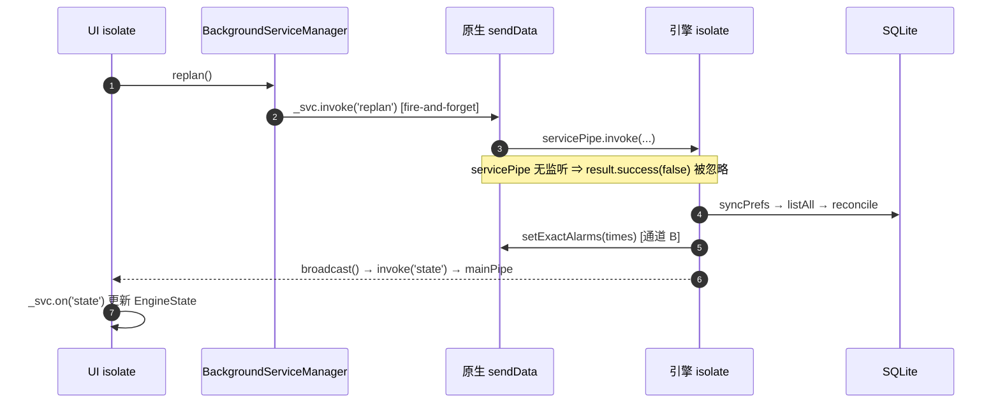

# 01 · 架构地图

> 来源：`_work/A1-architecture.md` §1–§2（逐文件 import 实测 + 行号级阅读）

## 1. 技术栈

| 层 | 技术 | 证据 |
|---|---|---|
| 语言/框架 | Dart 3 / Flutter（Android + iOS） | `pubspec.yaml`、`analysis_options.yaml` |
| 状态管理 | Riverpod（`ProviderScope` + `providers.dart` 287 行） | `lib/main.dart:83` |
| 路由 | `go_router`（`lib/core/router.dart` 161 行） | — |
| 本地库 | `sqflite`，schema **v5**，`singleInstance: false` | `lib/data/db/app_database.dart:36-55` |
| 后台 | `flutter_background_service`（Android FGS）+ 原生 `AlarmManager` 双通道 | `background_service_manager.dart`、`BackgroundService.java` |
| 音频采集 | `record`（`AudioRecord`，16kHz mono PCM16） | `sound_guard_service.dart:144` |
| 音频播放 | `just_audio` + `audio_session` | `playback_service.dart` |
| 振动 | 自建 `packages/native_bridge`（Kotlin `Vibrator` + `VibrationEffect`） | `NativeBridgePlugin.kt` |
| TTS | 本地 `flutter_tts` + 可选 `sherpa-onnx`（`assets/*.onnx`） | `neural_tts.dart` |
| 远程 | MQTT（`mqtt_client`），AES-GCM + HKDF/PBKDF2，扫码配对 | `lib/remote/protocol.dart` |
| 通话 | WebRTC（`flutter_webrtc`） | `call_service.dart` |
| 测试 | `flutter_test` + `integration_test`，207 文件 / 67,689 行 | `test/` |

## 2. 静态分层

```mermaid
graph TB
  subgraph L1["① UI lib/features (15,214 行)"]
    F_DASH[dashboard]
    F_TASKS[tasks]
    F_GUARD[guard]
    F_REMOTE[remote]
    F_SET[settings]
    F_OTHER[logs / stats / sounds / onboarding / local]
  end

  subgraph L2["② 装配 lib/core"]
    MAIN[main.dart 启动链]
    ROUTER[router.dart]
    PROV[providers.dart Riverpod DI]
    CONST[constants.dart]
  end

  subgraph L3["③ 领域 lib/domain (5,022 行)"]
    MODELS[models: Task/Action/Trigger/Condition/CounterPlan]
    SCHED[scheduling: ScheduleEngine 纯函数 / RunPause / vibrate_resolve]
  end

  subgraph L4["④ 服务 lib/services (7,919 行)"]
    ENGMGR[BackgroundServiceManager]
    ENGINE["background_engine 2,388 行"]
    PLAY[PlaybackService]
    GUARDSVC[SoundGuardService]
    VIB[VibrateSession]
    TTS[TtsService / NeuralTts]
    NOTIF[NotificationService]
    NATIVE[NativeBridge]
    CP[CounterPlanService]
  end

  subgraph L5["⑤ 远程 lib/remote (12,615 行)"]
    EP["RcEndpointService 4,468 行"]
    PROTO[protocol: RcCodec / RcMessage]
    STORE[RemoteStore]
    SCRIPT[RcScriptExecutor]
    CALL[CallService / call_lifecycle]
  end

  subgraph L6["⑥ 数据 lib/data (1,370 行)"]
    DB[AppDatabase sqflite v5]
    RT[TaskRepository]
    RO[OccurrenceRepository]
    RL[LogRepository]
  end

  subgraph L7["⑦ 原生"]
    K_PLUGIN["NativeBridgePlugin ~40 方法"]
    K_ALARM[AlarmWatchdogReceiver]
    K_BOOT[BootReceiver]
    K_MIC[MicGuardService]
    K_CAST[ScreenCastService]
  end

  MAIN --> ROUTER & PROV & EP & ENGMGR
  L1 --> PROV & L5 & RT & ENGMGR
  ENGMGR -->|invoke| ENGINE
  ENGINE --> SCHED & RO & RT & RL & DB
  ENGINE --> PLAY & GUARDSVC & VIB & NATIVE & CP
  ENGINE -->|"import features/guard ⚠️"| F_GUARD
  EP --> PROTO & STORE & SCRIPT
  EP --> RT & RO & DB & ENGMGR & NATIVE
  NATIVE --> K_PLUGIN
  K_ALARM --> ENGINE
  K_BOOT --> K_ALARM
  classDef viol fill:#ffe0e0,stroke:#c00,stroke-width:2px
  class ENGINE viol
```



红框 = **唯一一处分层倒置**：`background_engine.dart:32` 反向 import `features/guard/guard_orchestration.dart`（见 ARCH-10）。

## 3. 运行拓扑（关键：两个 isolate + 两个触发通道）



- **通道 A**：引擎内 `Timer.periodic(15s)` → `executeDue`（Doze 下会被冻结）
- **通道 B**：原生 `AlarmManager.setAlarmClock` 精确闹钟 → `AlarmWatchdogReceiver` 拉起 FGS（Doze 下仍可唤醒）
- **两条通道共用同一个执行体**，但 `executing` 闸门是 `_engineBody` 的**闭包局部变量** —— 若出现两个引擎实例（原生闹钟在旧实例未退出时拉起新实例），闸门互相看不见（DAT-03 / SCH-03）。

## 4. 启动链（`main.dart:27-84`，`runApp` 前 6 段 await）

| # | 步骤 | 失败降级 | 缺陷 |
|---|---|---|---|
| 1 | `ensureInitialized` + 竖屏锁定 | **无 try/catch** | `SUSPECTED`（P3 级，未立条） |
| 2 | `NotificationService.createServiceChannel()`（必须早于 FGS） | catch → print | — |
| 3 | `RcScriptExecutor.registerStopHandler` | **无 try/catch** | `SUSPECTED` |
| 4 | `CallService.bindStore` + `attach(events)` | **无 try/catch**（纯内存） | — |
| 5 | `_wireRemoteEndpoint()` → 若 `rc_enabled` 则 **`await` MQTT connect（5s 超时）** | catch → print | **ARCH-04（P2）**：可选模块阻塞首帧 |
| 6 | `BackgroundServiceManager.init()` | catch → `_initError` | — |
| 7 | `NotificationService.ensure()` | catch → print | — |
| 8 | `runApp` | — | — |

## 5. 引擎启动顺序（27 步，关键时序）

```
engineEntryPoint → runZonedGuarded
  → AppDatabase.open()（失败 500ms 重试一次，R89 双引擎建表竞争）
  → RetentionMaintenance.run()
  → SharedPreferences.getInstance()
  → applyPowerMode(prefs['powerMode'] ?? 'balanced')     ← ⚠️ 在 syncPrefs() 之前
  → VibrateSession.recoverAfterRestart()（一律停止残留，绝不续发）
  → guardEnabled = prefs['guard_enabled']                ← ⚠️ 也在 syncPrefs() 之前
  → 注册 6 个 service.on(...)
  → Timer.periodic(15s)                                  通道 A
  → stepGuarded('executeDue')                            补执行（限 3 条 / 10 分钟陈旧丢弃）
  → stopReactiveCounter(boot) 自愈
  → extendCounterPlan()（必须早于 replan）
  → replan()
  → if (guardEnabled) service.invoke('guard', enabled:true)  ← ⚠️ 死路径（ARCH-01 / NAT-03）
  → broadcast()
  → _engineBootstrapDone = true
```

## 6. 停机清理顺序（`stopping` 在**任何 await 之前**同步置位 —— 正确）

```
service.on('stop') → stopping = true
  → cancel guardDelayTimer
  → guard.stop()（2s 超时）
  → playback.dispose()
  → vibrate.dispose()（下发一次原生 cancel，BUG-127）
  → stopMicService
  → clearAllAlarms()          ← ⚠️ 因 KEY_ALARMS 被整体覆盖而清不干净（ARCH-02）
  → applyPowerMode('balanced')
  → broadcast(running:false)
  → 150ms
  → finally: service.stopSelf()
```

## 7. 架构层面的三个结构性判断

| 判断 | 结论 |
|---|---|
| `endpoint_service.dart` 4,468 行是否过载 | **是**：单文件承担传输 / 协议 / 鉴权 / 业务编排 / 审计 5 类职责。纯函数已部分抽出（`resolveRcDelivery` / `decideRcAdmission` / `DecodeFailThrottle`）缓解了可测性，但**授权模型**仍嵌在巨型文件里 |
| `background_engine.dart` 2,388 行是否过载 | **过载但内聚**：所有状态在一个闭包里，`executing`/`stopping` 才能"同步置位"。代价是**不可单测**（`executeDue` 循环体是闭包，无法注入 `now`），这直接导致 SCH-01/SCH-03 无法被回归锁住 |
| `domain` 是不是事务边界 | **不是**。它只是模型 + 纯函数调度；写路径的事实边界是 `Repository`。`features` 直接持有 `Repository` 是既定风格，但导致同一业务用例出现两套编排（ARCH-06） |
