# 03 · 关键调用链

> 5 条链路，每条给出：入口 → 关键函数（文件:行号）→ 状态与数据 → 反向链 → 异常传播方向 → **可能断点**。
> 断点只标"本链路自身的结构性风险"；已由其它工作包单独成条的只做交叉引用。

---

## L1 — 任务创建/编辑 → 落库 → replan → occurrence 物化

```mermaid
graph LR
  A["编辑器保存<br/>task_editor_screen:1607"] --> B["TaskRepository.upsert<br/>单事务 UPDATE→INSERT<br/>task_repository:84-88"]
  B --> C["replan()<br/>background_service_manager:283"]
  C -->|"fire-and-forget<br/>无回执"| D["service.invoke('replan')"]
  D --> E["引擎 service.on('replan')<br/>background_engine:1904"]
  E --> F["replan()<br/>:1242 闸门"]
  F --> G["syncPrefs → listAll(enabledOnly)"]
  G --> H["ScheduleEngine.materialize<br/>逐任务分支"]
  H --> I["_applyQuiet / _enforceCooldown"]
  I --> J["occs.reconcile<br/>单事务删-插"]
  J --> K["pushExactAlarms<br/>通道 B"]
  K --> L["NativeBridgePlugin.kt:345<br/>setAlarmClock"]
  J --> M["broadcast → UI"]
```



**关键状态**：`task.updatedAt` 同时是"计划版本键"和 DP RNG 种子输入（`planSeed(taskId, date)`）。

**反向链**：
- 写 `tasks` 的 5 个来源：编辑器、`preset_import`、`CounterPlanService`、远程 `_upsertTask`/`_deleteTask`/`task.toggle`、`deleteCounterTasks`
- 触发 `replan` 的 7 个来源：编辑器、任务列表、设置页（3 处）、守卫页、远程、引擎 tick（`planNeedsExtend`）、引擎启动

**异常传播**：`materialize` 抛 → `replan` 内层 finally 复位 `replanning` → 外层 finally 补跑 → `service.on` 的 `unawaited(...)` → 成为未处理异步错误 → `runZonedGuarded` 留痕。
正常路径下 `replan` 被 `stepGuarded('replan', replan)` 包裹，异常记成一条审计，**不中断引擎**。

**断点**：

| 断点 | 证据 | 说明 |
|---|---|---|
| `_invoke('replan')` 无回执 | `CONFIRMED` | 引擎未运行时 replan 静默丢失。补偿：引擎下次启动必做 replan，只在"引擎长期不启动"时表现为计划陈旧 |
| `reconcile` 删除面 = `taskIds`（仅**启用**任务） | `CONFIRMED` | 停用任务的未来 pending 不会被删 → **ARCH-06** |
| `KEY_ALARMS` 整体覆盖 | `CONFIRMED` | 旧批次闹钟失去引用，`clearAllAlarms` 清不掉 → **ARCH-02** |
| `updatedAt` 作版本键 | `SUSPECTED` | 同一毫秒两次保存 ⇒ 种子不变 ⇒ 改了触发器但计划不重算。触发窗口极窄，未立条 |

---

## L2 — 定时触发 → 引擎 tick → 执行 action → 结果记录

**两条触发源，同一个执行体：**

```
通道 A：Timer.periodic(15s) → stepGuarded('executeDue')
通道 B：AlarmManager → AlarmWatchdogReceiver → startForegroundService → engineEntryPoint → executeDue
        （B 会校验 KEY_SHOULD_RUN + EXTRA_GENERATION == KEY_GENERATION）
```

**执行体 19 步（`executeDue`）**：

| # | 位置 | 动作 | 备注 |
|---|---|---|---|
| 1 | `:1473-1485` | `stopping` 闸 → `executing` 闸 | 重入只 print，**不写审计** |
| 2 | `:1490` | `syncPrefs()` | `runMasterMode` 必须即时生效 |
| 3 | `:1492` | `occs.due(now, limit: catchUpLimit=3)` | `status='pending' AND fire_at<=? ORDER BY fire_at ASC LIMIT 3` |
| 4 | `:1495` | `pausedAt(now)` | 节假日自动暂停 |
| 5 | `:1497` | `RoundConditionEnv`（惰性读电量/网络/通话） | — |
| 6 | `:1507-1517` | 逐条 `tickNow`；`> 10min` ⇒ `skipped` + `skip-stale` | **SCH-01 的算术根源** |
| 7 | `:1518-1521` | `task==null \|\| !enabled` ⇒ `skipped`，**无审计** | **DAT-02 毒丸点**（`get()` 可抛） |
| 8 | `:1525-1532` | `pausedNow && !forceRun` ⇒ `skipped` + `runPause` | — |
| 9 | `:1535-1543` | 条件不满足 ⇒ `skipped` + `condition` | — |
| 10 | `:1546-1555` | 概率未中 ⇒ `skipped` + `probability` | — |
| 11 | `:1571` | **乐观置 `failed`**（"已被取走"标记） | **DAT-03 / SCH-04 的根源** |
| 12 | `:1572` | `runAction(...)` | 可长达 1800s |
| 13 | `:1115-1143` | `runAction`：Composite 先通知 → `runSingle`；catch 全异常 | — |
| 14 | `:1006-1112` | `runSingle` 分派 8 类动作 | 振动类转 `vibrate.start`（引擎 isolate） |
| 15 | `playback_service:153-235` | 新建 `AudioPlayer` → 焦点 → 渐变 → `_waitPlayWindow` | 每路独立播放器（R91 修） |
| 16 | `:1587-1592` | 三态映射 `isSkipped/ok/else` | — |
| 17 | `:1593` | `markStatus(terminal)` | 无条件 UPDATE |
| 18 | `:1597-1606` | `quietExempt` 额外审计 | — |
| 19 | `:1602` | `broadcast(lastAction)` | — |

**反向链**：pending 由 `reconcile`（L1）/ `runGuardPlan.commitAll`（L3）/ 远程 `_rematerialize` 产生；
终态被 `lastDoneFor`（L3 冷却）、`pendingCountAfter`（UI 角标）、日志页、`purgeOlderThan` 消费。

**异常传播**：`runSingle` 各动作自己收敛（返回 `ExecutionOutcome.failed`，不抛）；`runAction` 再兜一层。
因此执行期异常**不会**打断循环 —— 这是刻意的。
代价：`markStatus(terminal)` 若抛（DB 锁/关闭），异常穿出循环 → `stepGuarded` 记一条审计 → 本轮剩余条目**不再执行**，
而**已被乐观置 `failed` 的条目永远不会再被 `due()` 取出**。

**断点**：

| 断点 | 证据 | 说明 |
|---|---|---|
| `runGuardPlan` 不取 `executing` 锁 | `CONFIRMED` | → **ARCH-08 / SCH-03** |
| 第 7 步静默 skipped | `CONFIRMED` | 停用/删除任务的残留 pending 被静默改写，无审计 → **ARCH-06** |
| 第 11→17 步之间进程死亡 | `CONFIRMED` | 行停在 `failed`，无补偿 → **SCH-04** |
| 第 6 步 10 分钟陈旧阈值 | `CONFIRMED` | 长动作导致同批后续条目被判 stale → **SCH-01** |
| 深度 Doze 下通道 A 不跑 | `CONFIRMED`（设计已知） | 依赖通道 B；若闹钟额度被 64 条截断，尾部任务永不唤醒（有审计） |

---

## L3 — 声音检测触发 → 阈值 → 冷却 → 反击/响应

```mermaid
graph LR
  A["guard_toggle.setGuard(true)"] --> B["service.invoke('guard')"]
  B --> C["background_engine:1919 on('guard')"]
  C --> D["NativeBridge.startMicService()"]
  D --> E["SoundGuardService.start<br/>startStream 16kHz"]
  E --> F["VAD: rmsDbfs + threshold<br/>+ minDuration + cooldown"]
  F --> G["guard.events → onSoundEvent:1670"]
  G --> H["候选 = 启用 && soundTriggered"]
  H --> I["lastDoneFor + max(cooldownSec)"]
  I --> J["admitExecution（总开关→条件→概率）"]
  J --> K["resolveGuardPlan → GuardPlan{taskIds, delayMs}"]
  K -->|"delayMs>0"| L["guardDelayTimer 单槽"]
  K -->|"delayMs==0"| M["runGuardPlan:1620"]
  L --> M
  M --> N["runAction × N → commitAll → broadcast"]
  F --> O["reactive.onSound → 反击"]
```



**关键**：`SoundGuardService` 是**唯一**麦克风通路，`ReactiveCounterService` 复用同一流 ⇒ 结构上不会出现第二个录音器（正确设计）。

**反向链**：关闭走 `service.on('guard')` 的 else 分支 → 取消 `guardDelayTimer` → 取消两个订阅 → `stopReactiveCounter` → `guard.stop()`。

**异常传播**：
- 采流出错（麦克风被抢占）：`SoundGuardService` 只把 `isRunning=false`，**不抛** → `guard.errors` 流 → 引擎写审计 + 回投 `guardError`。方向正确。
- `onSoundEvent` 内 `commitAll` 抛：穿出 → `guardSub` **没有 `onError`**（只给了 `onData`）→ 未处理异步错误 → **该次声音事件无终态、无审计**。

**断点**：

| 断点 | 证据 | 说明 |
|---|---|---|
| `guardSub` 无 `onError` | `CONFIRMED` | 事件抛错时无终态、无审计（P3，并入 ARCH-08 说明） |
| `guardDelayTimer` 单槽覆盖 | `CONFIRMED` | 新计划直接 cancel 旧计划，无审计 → **ARCH-07** |
| `runGuardPlan` 不取执行锁 | `CONFIRMED` | → **ARCH-08** |
| 引擎重启后守卫不恢复 | `CONFIRMED`（死路径）+ `UNVERIFIED`（平台） | → **ARCH-01 / NAT-03** |
| 冷却基准在执行**之后**落库 | `CONFIRMED` | 长动作期间同一任务可重复触发 → **SCH-08** |

---

## L4 — 扫码配对 → 会话建立 → 指令下发 → 回执

**配对链 10 步**：

| # | 位置 | 动作 |
|---|---|---|
| 1 | `pair_qr_screen:280-308` | 扫码解析 → `store.addPaired` → `refreshSubscriptions` → `notifyPeerOfPairing` |
| 2 | `remote_store.addPaired` | 同 `deviceId` 原位覆盖 |
| 3 | `endpoint_service:759-795` | 订阅 `{ownId}/cmd`、`/evt`、assist 主题 |
| 4 | `:3419-3452` | `requestPairing`：`_prunePendingPairs` → `sendTo(..., withSalt:false)`（**盐引导报文必须走 v1**） |
| 5 | `:3319-3400` | `sendTo`：失败 ⇒ 入 outbox（**密文**） |
| 6 | `:3147-3202` | `_send`：assist zone 优先 → 未连接/无配对 ⇒ `_auditSendDrop` → `RcCodec.encode` |
| 7 | `:1728-1814` | 对端 `_handlePairRequest`：长度校验 → 撤销名单 → 码校验 → `addPaired` → `_ensureSalt` → `_send(ack{kdfsalt})` |
| 8 | `:962-1029` | 控制端 `_handlePeerEvent`：LWT 哨兵 → 盐候选 → `_tapAck` → `reserveInboundId` → `_broadcast` |
| 9 | `:1036-1060` | `_tapAck`：`_pendingPairs.remove` → `_savePeerSalt` → `waiter.complete` |
| 10 | `:3435-3452` | `_awaitAck(pending, 8s)`：**超时不撤销登记**（迟到 ack 仍落盐） |

**指令链 8 步**：

| # | 位置 | 动作 |
|---|---|---|
| 11 | `:825-959` | `_handleRaw`：assist 路由 → evt 分支 → cmd **多盐候选试解（首项恒 `null`）** → 失败 `_auditDecodeFail` → `reserveInboundId`（10min 去重）→ **`decideRcAdmission`** → 停类命令先于限流 → `guardDispatch` |
| 12 | `guarded_dispatch.dart` | `guardDispatch` **永不抛**；失败 ⇒ `_ack(false)` + 审计 |
| 13 | `:1121-1412` | `_dispatch`：~35 个 `RcCmd` 分支；`default` **显式拒绝** |
| 14 | `:1242-1272` | `task.toggle`：布尔宽容解析 → 存在性检查 → 权限裁决 → `setEnabled` → `deletePendingForTask` → `_rematerialize` → `replan` → 审计 → ack |
| 15 | `:2462-2479` | `sound.play` → `performRemotePlay` → `playHandler` |
| 16 | `:2532-2573` | `script.run`：`_tryClaimScript()` **同步占位** → 执行 → finally 释放 |
| 17 | `script_executor.dart` | 全程 try/finally；`Future.any([步骤, 终止令牌])`；`abortGrace=3s` |
| 18 | `:3400+` | 回执 `_send(ack)` → 对端 `_handlePeerEvent` → `_tapAck`/`_broadcast` |

**关键结构性发现（HR-15）**：`mqtt_client` 的 `Stream.listen` **不会等待 async 回调返回** ⇒ 每条命令各自独立并发。
因此长指令组（最长 30 分钟）**不会**阻塞后续 `script.stop` —— 终止命令可到达。这是**正确**的设计，不是缺陷。

**异常传播**：
- 解密失败：**不抛**，`_auditDecodeFail`（带节流）+ 丢弃。方向正确。
- `_dispatch` 业务异常：`guardDispatch` 收口成 `ack(false)` + `describeFailure`（去换行 + 160 字截断）。
- `client.updates.listen` 回调内 `try/catch` 兜底 `_handleRaw`，**异常绝不漏出回调**（BUG-051 教训，已核对存在）。

**断点**：

| 断点 | 证据 | 说明 |
|---|---|---|
| **`decideRcAdmission` 依赖 `msg.from` 自报** | `CONFIRMED`（源码注释自认） | 空 `from` ⇒ `allowUnidentified` ⇒ **REM-01（P0）** |
| 配对"双向"语义 | `CONFIRMED`（设计） | 8s 无 ack 只提示"请在对端也扫一次"；对端永不扫 ⇒ 本机已 `addPaired` 但无对端盐 ⇒ 后续走 v1 无盐 |
| `sound.play` 无时长预算 | `CONFIRMED` | → **ARCH-03 / REM-07** |
| `task.upsert`/`task.delete` 不触发 `replan` | `CONFIRMED` | → **SCH-06**；另：`setExactAlarms` **不清空重设** → **ARCH-02** |
| `vibrate.stop` 无条件 ack(true) | `CONFIRMED` | 引擎未运行时"已停止"是假成功 → **ARCH-12** |
| 去重表仅内存 | `CONFIRMED` | 进程重启后 90s 内重放会重复执行 → **REM-15** |

---

## L5 — 应用启动 → 引擎恢复 → 未完成补偿 / 停机清理

（启动 27 步与停机 10 步详见 `01-architecture-map.md` §5–§6）

**补偿语义**（这是"崩溃后能不能自愈"的全部答案）：

| 场景 | 补偿机制 | 缺陷 |
|---|---|---|
| 停机期间积压的到期计划 | `executeDue` 限 3 条 + 10 分钟陈旧丢弃 | **SCH-01**：长动作会让后续全丢 |
| 执行中进程被杀 | 无补偿（行停在 `failed`，`due()` 不再取） | **SCH-04** |
| 残留振动 | `recoverAfterRestart()` 一律停止，绝不续发 | ✅ 已审计未发现问题 |
| 反击计划断档 | `extendCounterPlan()` 续算 7 天 | ✅ |
| 守卫开启状态 | `service.invoke('guard')` 自恢复 | **ARCH-01 / NAT-03**：无消费者 + 无 mic FGS |
| 引擎状态与 UI | 启动期抛 ⇒ `invoke('state', running:false)` + `stopSelf` | ✅ 方向正确 |

**停机清理的关键保证**：`stopping = true` 在**任何 await 之前**同步置位 —— 这是 R91 的核心修复，已确认成立。

**断点**：

| 断点 | 证据 | 说明 |
|---|---|---|
| 第 25 步守卫自恢复 | `CONFIRMED` | 消息投向 UI isolate，**全仓无消费者** → ARCH-01 |
| 第 16/18 步在 `syncPrefs()` 之前读 prefs | `HIGH_CONFIDENCE` | 新 isolate 首次 `getInstance()` 全量读盘通常不陈旧；若引擎 isolate 被复用则读到旧快照 → ARCH-11 |
| "先关 shouldRun 再 stop" | `CONFIRMED` | 引擎已死时 `_invoke('stop')` 被丢弃，`isManuallyStopped` 不会置 true ⇒ 包自带 `WatchdogReceiver` 仍可能复活 → **ARCH-05** |
| 清理链 150ms 尾部 | `CONFIRMED` | 期间通道 A 仍触发，但 `stopping` 闸拦住 |
| `stopSelf()` 在 `finally` | `SUSPECTED`（低） | 清理链若有无超时的 await 则永不执行。已核对：`guard.stop()` 有 2s 超时、`playback.dispose()` 同步、`vibrate.dispose()` fire-and-forget ⇒ **当前无此风险** |
| 第 2/4/5 步无 try/catch | `SUSPECTED` | 与 BUG-108/BUG-026 的"每个 await 都要降级"纪律不完全一致（未立条） |
