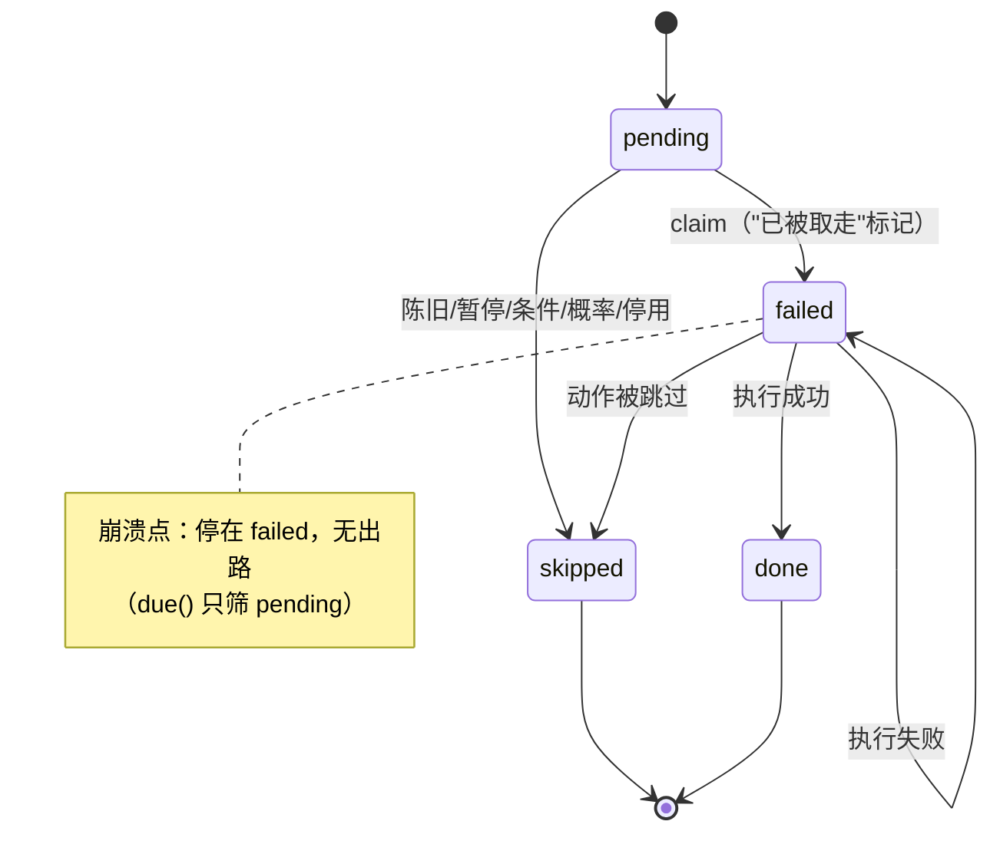

# 06 · 异步与并发审计

> 来源：`_work/A2-scheduling.md`（15 条）+ `_work/A1`（跨 isolate 部分）+ `_work/A3`（CAS 部分）。
> 详细证据（行号、代码片段、最小复现用例）见各工作包报告对应条目。

## 1. 执行模型总览（这是所有并发问题的地层）

```
┌─ UI isolate ────────────────┐        ┌─ 引擎 isolate ──────────────┐
│ Riverpod / Widgets          │        │ _engineBody 闭包            │
│ PlaybackService（远程播放）  │        │ executing / stopping 局部变量│
│ RcEndpointService（MQTT）    │        │ Timer.periodic(15s) 通道 A   │
└──────────┬──────────────────┘        └──────────┬──────────────────┘
           │ service.invoke (fire-and-forget)      │
           └──────────────► 原生 sendData ◄────────┘
                                  │
                    AlarmManager（通道 B，可拉起第二个实例）

SQLite：两个 isolate 各持一条连接（singleInstance: false）
```

**三个结构性事实**（决定了后面所有缺陷）：

1. `executing` / `stopping` 是**闭包局部变量** ⇒ 只对**同一个** `_engineBody` 实例有效。
2. `service.invoke` 是 **fire-and-forget**，`servicePipe` 无监听 ⇒ 调用方**永远不知道**引擎收没收到。
3. 数据库是**两个连接**（`singleInstance: false`，R89 定死的原因见 DAT-03），**没有跨连接互斥**。

## 2. 竞态清单

| ID | 竞态 | 双方 | 后果 | 严重度 |
|---|---|---|---|---|
| SCH-03 | 执行互斥缺失 | `executeDue`（持 `executing`） vs `runNow` / `runGuardPlan`（**不持**） | 同一任务并发跑两份 → 双响、双份录音（第二份必失败但污染审计） | **P1** |
| DAT-03 | 非 CAS 抢占 | 两个引擎实例同时 `due()` → 都 `markStatus(failed)` | 同一 occurrence 执行两次 | **P1** |
| SCH-05 | 删-插非事务 | 主 isolate `_rematerialize` vs 引擎 `reconcile` | 中间窗口读到空计划 / 重复行 | P2 |
| SCH-08 | 冷却基准后置 | 声音事件 N 与 N+1 | 长动作期间同一任务可重复触发 | P2 |
| ARCH-08 | 绕过执行锁 | 声音响应 vs 定时执行 | 并发执行 | P3 |
| REM-15 | 去重表仅内存 | 进程重启前后 | 90s 窗口内重放会重复执行副作用 | P3 |

## 3. 幂等性审计

| 操作 | 幂等？ | 机制 | 问题 |
|---|---|---|---|
| `reconcile`（物化） | ✅ | 单事务 + `ConflictAlgorithm.ignore` + `occurrenceId = '${taskId}@$ms'` 确定性 ID | — |
| `commitAll` | ⚠️ 部分 | 只有 PK 去重，**无 UNIQUE(task_id, fire_at)** | DAT-13 |
| `markStatus` | ❌ | 无条件 UPDATE，最后写入者胜 | DAT-03 / SCH-04 |
| `skipNextForTask` | ❌ | SELECT → UPDATE 无事务 | DAT-17 |
| 远程 `task.upsert` | ❌ | 三段写非原子，失败不自愈 | DAT-05 |
| `CounterPlanService.apply(replace:true)` | ❌ | 删 + 插两个事务 | DAT-04 |
| `removeAssetRef` | ❌ | 读全表 → 批量覆盖 | DAT-06 |
| 导入预置库 | ❌ | `nameSet()` 判重是 TOCTOU | DAT-16 |
| 远程指令去重 | ⚠️ | `reserveInboundId` 原子 + 10min 窗口，但**仅内存** | REM-15 |

## 4. 任务丢失面（用户最痛的一类）

| 路径 | 丢失机制 | 有无审计 | 缺陷 |
|---|---|---|---|
| 长动作后的同批条目 | 逐条实时 `now` + 10min 阈值 ⇒ 排队时间被算作"迟到" ⇒ `skipped` | 有 `skip-stale`，但 `message` 为空 | **SCH-01** |
| 远程 `task.upsert`/`toggle` | `deletePendingForTask` 删**全部** pending（含已到期未执行），随后只物化未来 | ❌ 只剩"清理 N 条旧计划"混合计数 | **SCH-02** |
| 执行中进程被杀 | 行停在 `failed`，`due()` 不再取 | ❌ 无 `interrupted` 记录 | **SCH-04** |
| 远程 `task.upsert` 物化失败 | 任务零计划，续算判据看**全局** `MAX(fire_at)` ⇒ 不自愈 | 有失败回执 | **DAT-05** |
| 反击计划 `apply` 失败 | 旧计划已删、新计划未写 | 有异常，但计划已消失 | **DAT-04** |
| 停用任务的残留 pending | 到点静默 `skipped`（`:1518-1521` 无审计） | ❌ | ARCH-06 |
| 单条坏任务行 | `tasksRepo.get()` 抛 ⇒ 整轮剩余全不执行 | 一条 `executeDue(tick) failed` | **DAT-02** |
| 守卫延时计划 | 单槽 `guardDelayTimer` 被新计划 `cancel()` | ❌ | ARCH-07 / SCH-14 |

**共性**：丢失发生时，**状态机里没有"被撤销/被丢弃"这个态**。所有丢弃都借用 `skipped`（与"用户主动跳过"同形），
于是审计无法区分"用户不要了"与"系统吃掉了"。

## 5. 状态机审计

### 5.1 occurrence 状态机（现状 4 态）



**问题**：
1. 缺 `running` 态 ⇒ "占用"借用终态 `failed`（SCH-04）。
2. `failed` 同时表示"执行中"和"执行失败"和"崩溃中断"——三种语义一个值。
3. 无 `cancelled` 态 ⇒ 撤销类操作只能删行（SCH-02）。
4. `markStatus` 无前置状态条件 ⇒ 任何转换都合法（DAT-03）。

### 5.2 引擎状态机

```
starting → running → stopping → stopped
              ↑                    │
              └──── 无法再次启动 ────┘  （SCH-15：stopping 永不复位）
```

`stopping` 一旦置 true **永不复位**；若 `stopSelf()` 失败，引擎成为"僵尸"：无法再启动、无法自愈（SCH-15，P3）。

### 5.3 任务状态（`tasks.enabled` + `pausedAt` + `quietExempt` + `forceRun`）

四个独立布尔/三态字段组合出至少 2^4 种状态，但**没有单一状态字段**，
判据散落在 `executeDue`（4 处）、`admitExecution`、`ScheduleEngine._applyQuiet`、`runNow`。
这是"同一业务状态拆成多份"的又一处投影（见 00 §5.1）。

## 6. 定时器 / 订阅生命周期

| 资源 | 创建 | 释放 | 配对？ |
|---|---|---|---|
| 通道 A `Timer.periodic(15s)` | `:2291` | `stopping` 闸 + `stop` 分支 | ✅ |
| `guardDelayTimer`（单槽） | `:1728-1745` | `cancel()` 后重建 | ⚠️ 覆盖丢事件（ARCH-07） |
| `reactive` Timer | `startReactiveCounter` | `stopReactiveCounter` | ❌ **可重复调用不停止旧实例**（SCH-09：Timer 泄漏 + "关掉后仍出声"） |
| `guard.events` / `guard.errors` 订阅 | `:1942` | `:1962-1980` | ✅ 但 **`guardSub` 无 `onError`** |
| `client.updates.listen` | `:673` | 重连时重建 | ✅ `autoReconnect=false`，重连 owner 唯一 |
| `VibrateSession` 3s 续发定时器 | `:339` | 20s 分片 + 进程死亡自停 | ✅（S1 分片成立） |
| 精确闹钟 | `setExactAlarms` | `clearAllAlarms` | ❌ **引用丢失**（ARCH-02） |

## 7. 墙钟依赖（系统时间跳变）

| 判据 | 用墙钟？ | 影响 | 缺陷 |
|---|---|---|---|
| 陈旧判定 `tickNow - fireAt > 10min` | 是 | 用户改时间/ NTP 校正后大批误判 | SCH-10 |
| 声音冷却 `lastDoneFor` | 是 | 同上 | SCH-10 |
| 免打扰窗口 `[start, end)` | 是（`hour` 比较） | 跨午夜用 `Duration(days:1)` ⇒ DST 错 1 小时 | SCH-12 |
| 跨午夜窗口构造 | 绝对 24h | DST 时区窗口错 1 小时 | SCH-12 |
| 计划 `fire_at` | epoch ms（UTC 瞬时） | 与触发器"本地墙钟 ISO 无偏移"混用 | **DAT-10** |

## 8. 本域已审计、未发现问题的部分

| 项 | 核查点 | 结论 |
|---|---|---|
| `stopping` 置位时机 | 是否在首个 await 之前 | ✅ 是（R91 修复成立） |
| `replan` 重入 | `replanning` 闸 + `replanQueued` 补跑 | ✅ |
| 长指令组 vs 终止命令 | `mqtt_client` 的 `listen` 不等待 async 回调 ⇒ 每条命令独立并发 | ✅ **终止命令可到达**（与直觉相反，已核对库源码） |
| `script.run` 抢占 | `_tryClaimScript()` **同步**占位 + `finally` 释放 | ✅ |
| 振动失效安全 | S1 分片 ≤20s / S2 重启不续发 / S3 `stopAll`+原生 cancel / S4 电量闸 | ✅ 四条均成立 |
| 通话超时 | 主叫 45s / 振铃 45s / 建连 15s；`connected` 时恒不判超时 | ✅ 有界 |
| 回调异常隔离 | `client.updates.listen` 内 try/catch，异常不漏出（BUG-051 教训） | ✅ |
| 执行期异常不饿死循环 | `runSingle` 自收敛 + `runAction` 再兜一层 | ✅ 刻意设计 |
