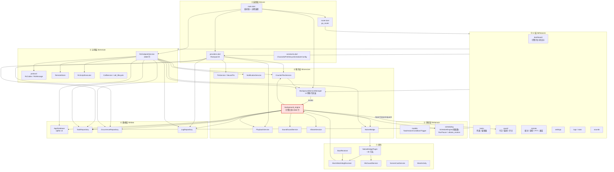
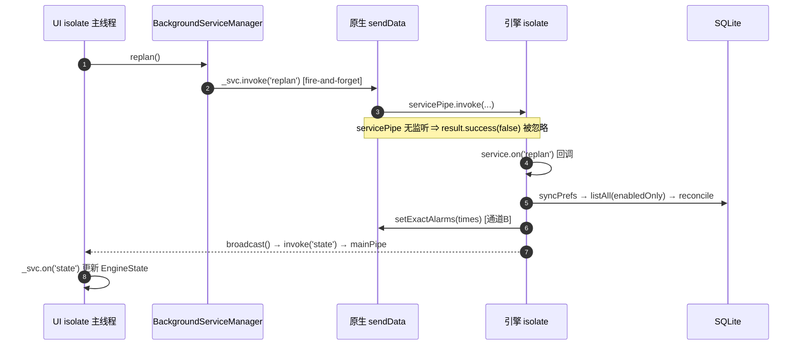

# A1 — 全局架构与关键调用链审计

- **项目**：SonicShield（`E:\SonicShield`），Flutter/Dart，Android 主 + iOS，版本 `1.9.9+32`
- **工作包**：A1（全局架构 / 模块依赖 / 5 条关键链路 / 高风险节点）
- **审计方式**：**纯静态只读**。未运行 `flutter analyze`、未运行任何测试、未修改任何项目文件。
- **写入范围**：本文件是本次工作包**唯一**的写产物（`.audit/_work/A1-architecture.md`）。
- **代码基线**：`lib/` 107 个 `.dart`、43,510 行；`test/` 207 个文件、67,689 行；`packages/native_bridge` Kotlin 插件；`android/app/src/main/kotlin` 应用侧 Kotlin。
- **工作区状态（重要）**：审计时工作区**存在未提交修改**（`git status`：`lib/domain/models/action.dart`、`lib/domain/models/vibrate_caps.dart`、`lib/domain/scheduling/counter_plan_materializer.dart`、`lib/features/tasks/task_editor_screen.dart`、`lib/services/vibrate_session.dart`、`NativeBridgePlugin.kt`、两个测试文件，以及未跟踪的 `test/r93_vibrate_dnd_test.dart`）。这些修改**不是本次审计产生的**（本包只写了本文件）。**本报告的所有行号与行为描述均以工作区为准，不是 `HEAD`**；若这些改动被回滚或提交，行号会漂移，结论需按语义复核。

## 证据等级定义（全文统一）

| 等级 | 含义 | 本报告的判定标准 |
|---|---|---|
| `CONFIRMED` | 已由源码逐行核对，调用方与被调用方、数据流向、触发条件全部闭合 | 至少两端代码 + 一条可达路径 |
| `HIGH_CONFIDENCE` | 源码事实成立，但**运行时表现**依赖第三方库/系统行为，未在真机复现 | 主链闭合，末端依赖外部语义 |
| `SUSPECTED` | 有明确代码迹象，但存在未读分支或无法静态确认的反射/通道 | 有迹象、缺一环 |
| `NOT_REPRODUCED` | 尝试追踪但未能在代码中构造出触发路径 | 明确写出"未构造出" |
| `UNVERIFIED` | 关键一环依赖平台/第三方行为或未读实现，无法静态判定 | 只用于明确标注"哪一环没验证"的结论（见 ARCH-01 的平台限制） |

> 纪律：本报告**不把注释当证据**。项目注释质量很高（大量 BUG-xxx / Rxx 记录），但注释描述的是"作者认为的行为"；凡与代码不一致处，一律以代码为准并在正文指出。

---

# 1. 技术栈与运行环境清单

## 1.1 语言 / 框架 / 构建

| 项 | 值 | 来源 |
|---|---|---|
| Dart SDK 约束 | `>=3.5.0 <4.0.0` | `pubspec.yaml:11` |
| Flutter 约束 | `>=3.24.0` | `pubspec.yaml:12` |
| 应用版本 | `1.9.9+32` | `pubspec.yaml:9`、`lib/core/constants.dart`（`AppMeta`） |
| 构建日期常量 | `2026-10-18` | `lib/core/constants.dart` |
| Android 入口 | `MainActivity`（`configureFlutterEngine` 注册 `sonic_shield/screencast`） | `android/app/src/main/kotlin/.../MainActivity.kt` |
| 本地原生插件 | `native_bridge`（path 依赖，通道 `sonic_shield/native`） | `pubspec.yaml:65-68`、`NativeBridgePlugin.kt:CHANNEL` |

## 1.2 状态管理 / 路由

| 能力 | 选型 | 关键文件 |
|---|---|---|
| DI + 状态 | `flutter_riverpod ^2.5.1`（`Provider` / `FutureProvider` / `StreamProvider` / `autoDispose`） | `lib/core/providers.dart`（287 行） |
| 路由 | `go_router ^14.2.7`，`StatefulShellRoute.indexedStack` 5 TAB | `lib/core/router.dart`（161 行） |
| 路由结构 | `/`(Dashboard) `/local` `/remote` `/logs` `/settings`；子 TAB 用 `?t=N`；整页 `/tasks/new`、`/tasks/:id/edit`、`/remote/*` | 同上 |

## 1.3 数据层

| 能力 | 选型 | 关键事实 |
|---|---|---|
| 关系库 | `sqflite ^2.3.3+1`，手写 SQL，无代码生成 | `lib/data/db/app_database.dart`，`dbVersion = 5` |
| 连接策略 | `singleInstance: false` | 双引擎（UI isolate + 引擎 isolate）各自持连接；`_onCreate` 全 `IF NOT EXISTS` 以抗并发建表竞争 |
| 并发参数 | WAL + `busy_timeout=5000` + `synchronous=NORMAL` | `app_database.dart` |
| 单例 | `AppDatabase` **进程内静态单例** + `inject()`（测试缝） | `close()` 会清 `_instance` |
| KV | `shared_preferences ^2.3.2` | **按 isolate 缓存**，跨 isolate 必须 `reload()`（见 4.5） |
| 表 | `tasks` / `occurrences` / `logs` / `assets` / `kv`（+ 迁移列 `condition_json`、`quiet_exempt`、`force_run`） | `_onCreate` / `_onUpgrade` |

## 1.4 后台与调度

| 能力 | 选型 / 机制 | 关键事实 |
|---|---|---|
| 前台服务 | `flutter_background_service ^5.0.10`（android `6.3.1`） | **独立 FlutterEngine isolate，同一进程**（`BackgroundService.java`），不是独立进程 |
| FGS 类型 | `mediaPlayback`（**不含** `microphone` / `dataSync`） | `background_service_manager.dart:96-112`；避开 Android 15 dataSync 6h 上限 |
| 通道 A | Dart `Timer.periodic(15s)` | `background_engine.dart:2291-2333` |
| 通道 B | 原生 `AlarmManager.setAlarmClock` / `setExactAndAllowWhileIdle` → `AlarmWatchdogReceiver` | `NativeBridgePlugin.kt:345-415`、`AlarmWatchdogReceiver.kt` |
| 代次 | `KEY_GENERATION` / `EXTRA_GENERATION`，停机自增使旧闹钟失效 | `NativeBridgePlugin.kt:285-291`、`AlarmWatchdogReceiver.kt` |
| 开机 | `BootReceiver`：`BOOT_COMPLETED` / `QUICKBOOT_POWERON` / `MY_PACKAGE_REPLACED` → 30s kick | `BootReceiver.kt`（`KICK_DELAY_MS`，避开 20s 白名单） |
| 麦克风守卫服务 | `MicGuardService`（sticky，独立于 FGS） | `packages/native_bridge/.../MicGuardService.kt` |

## 1.5 远程遥控 / 通话

| 能力 | 选型 | 关键事实 |
|---|---|---|
| 传输 | `mqtt_client ^10.11.11`，TLS 8883（可选 WSS） | `secure = true` **无条件**、不提供 `onBadCertificate`（fail-closed） |
| 加密 | `cryptography ^2.9.0`：AES-256-GCM + HKDF-SHA256；有盐时 PBKDF2 120k 前置拉伸 | `protocol.dart:RcCodec.deriveKey` |
| 密钥方向 | **按接收方身份派生**：`deriveKey(接收方配对码, '{接收方ID}\|cmd\|evt', salt)` | 单向：控制端与端点各持一把 |
| 重放防护 | AAD=topic；`maxSkewMs = 90_000`；`reserveInboundId` 原子去重（10 分钟窗口） | `protocol.dart` |
| 通话 | `flutter_webrtc ^1.6.1` + MQTT 信令 | `call_service.dart`（1110 行）、`call_lifecycle.dart`（362 行纯逻辑） |
| 扫码配对 | `mobile_scanner ^6.0.11` + `qr_flutter ^4.1.0` | `pair_qr_screen.dart` |

## 1.6 音频 / 语音

| 能力 | 选型 | 关键事实 |
|---|---|---|
| 播放 | `just_audio ^0.9.40` + `audio_session ^0.1.21` | `play()` **每次新建 `AudioPlayer`**（R90-07 并发隔离）；`_stopGen` 代次 + 50ms 窗口轮询 |
| 采音 | `record ^7.1.1` | `SoundGuardService.start()` 直接 `startStream`，不查 `hasPermission()`（引擎无 Activity，插件恒 false） |
| TTS | `flutter_tts ^4.0.2`（离线）+ `sherpa_onnx ^1.13.8`（神经 TTS）+ 在线 HTTP | 三条路统一收敛到 `TtsService.say()` 的 `ok` |

## 1.7 运行拓扑（关键）

```
┌──────────────────────────── Android 进程（单进程） ────────────────────────────┐
│                                                                               │
│  UI FlutterEngine (main isolate)          Engine FlutterEngine (bg isolate)    │
│  ├─ main.dart 启动链                      ├─ engineEntryPoint → _engineBody     │
│  ├─ Riverpod providers                    ├─ Timer.periodic(15s)  ← 通道A      │
│  ├─ RcEndpointService（MQTT 客户端）      ├─ ScheduleEngine / OccurrenceRepo     │
│  ├─ CallService（WebRTC）                 ├─ PlaybackService / SoundGuardService│
│  ├─ PlaybackService（远程播放）           ├─ VibrateSession（分片续发）         │
│  └─ BackgroundServiceManager（发命令）    └─ service.on('replan'|'guard'|...)   │
│         │                                          ▲                           │
│         │  _svc.invoke(method,args)                │  servicePipe              │
│         ▼                                          │                           │
│  FlutterBackgroundServicePlugin.sendData ──────────┘                           │
│         ▲                                                                      │
│         │  mainPipe                                                            │
│  BackgroundService.sendData ────── 引擎侧 service.invoke(...)                  │
│                                                                                │
│  AlarmManager ──fire──► AlarmWatchdogReceiver ──► startForegroundService       │
│  BootReceiver ──30s──► AlarmWatchdogReceiver ──► startForegroundService        │
└────────────────────────────────────────────────────────────────────────────────┘
```

**这是全项目最重要的架构事实**：两个 isolate 之间**没有共享内存**，只有两条单向 `MethodChannel` 管道（`mainPipe` / `servicePipe`），且**发送端不等待、不校验接收端是否存在**：

- UI → 引擎：`FlutterBackgroundServicePlugin.sendData` 若 `servicePipe` 无监听，`result.success(false)`，Dart 侧 `invoke` 返回 `void` → **静默丢弃**（`FlutterBackgroundServicePlugin.java:134-146`）。
- 引擎 → UI：`BackgroundService.sendData` 若 `mainPipe` 无监听则**什么也不做**，`result.success(true)`（`BackgroundService.java:312-320`）。

这条"发出去就当你收到了"的语义，是后面 ARCH-01 / ARCH-05 的共同根因。

---

# 2. 架构分层图

## 2.1 静态分层



红色节点 = 唯一一处**分层倒置**（服务层反向 import 功能层），见 ARCH-10。

## 2.2 运行时调用路径（跨 isolate）



## 2.3 启动入口与初始化顺序

`lib/main.dart:27-84`（`runApp` 之前的 6 段 await，**每一段都有 try/catch 降级**）：

1. `WidgetsFlutterBinding.ensureInitialized()` + 竖屏锁定
2. `NotificationService.createServiceChannel()` — **必须早于 FGS**（自定义 channel 不会被插件自动创建）
3. `RcScriptExecutor.registerStopHandler(...)` — 通知栏"终止指令组"按钮
4. `CallService.bindStore(...)` + `CallService.instance.attach(RcEndpointService.instance.events)`
5. `_wireRemoteEndpoint()` — 注入 `playHandler` / `pttStreamOpener` / `ttsHandler` / `vibrateHandler` / `vibrateActionHandler`；若 `rc_enabled && deviceId != ''` 则 `await start(store, await AppDatabase.open())`
6. `BackgroundServiceManager.instance.init()` — 注册两条 `_svc.on(...)`
7. `NotificationService.instance.ensure()`
8. `runApp(ProviderScope(child: SonicShieldApp()))`

**顺序性缺陷**：第 5 步在 `runApp` 之前 `await` 了 MQTT `connect()`（默认 5s 超时），见 ARCH-04。

---

# 3. 模块依赖矩阵

## 3.1 层间依赖边（按 `import` 实测统计，仅统计 `lib/` 内部相对导入）

| from \ to | core | domain | data | services | remote | features | 合计 |
|---|---:|---:|---:|---:|---:|---:|---:|
| **features** | 41 | 24 | **6** | 21 | 64 | — | 156 |
| **core** | — | 3 | 6 | 8 | 0 | **14** | 31 |
| **services** | 10 | 24 | 13 | — | **3** | **1** | 51 |
| **remote** | 3 | 12 | 5 | **8** | — | 0 | 28 |
| **data** | 0 | 4 | — | 0 | 0 | 0 | 4 |
| **domain** | 4 | — | 0 | 0 | 0 | 0 | 4 |

统计口径：`python` 遍历 107 个 `.dart`，解析 `^import '...'` 中相对路径，按 `lib/<层>/` 归类去重计数。

## 3.2 循环依赖结论

**文件级：0 个循环。** 对 107 个文件做 DFS 三色标记，未发现任何 `A → … → A` 的导入环。这是硬结论（可复现的静态扫描）。

**目录级：2 组真正的双向依赖 + 1 条单向倒置，其中倒置那条是真实设计问题。**

| 双向组 | 正向边 | 反向边 | 判定 |
|---|---|---|---|
| `core ↔ features` | `core/router.dart` → 14 个页面 | 页面 → `core/providers.dart` / `constants.dart` | **可接受**：router/DI 是组合根，天然引用页面；页面只引用 DI 与常量，不引用 router |
| `services ↔ remote` | `services/device_name_service.dart` → `remote/endpoint_service.dart`、`remote/protocol.dart`、`remote/remote_store.dart` | `remote/endpoint_service.dart` → `services/background_service_manager.dart`、`counter_plan_service.dart`、`native_bridge.dart`、`notification_service.dart`、`ptt_stream_sink.dart`、`run_master_service.dart` | **可接受但有耦合成本**：`device_name_service` 只为读 `deviceId` 而依赖整个 4468 行的端点单例；`endpoint_service` 反向依赖 6 个服务。二者不能独立测试/独立裁剪 |
| `services ↔ features` | `services/background_engine.dart:32` → `features/guard/guard_orchestration.dart` | 无 | **不可接受（分层倒置）**：引擎（最底层运行时）依赖 UI 功能目录的一个文件。见 ARCH-10 |

## 3.3 "UI 是否绕过 domain 直接写 DB"

**是，有 5 个文件 / 6 条导入**（`features` → `data` 直接导入；另有一处经 providers 间接写库）：

| 文件 | 导入 | 是否写库 |
|---|---|---|
| `features/tasks/task_editor_screen.dart:8` | `task_repository.dart show AudioAsset` | 否（只用模型类） |
| `features/guard/guard_screen.dart:11` | `task_repository.dart` | 是（读任务做编排候选） |
| `features/settings/settings_screen.dart:16-17` | `api_config_store.dart`、`counter_plan_store.dart` | 是（直接写 KV 表） |
| `features/sounds/sound_library_screen.dart:9` | `task_repository.dart` | 是（`removeAssetRef` 等） |
| `features/stats/stats_screen.dart:5` | `log_repository.dart` | 否（只读聚合） |
| `features/tasks/task_list_screen.dart:604/700`（**不直接导入**） | 经 `taskRepoProvider` 拿 `TaskRepository` | 是（`setEnabled` / `delete`） |

**判定**：`domain` 在本项目里**不是事务边界**，只是模型 + 纯函数调度。写路径的事实边界是 `Repository`，`features` 直接持有 `Repository` 是既定风格（不是缺陷），但它导致**同一条业务用例出现两套编排**——见 ARCH-06（停用任务）。

## 3.4 模块规模与职责（用于判断"上帝类"）

| 文件 | 行数 | 职责 | 评价 |
|---|---:|---|---|
| `remote/endpoint_service.dart` | 4468 | MQTT 连接/重连/加解密/去重/35 个命令分支/outbox/assist/PTT/通话信令 | **超载**：单文件承担传输、协议、鉴权、业务编排、审计 5 类职责；纯函数已抽出（`resolveRcDelivery` / `decideRcAdmission` / `DecodeFailThrottle`）缓解了一部分 |
| `services/background_engine.dart` | 2388 | 引擎生命周期 + 8 类动作执行 + 声音守卫 + 振动 + 远程执行 + 停机清理 | **超载但内聚**：所有状态都在一个闭包里，重入守卫因此可以"同步置位"，是刻意的取舍 |
| `features/settings/settings_screen.dart` | 1931 | 全部设置项 | 可接受（纯 UI） |
| `remote/call_service.dart` | 1110 | WebRTC 状态机 | 判定逻辑已抽到 `call_lifecycle.dart`（纯函数，362 行） |
| `services/playback_service.dart` | 564 | 播放/焦点/代次 | 合理 |

---

# 4. 五条关键链路追踪

> 每条链路给出：**入口 → 关键函数（文件:行号）→ 状态与数据 → 反向链（谁产生输入 / 谁消费输出）→ 异常传播方向 → 可能断点**。
> 断点只标注**本链路自身**的结构性风险；已由 A2（调度）/ A3（数据）单独成条的，这里只做交叉引用，不重复计缺陷。

## L1 — 任务创建/编辑 → 落库 → 调度重算（replan）→ occurrence 物化

### 正向链

| # | 位置 | 动作 | 关键状态 |
|---|---|---|---|
| 1 | `features/tasks/task_editor_screen.dart:1607` | 用户点保存 → `repo.upsert(task)` | `task.updatedAt` 被刷新（**这是计划版本键**） |
| 2 | `data/repositories/task_repository.dart:84-88` | 单事务 `UPDATE` → 影响 0 行则 `INSERT` | 刻意不用 `REPLACE`（会触发 `ON DELETE CASCADE` 删掉 occurrences，P2-02/BUG-147） |
| 3 | `task_editor_screen.dart:1608` | `BackgroundServiceManager.instance.replan()` | — |
| 4 | `services/background_service_manager.dart:283-289` | `replan()` → `_invoke('replan')` | **fire-and-forget**，无回执 |
| 5 | `background_service_manager.dart:266-271` | `_svc.invoke('replan', null)` | `AndroidServiceInstance.invoke` 不 await |
| 6 | 原生 `FlutterBackgroundServicePlugin.java:134` | `sendData` → `servicePipe.invoke` | `servicePipe` 无监听 ⇒ `success(false)`，**Dart 侧看不到** |
| 7 | `services/background_engine.dart:1904` | `service.on('replan').listen(...)` → `unawaited(replan())` | — |
| 8 | `background_engine.dart:1242-1252` | `stopping` 闸 → `replanning` 闸（重入则 `replanQueued = true` 并返回） | 守卫在**任何 await 之前**同步置位 |
| 9 | `background_engine.dart:1261` | `syncPrefs()`（`prefs.reload()`） | 跨 isolate 快照同步（BUG-082） |
| 10 | `background_engine.dart:1263-1266` | `tasksRepo.listAll(enabledOnly: true, onRowError: reportBadTaskRow)` | 单行坏数据不拖垮整表（R90-09） |
| 11 | `background_engine.dart:1268-1272` | `normalizeQuietWindow(quietStartHour, quietEndHour)` | 越界/相等回落 22–07 |
| 12 | `background_engine.dart:1274-1304` | 免打扰主开关关闭 ⇒ `occs.deletePendingQuietExempt(keepTaskIds: forceExemptIds)` | 任务级 `quietExempt == true` 仍保留（双向覆盖） |
| 13 | `background_engine.dart:1309-1317` | 逐任务 `ScheduleEngine.materialize(t, now)`；**声音触发任务只 `taskIds.add` 不物化**（BUG-089） | 声音任务进对账删除面 |
| 14 | `domain/scheduling/schedule_engine.dart:99+` | 按 trigger 分支：`fixedTime` / `randomWindow` / `randomDate` / `interval` / `soundTriggered`（返回空） | `occurrenceId = '${task.id}@$ms'`；DPRNG 种子 `planSeed(taskId#, date)` |
| 15 | `schedule_engine.dart:_applyQuiet()` | 免打扰窗口内：`exempt = taskExemptOverride ?? allowQuietExempt`；不免疫则跳过或平移到窗口结束 | `quietExempted` 写进 occurrence 行 |
| 16 | `schedule_engine.dart:_enforceCooldown()` | 同任务最小间隔（`ComplianceGuardrails.minCooldownSeconds = 60`） | — |
| 17 | `background_engine.dart:1324-1338` | `occs.reconcile(taskIds, entries, now)` | **单事务**：删 `task_id IN taskIds AND status='pending' AND fire_at > now` → 删投影外未来 `skipped` → 插（`ConflictAlgorithm.ignore`） |
| 18 | `background_engine.dart:1340-1343` | `newEntries.isEmpty` ⇒ `clearAllAlarms()` + `broadcast()` + return | — |
| 19 | `background_engine.dart:1350-1362` | 全局按 `fireAt` 升序取前 `maxNativeAlarmsPerTask = 64`；超额写审计 | BUG-088 |
| 20 | `background_engine.dart:1179-1225` | `pushExactAlarms(times)` → `NativeBridge.setExactAlarms` | 通道 B；`stopping` 时直接 return |
| 21 | `NativeBridgePlugin.kt:345-415` | 逐条 `setAlarmClock` / `setExactAndAllowWhileIdle`，失败回退；末尾 `putStringSet(KEY_ALARMS, saved)` | **整体覆盖**（见 ARCH-02） |
| 22 | `background_engine.dart:1381` | `broadcast()` → `service.invoke('state', {...})` | 引擎 → UI |
| 23 | `background_service_manager.dart:117-131` | `_svc.on('state')` → 重建 `EngineState` → `_stateCtrl.add` | UI 缓存 `_last` |
| 24 | `task_editor_screen.dart:1616` | `invalidateTaskDerivedCaches(ref)` | 失效 `taskListProvider` / `forceRunTasksProvider` / `quietExemptOverrideTasksProvider` |

### 反向链

- **谁写 `tasks` 表**：编辑器保存（本链）、`preset_import.dart`、`CounterPlanService`（反击计划物化）、远程 `_upsertTask` / `_deleteTask` / `task.toggle`、`TaskRepository.deleteCounterTasks`。
- **谁触发 `replan`**：编辑器、任务列表（启停/删除/批量/跳过）、设置页（免打扰窗口 / 豁免主开关 / 闹钟通道）、守卫页、远程 `task.toggle` / `plan.*`、引擎 tick（`planNeedsExtend`）、引擎启动（`2356`）。
- **谁消费 occurrence**：`executeDue`（L2）、`pendingCountAfter` / `pendingWithin` / `nextPendingByTask`（UI 展示）、`lastDoneFor`（L3 冷却基准）。

### 异常传播方向

```
ScheduleEngine.materialize（纯函数，可抛 assert/FormatException）
  ↑ 未捕获 → replan 内层 try/finally 复位 replanning → 外层 finally 补跑 → 继续上抛
    ↑ service.on('replan') 的 unawaited(...) → 成为未处理异步错误
      ↑ runZonedGuarded 兜底（_engineBootstrapDone 之后只留痕，不收口）
```
但正常路径下 `replan` 被 `stepGuarded('replan', replan)` 包裹（`2349`/`2360`），异常被记成一条 `engine/replan/failed` 审计，**不会中断引擎**。

### 可能断点

| 断点 | 证据等级 | 说明 |
|---|---|---|
| 第 4→5 步 `_invoke` 无回执 | `CONFIRMED` | 引擎未运行时 `replan` 静默丢失；用户"保存成功"的感知与"计划已重算"不必然一致。补偿：引擎下次启动必做 `replan`（`2356`），所以只在"引擎长期不启动"时表现为计划陈旧 |
| 第 17 步 `reconcile` 的删除面 = `taskIds`（仅**启用**任务） | `CONFIRMED` | 停用任务的未来 pending 不会被删 → 见 ARCH-06 |
| 第 21 步 `KEY_ALARMS` 整体覆盖 | `CONFIRMED` | 旧批次闹钟失去引用，`clearExactAlarms` 无法回收 → 见 ARCH-02 |
| 第 2 步 `updatedAt` 作为计划版本键 | `HIGH_CONFIDENCE` | 若同一毫秒内两次保存，`updatedAt` 相同 ⇒ 计划种子不变 ⇒ 用户改了触发器但计划不重算。触发条件极窄（需要两次保存落在同一毫秒），列为 `SUSPECTED`，未单独立条 |
| 第 13 步声音任务"只对账不物化" | `CONFIRMED`（已由 A2 覆盖 BUG-089 修复） | 本报告只确认修复存在，不重复计缺陷 |

---

## L2 — 定时触发 → 引擎 tick → 执行 action → 结果记录

### 正向链（两条触发源，同一个执行体）

| # | 位置 | 动作 |
|---|---|---|
| A1 | `background_engine.dart:2291` | `Timer.periodic(SchedulerConfig.tick = 15s)` |
| A2 | `background_engine.dart:2296-2300` | `stepGuarded('executeDue(tick)', executeDue)` |
| A3 | 并发闭包 `extendCounterPlan` | 与 `executeDue` **并行**（不共享 `executing` 锁） |
| A4 | `background_engine.dart:2310-2320` | `latestPendingFireAt` → `planNeedsExtend(coverEnd, now, 12h)` → `replan()` |
| B1 | 原生 `AlarmWatchdogReceiver.kt:onReceive` | 校验 `KEY_SHOULD_RUN` + `EXTRA_GENERATION == KEY_GENERATION` |
| B2 | 同上 | `ContextCompat.startForegroundService(BackgroundService)` |
| B3 | `BackgroundService.java:onStartCommand` | `runService()`（已运行则 early-return） |
| B4 | `background_engine.dart:205` | `engineEntryPoint` → `_engineBody` → `2346 executeDue` |
| 1 | `background_engine.dart:1473-1485` | `stopping` 闸 → `executing` 闸（重入 print 后 return，**不写审计**） |
| 2 | `background_engine.dart:1490` | `syncPrefs()`（`runMasterMode` 必须即时生效） |
| 3 | `background_engine.dart:1492` | `occs.due(now, limit: catchUpLimit = 3)` — SQL `status='pending' AND fire_at <= ? ORDER BY fire_at ASC LIMIT 3` |
| 4 | `background_engine.dart:1495` | `pausedAt(now)`（节假日自动暂停，`RunPause`） |
| 5 | `background_engine.dart:1497` | `RoundConditionEnv`（惰性读环境：电量/网络/通话…） |
| 6 | `background_engine.dart:1505-1514` | 逐条 `tickNow`；`tickNow - fireAt > 10min` ⇒ `markStatus(skipped)` + `skip-stale` 审计 |
| 7 | `background_engine.dart:1518-1521` | `task == null \|\| !task.enabled` ⇒ `markStatus(skipped)`，**无审计** |
| 8 | `background_engine.dart:1525-1532` | `pausedNow && !task.forceRun` ⇒ skipped + `runPause` 审计 |
| 9 | `background_engine.dart:1535-1543` | `conditionFailedIn(task, env)` ⇒ skipped + `condition` 审计 |
| 10 | `background_engine.dart:1546-1555` | `probabilityGateMissed(task)` ⇒ skipped + `probability` 审计 |
| 11 | `background_engine.dart:1571` | **乐观置 `failed`**（"已被本次取走"标记，防跨 isolate 二次取出） |
| 12 | `background_engine.dart:1572-1574` | `runAction(task, o.volume ?? 0.8, o.durationMs ?? 0, 'schedule', occurrenceId: o.id)` |
| 13 | `background_engine.dart:1115-1143` | `runAction`：`CompositeAction` 先 `prefixNotify` 通知 → `runSingle(primary)`；**catch 全异常** → `ExecutionOutcome.failed` + 审计 |
| 14 | `background_engine.dart:1006-1112` | `runSingle` 分派 8 类：播放 / TTS / 固定振动 / 随机振动 / 持续振动 / 录音 / 声景 / 复合；振动类转 `vibrate.start`（引擎隔离） |
| 15 | `playback_service.dart:153-235` | `play()`：新建 `AudioPlayer` → 配 `AudioContext`（`audioSessionConfigFor`）→ `setFilePath` → 渐变 → `play` → `_waitPlayWindow(target)` |
| 16 | `background_engine.dart:1587-1592` | 三态映射：`isSkipped → skipped`；`ok → done`；否则 `failed` |
| 17 | `background_engine.dart:1593` | `markStatus(o.id, terminal)` |
| 18 | `background_engine.dart:1597-1606` | `o.quietExempt` ⇒ 额外一条 `quietExempt` 审计 |
| 19 | `background_engine.dart:1602` | `broadcast()`（带 `lastAction`） |

### 反向链

- **谁产生 pending**：L1 的 `reconcile`、`runGuardPlan` 的 `commitAll`（L3）、远程 `_rematerialize`。
- **谁消费终态**：`lastDoneFor`（L3 冷却）、`pendingCountAfter`（UI 角标）、日志页、`RetentionMaintenance.purgeOlderThan`。
- **结果落点**：`occurrences.status` + `logs` 表若干行。**没有** `executeDue` 级别的"本轮汇总"记录——单条审计是唯一事实源。

### 异常传播方向

`runSingle` 内部各动作自己收敛（播放失败返回 `ExecutionOutcome.failed`，不抛）；`runAction` 再兜一层 `catch`。因此**执行期异常不会打断 `executeDue` 的循环**——这是刻意的（一条坏任务不能饿死后面的任务）。代价是：`markStatus(terminal)` 若抛（DB 锁/关闭），异常会穿出循环 → 穿出 `executeDue` → `stepGuarded` 记一条审计 → 本轮剩余条目**不再执行**（下轮 tick 再来，但已被乐观置 `failed` 的条目**永远不会再被 `due()` 取出**）。

> 这是 A2-P0-2 乐观置状态的已知代价，A2 已立条（"乐观置状态非 CAS"，DAT-03/A2-P0-2）。本报告只记录其**架构含义**：`executeDue` 不是"逐条事务"，中途失败会让本轮部分条目永久停在 `failed`。

### 可能断点

| 断点 | 证据等级 | 说明 |
|---|---|---|
| `executeDue` 与 `runGuardPlan` 并发 | `CONFIRMED` | 后者**不取 `executing` 锁** → 见 ARCH-08 |
| 第 7 步静默 skipped | `CONFIRMED` | 停用/删除任务的残留 pending 被静默改写，无审计 → 与 ARCH-06 同源 |
| 第 11→17 步之间的进程死亡 | `CONFIRMED` | 行停在 `failed`，无补偿；`RetentionMaintenance` 只按时间清理 |
| 通道 A 在深度 Doze 下不跑 | `CONFIRMED`（设计已知） | 依赖通道 B；若闹钟额度被 64 条截断，尾部任务"永不唤醒"（已有审计） |
| 日志实时性 | `CONFIRMED`（非缺陷） | 引擎写 `logs` 表，UI 的 `logListProvider` 是 `FutureProvider`（一次性读），只能靠 `RefreshIndicator` 手动失效（`log_screen.dart:133`） |

---

## L3 — 声音检测触发 → 阈值判定 → 冷却 → 反击/响应

### 正向链

| # | 位置 | 动作 |
|---|---|---|
| 1 | `background_service_manager.dart:303-312` | `setGuard(true, micGranted: true)` → `_invoke('guard', {enabled, micGranted})` |
| 2 | `background_engine.dart:1919` | `service.on('guard').listen(...)` |
| 3 | `background_engine.dart:1920-1921` | `guardEnabled = m['enabled']`；`prefs.setBool(guardEnabled)` |
| 4 | `background_engine.dart:1923-1960` | 开启分支：`NativeBridge.startMicService()` → 读 `sound_profiles` 首个 enabled → `guard.start(cfg)` → 订阅 `guard.events` / `guard.errors` → 可选 `reactive.start()` |
| 5 | `services/sound_guard_service.dart:120-180` | `start()` **直接 `startStream`**（不查 `hasPermission`，引擎无 Activity）→ `stream.listen` 内 VAD：`rmsDbfs` + `threshold` + `minDuration` + 内部 cooldown → `_events.add(SoundEvent)` |
| 6 | `sound_guard_service.dart:167-180` | `gradeOf(peakDbfs)`：heavy `-12 dBFS / -20 dBFS + 3s`；medium `-25 / -30 + 2s` |
| 7 | `background_engine.dart:1942` | `guardSub = guard.events.listen(onSoundEvent)` |
| 8 | `background_engine.dart:1670-1690` | `onSoundEvent`：候选 = 启用且 `triggerType == soundTriggered` 的任务；`lastDoneFor(t.id)` + `max(cfg.cooldownSec, t.cooldownSec)` 冷却过滤 |
| 9 | `background_engine.dart:1689` | `admitExecution(t, 0.8, 0, 'sound')` —— **全局执行总开关 → 条件 → 概率**（与远程复用同一函数，`960-1002`） |
| 10 | `background_engine.dart:1695-1710` | `resolveGuardPlan(candidates, orchestration)` → `GuardPlan{taskIds, delayMs}`（`guard_orchestration.dart`，`maxDelaySec = 600`） |
| 11a | `background_engine.dart:1728-1745` | `plan.delayMs > 0` ⇒ `guardDelayTimer?.cancel()` → 新 `Timer` → 到点复查 `guardEnabled` → `runGuardPlan(plan, DateTime.now())` |
| 11b | `background_engine.dart:1747` | 否则 `runGuardPlan(plan, at)` |
| 12 | `background_engine.dart:1620-1663` | `runGuardPlan`：`listAll(enabledOnly)` → 逐个 id 解析（缺失/停用 ⇒ skipped 审计，**不拿别的任务顶上**）→ `occId = '${t.id}@sound@${at.ms}'` → `runAction(t, 0.8, 0, 'sound', occurrenceId: occId)` → `occs.commitAll([...])` → `broadcast()` |
| 13 | 并行：`background_engine.dart:1945-1950` | `reactive?.onSound(event)` → `reactive_counter_service.dart:onSound()`：light 忽略 / medium 记录 / heavy 反击 |
| 14 | `reactive_counter_service.dart:357-420` | `_counter()`：`_acting` 互斥 + `_isBusy()` + 冷却 + 空池 → 执行反击动作 → `_record()`（内存优先，sink 失败不上抛） |

### 反向链

- **输入源**：`SoundGuardService.events`（唯一的麦克风通路；`ReactiveCounterService` 复用同一流，结构上不会出现第二个录音器）。
- **关闭方向**：`service.on('guard')` 的 else 分支（`1962-1980`）→ 取消 `guardDelayTimer` → 取消两个订阅 → `stopReactiveCounter()` → `guard.stop()`。
- **消费方**：`logs` 表（`sound/guardPlan`、`sound/guardDelay`）、`lastDoneFor`（下一次冷却基准）、UI 的 `guardActive` / `guardError`（经 `broadcast`）。

### 异常传播方向

- 采流中途出错（麦克风被抢占）：`SoundGuardService` 只把 `isRunning` 置 false，**不抛** → `guard.errors` 流 → `background_engine.dart:1955-1960` 写审计 + 回投 `guardError`。这是正确的方向（错误必须可见）。
- `onSoundEvent` 内 `runAction` 抛：`runAction` 自己 catch；`commitAll` 抛：穿出 `onSoundEvent` → 进入 `guardSub` 的 `onError`？**没有 `onError`**（`listen(onSoundEvent)` 只给了 `onData`）→ 成为未处理异步错误 → zone 留痕，但**这一条声音事件的终态永远不会落库**（既不是 done 也不是 failed）。

### 可能断点

| 断点 | 证据等级 | 说明 |
|---|---|---|
| `guardSub` 无 `onError` | `CONFIRMED` | 见上：`onSoundEvent` 抛错时该次事件无终态、无审计（`guard.events` 是 `StreamController.broadcast`，默认 `sync: false`，错误会走 zone） |
| `guardDelayTimer` 单槽 | `CONFIRMED` | 新计划直接 `cancel()` 旧计划，无审计 → 见 ARCH-07 |
| `runGuardPlan` 不取 `executing` 锁 | `CONFIRMED` | 见 ARCH-08 |
| 引擎重启后守卫不恢复 | `CONFIRMED`（死路径）/ `UNVERIFIED`（平台是否允许后台恢复采音） | 见 ARCH-01（P2） |
| `admitExecution` 的 `msg.from` 可伪造 | `CONFIRMED`（源码注释已诚实标注） | 属远程鉴权面，A4/安全包范围，本报告只登记 |

---

## L4 — 扫码配对 → 会话建立 → 远程指令下发 → 回执

### 正向链（配对）

| # | 位置 | 动作 |
|---|---|---|
| 1 | `features/remote/pair_qr_screen.dart:280-308` | 扫码解析 URI → `store.addPaired(peer)` → `RcEndpointService.instance.refreshSubscriptions()` → `notifyPeerOfPairing()` |
| 2 | `remote/remote_store.dart:addPaired` | 同 `deviceId` 原位覆盖（不产生重复条目） |
| 3 | `endpoint_service.dart:759-795` | `refreshSubscriptions()`：订阅 `sonicshield/v1/{ownId}/cmd`、`.../evt`、assist 主题 |
| 4 | `endpoint_service.dart:3419-3452` | `requestPairing(endpoint, store, request)`：`_prunePendingPairs()` → `_pendingPairs[request.id] = pending` → `sendTo(..., withSalt: false)`（**盐引导报文必须走 v1**） |
| 5 | `endpoint_service.dart:3319-3400` | `sendTo`：`_send` 失败 ⇒ `enqueue` 到 outbox（**密文**）+ `_delivery.record`；`enqueueOnFail: false` 时直接返回 false |
| 6 | `endpoint_service.dart:3147-3202` | `_send`：assist zone 优先 → 未连接/无配对/目标缺失 ⇒ `_auditSendDrop` → `RcCodec.encode(..., withSalt)` |
| 7 | 对端 `endpoint_service.dart:1728-1814` | `_handlePairRequest`：长度校验 → 撤销名单 → 已配对且码不符则拒 → `addPaired` → `refreshSubscriptions` → `_ensureSalt` → 审计 → `_send(ack{kdfsalt}, withSalt: false)` |
| 8 | 控制端 `endpoint_service.dart:962-1029` | `_handlePeerEvent`：LWT 明文哨兵识别 → 盐候选 → `_tapAck` → `reserveInboundId` → `_broadcast` |
| 9 | `endpoint_service.dart:1036-1060` | `_tapAck`：`_pendingPairs.remove(forId)` → `_savePeerSalt` → `waiter.complete(ack)` |
| 10 | `endpoint_service.dart:3435-3452` | `_awaitAck(pending, 8s)`：**超时不撤销登记**（迟到的 ack 仍会落盐，P1-13） |

### 正向链（指令下发 → 回执）

| # | 位置 | 动作 |
|---|---|---|
| 11 | `endpoint_service.dart:825-959` | `_handleRaw`：assist 精确路由 → evt 分支 → cmd 多盐候选试解（首项 `null` 兼容 v1）→ 失败 `_auditDecodeFail` → `RcCodec.reserveInboundId` 原子去重（10min）→ `decideRcAdmission` → **停类命令先于限流** → `guardDispatch(() => _dispatch(msg, peer))` |
| 12 | `remote/guarded_dispatch.dart:guardDispatch` | **永不抛**；失败 ⇒ `_ack(false)` + 审计 |
| 13 | `endpoint_service.dart:1121-1412` | `_dispatch`：~35 个 `RcCmd` 分支；`default` **显式拒绝**（不静默成功） |
| 14 | 例：`endpoint_service.dart:1242-1272` | `task.toggle`：布尔宽容解析 → 存在性检查（BUG-113）→ 动作级权限裁决 → `setEnabled` → `deletePendingForTask` → `_rematerialize` → `replan()` → 审计 → `_ack` |
| 15 | 例：`endpoint_service.dart:2462-2479` | `sound.play`：`performRemotePlay` → `playHandler`（UI isolate 的 `PlaybackService`）→ 审计 + `_ack` |
| 16 | 例：`endpoint_service.dart:2532-2573` | `script.run`：`_tryClaimScript()` **同步占位** → `_runClaimedScript` → `finally` 释放 `_scriptClaimed` + `_activeScriptOwner` |
| 17 | `remote/script_executor.dart:RcScriptExecutor.run` | 全程 try/finally 确保 `_current = null`；`Future.any([步骤, 终止令牌])` 竞速；`abortGrace = 3s`；`_haltMedia` |
| 18 | `endpoint_service.dart:3400+` | 回执：`_send(RcMessage.now(RcEvt.ack, {...}))` → 对端 `_handlePeerEvent` → `_tapAck` / `_broadcast` → `CallService` / UI |

### 反向链

- **谁产生 cmd**：控制端的 UI（`features/remote/*`）→ `RcEndpointService.sendTo` / `send`；以及 `CallService` 的信令（`call.invite/answer/candidate/end`）。
- **谁消费 evt**：`CallService.instance.attach(events)`（`main.dart:57`）、`_handlePeerEvent` 的 `_tapAck`、`RcScriptExecutor` 的 `script.state` 进度、assist 会话。
- **持久化**：`RemoteStore.paired`（JSON 列表）、`KdfSaltStore`（每设备盐）、outbox（密文 + 重放时重盖 `ts`/`id`）。

### 异常传播方向

- 解密失败：**不抛**，`_auditDecodeFail`（带节流）+ 丢弃。方向正确（网络输入不可信）。
- `_dispatch` 内业务异常：被 `guardDispatch` 收口成 `ack(false)` + `describeFailure`（去换行 + 160 字截断）。
- `client.updates.listen` 回调内：`try/catch` 兜底 `_handleRaw`，**异常绝不漏出回调**（BUG-051 的教训）——已核对存在。
- 发送失败：`_send` 写 `_auditSendDrop`；`sendTo` 入 outbox（可重放）。

### 可能断点

| 断点 | 证据等级 | 说明 |
|---|---|---|
| 配对"双向"语义 | `CONFIRMED`（设计） | 8s 内未收到 ack 只提示"请在对端也扫一次"；密钥绑定由迟到 ack 完成。若对端永远不扫，本机已 `addPaired` 但**无对端盐** → 后续所有 cmd 走 v1（无盐）→ 对端若已升级到 v2 会解不开。这是协议设计的已知取舍，`_ensureSalt` + 多盐候选缓解 |
| `decideRcAdmission` 依赖 `msg.from` 自报 | `CONFIRMED`（注释已标注） | 伪造 `from` 可绕过部分准入；属安全包范围 |
| `sound.play` 无时长预算 | `CONFIRMED` | 见 ARCH-03 |
| `task.upsert` / `task.delete` 不触发 `replan` | `CONFIRMED`（A2 SCH-06 已立条） | 本报告不重复；只补充"`setExactAlarms` 是否清空重设"的答案：**不清空**（ARCH-02） |
| `vibrate.stop` 无条件 `ack(true)` | `CONFIRMED` | 引擎未运行时"已请求停止"实际上什么都没发生，但回执是成功 → 见 ARCH-12（P3） |

---

## L5 — 应用启动 → 引擎恢复 → 未完成任务补偿 / 停机清理

### 正向链（冷启动）

| # | 位置 | 动作 | 失败降级 |
|---|---|---|---|
| 1 | `main.dart:28` | `WidgetsFlutterBinding.ensureInitialized()` | — |
| 2 | `main.dart:29` | `SystemChrome.setPreferredOrientations` | **无 try/catch**（平台通道失败会让 `main` 抛，`runApp` 不执行）。`SUSPECTED`：非 Android/iOS 或通道异常时白屏；Android 上极少触发 |
| 3 | `main.dart:37-42` | `createServiceChannel()` | catch → 打印（通知不可用，不阻启动） |
| 4 | `main.dart:44-46` | `RcScriptExecutor.registerStopHandler` | **无 try/catch** |
| 5 | `main.dart:48-57` | `CallService.bindStore` + `attach(events)` | **无 try/catch**（纯内存装配，实际不抛） |
| 6 | `main.dart:64-69` | `await _wireRemoteEndpoint()` | catch → 打印（远程模块降级） |
| 7 | `main.dart:154-157` | 若 `rc_enabled`：`await RcEndpointService.start(store, await AppDatabase.open())` | 内部 catch：连接失败 → `_scheduleReconnect(gen)`（**不抛**） |
| 8 | `main.dart:71-76` | `BackgroundServiceManager.init()` | catch → 打印（`_initError` 记录，`start()` 会短路并给出原因） |
| 9 | `main.dart:77-82` | `NotificationService.ensure()` | catch → 打印 |
| 10 | `main.dart:83` | `runApp(ProviderScope(...))` | — |

### 正向链（引擎启动 / 恢复）

| # | 位置 | 动作 |
|---|---|---|
| 11 | `background_engine.dart:205-207` | `engineEntryPoint`：`_diagStep('m0-entry')`（同步文件留痕，无插件依赖） |
| 12 | `background_engine.dart:208` | `runZonedGuarded` 包裹整个 body |
| 13 | `background_engine.dart:271-284` | `AppDatabase.open()`；失败 **500ms 后重试一次**（R89 双引擎建表竞争） |
| 14 | `background_engine.dart:293-326` | `RetentionMaintenance.run()`：清理过期日志/历史计划；失败只写审计，不阻启动 |
| 15 | `background_engine.dart:333` | `SharedPreferences.getInstance()` |
| 16 | `background_engine.dart:407` | `applyPowerMode(prefs.getString(powerMode) ?? 'balanced')` — **在首次 `syncPrefs()` 之前** |
| 17 | `background_engine.dart:424-432` | `VibrateSession.standard(...)` → `recoverAfterRestart()`：**一律停止残留振动，绝不续发**（S2） |
| 18 | `background_engine.dart:434` | `guardEnabled = prefs.getBool(guardEnabled)` — **也在首次 `syncPrefs()` 之前** |
| 19 | `background_engine.dart:1904-1920` | 注册 `on('replan')` / `on('guard')` / `on('stop')` / `on('vibrateStop')` / `on('runNow')` / `on('vibrateStep')` |
| 20 | `background_engine.dart:2291` | 启动通道 A `Timer.periodic(15s)` |
| 21 | `background_engine.dart:2346` | `stepGuarded('executeDue', executeDue)` — **补执行**（限 3 条、10 分钟陈旧丢弃） |
| 22 | `background_engine.dart:2351-2353` | 若 `reactiveCounterEnabled == false` ⇒ `stopReactiveCounter(boot)`（自愈漏关现场） |
| 23 | `background_engine.dart:2355` | `extendCounterPlan`（**必须早于 replan**） |
| 24 | `background_engine.dart:2356` | `replan()` |
| 25 | `background_engine.dart:2358-2360` | `if (guardEnabled) service.invoke('guard', {'enabled': true})` — **死路径**（见 ARCH-01） |
| 26 | `background_engine.dart:2361` | `broadcast()` |
| 27 | `background_engine.dart:2364` | `_engineBootstrapDone = true` |

### 正向链（停机清理）

| # | 位置 | 动作 |
|---|---|---|
| 28 | `dashboard_screen.dart:171-239` | 关闭分支：`NativeBridge.setServiceShouldRun(false)`（**代次自增**）→ `mgr.stop()` |
| 29 | `background_service_manager.dart:230-265` | `stop()`：`await _invoke('stop')` → **乐观**把 `_last.running = false` |
| 30 | `background_engine.dart:2000-2006` | `service.on('stop')`：**首句 `stopping = true`**（在任何 await 之前） |
| 31 | `background_engine.dart:2010-2082` | 清理链：取消 `guardDelayTimer` → `guard.stop()`（带超时）→ `playback.dispose()` → `vibrate.dispose()`（**下发一次原生 cancel**，BUG-127）→ `stopMicService` → `clearAllAlarms()` → `applyPowerMode('balanced')` → `broadcast(running: false)` → 150ms |
| 32 | `background_engine.dart:2084` | `finally { await service.stopSelf(); }` |
| 33 | 原生 `BackgroundService.java` | `stopService` → `isManuallyStopped = true` → `WatchdogReceiver.remove` → `stopSelf()` → `onDestroy`：`isRunning = false`、销毁引擎 |

### 反向链

- **谁让引擎启动**：Dashboard 开关（唯一用户入口）、`BootReceiver`（开机，30s kick）、`AlarmWatchdogReceiver`（精确闹钟）、包自带 `WatchdogReceiver`（5s 保活）。
- **谁消费 `running`**：Dashboard 开关、`guard_toggle.dart`（引擎未运行 ⇒ 直接报 `engineDown`，不发 `setGuard`）、`waitForGuardActive`。
- **补偿语义**：`executeDue` 的 `catchUpLimit = 3` + 10 分钟陈旧丢弃；振动 `recoverAfterRestart` 一律停；反击计划 `extendCounterPlan` 续算 7 天。

### 异常传播方向

```
_engineBody 抛
  → runZonedGuarded handler
    → if (!_engineBootstrapDone):
         service.invoke('state', {running:false})   // UI 开关落"关"
         service.stopSelf()                          // 撤掉空转的 FGS
         print(logcat)
      else: print(logcat)                            // 运行期只留痕
```
**方向正确**：启动期失败必须让 UI 看到"关"，否则开关永远停在"开"、用户再点也无效（R89 现场）。

### 可能断点

| 断点 | 证据等级 | 说明 |
|---|---|---|
| 第 25 步守卫自恢复 | `CONFIRMED` | 消息投向 UI isolate，无消费者；且即使修好，后台恢复采音还受 Android 14+ 前台服务类型限制 → 见 ARCH-01（**P2**） |
| 第 16/18 步在 `syncPrefs()` 之前读 prefs | `HIGH_CONFIDENCE` | 新 isolate 首次 `getInstance()` 会全量读盘，通常不陈旧；但若引擎 isolate 被复用（同一 FlutterEngine 上重跑 `_engineBody`），读到的是上次快照 → 见 ARCH-11（P3） |
| 第 28→29 步"先关 shouldRun 再 stop" | `CONFIRMED` | 若引擎已死，`_invoke('stop')` 被丢弃，`isManuallyStopped` 不会被置 true → 包自带 `WatchdogReceiver` 仍可能复活服务 → 见 ARCH-05（P2） |
| 第 31 步清理链的 150ms 尾部延迟 | `CONFIRMED` | 期间通道 A 仍会触发，但 `stopping` 闸拦住 `executeDue` / `replan` / `pushExactAlarms` |
| 第 32 步 `stopSelf()` 在 `finally` | `CONFIRMED` | 清理链任一 await 永久挂起（例如 `guard.stop()` 卡住且无超时）⇒ `finally` 永不执行 ⇒ 服务不退出。已核对：`guard.stop()` 带 2s 超时、`playback.dispose()` 同步、`vibrate.dispose()` fire-and-forget，**当前无无超时的 await** → 风险为 `SUSPECTED`（低） |
| 第 2/4/5 步无 try/catch | `SUSPECTED` | 见上表；与 BUG-108/BUG-026 的"每个 await 都要降级"纪律不完全一致 |

---

# 5. 高风险节点清单

> 只列**跨模块/跨 isolate/跨进程**的结构性风险；单文件内的局部 bug 归 A2/A3。
> "证据等级"按第 0 节定义；"缺陷"列指向第 6 节条目（无编号 = 已由其它工作包覆盖或判定为非缺陷）。

| ID | 位置 | 风险类型 | 证据等级 | 缺陷 |
|---|---|---|---|---|
| HR-01 | `background_engine.dart:2358-2360` | 跨 isolate 消息无消费者（死路径） | `CONFIRMED` | ARCH-01 |
| HR-02 | `NativeBridgePlugin.kt:412` + `:418-427` | 资源泄漏（闹钟失去引用） | `CONFIRMED` | ARCH-02 |
| HR-03 | `remote_playback.dart:191` → `playback_service.dart:194-200` | 无上限（单条命令可长期占用媒体通道） | `CONFIRMED` | ARCH-03 |
| HR-04 | `main.dart:154-157` → `endpoint_service.dart:662` | 启动路径无界等待（可选模块阻塞首帧） | `CONFIRMED` | ARCH-04 |
| HR-05 | `dashboard_screen.dart:204` + `background_service_manager.dart:230` + `WatchdogReceiver.java:87` | 关机闸门不闭环（服务可被第三方保活复活） | `HIGH_CONFIDENCE` | ARCH-05 |
| HR-06 | `task_list_screen.dart:604/700` vs `endpoint_service.dart:1242-1246` | 同一用例两套编排（TOCTOU/语义分叉） | `CONFIRMED` | ARCH-06 |
| HR-07 | `background_engine.dart:1728-1745` | 单槽定时器覆盖（丢事件、无审计） | `CONFIRMED` | ARCH-07 |
| HR-08 | `background_engine.dart:1620-1663` | 绕过执行锁（并发执行） | `CONFIRMED` | ARCH-08 |
| HR-09 | `playback_service.dart:162`（每次 `new AudioPlayer`） | 资源竞争（多播放器无仲裁） | `HIGH_CONFIDENCE` | ARCH-09 |
| HR-10 | `background_engine.dart:32` | 分层倒置（服务 → 功能） | `CONFIRMED` | ARCH-10 |
| HR-11 | `background_engine.dart:407/434` | 快照时序（prefs 在 sync 前读） | `HIGH_CONFIDENCE` | ARCH-11 |
| HR-12 | `endpoint_service.dart:2487-2497` | 回执语义（无条件 success） | `CONFIRMED` | ARCH-12 |
| HR-13 | `background_engine.dart:1478-1486` + `:1571` | 单例可变状态（`executing` / 乐观置 failed） | `CONFIRMED` | A2-P0-2 / DAT-03（已覆盖） |
| HR-14 | `background_engine.dart:1492`（`due(limit:3)`） | 补执行限流（停机期间积压 >3 条时，剩余条目在下轮才执行） | `CONFIRMED`（设计） | A2 已覆盖 |
| HR-15 | `endpoint_service.dart:673-690`（`client.updates!.listen`） | **命令回调无串行化**：每条 MQTT 消息一个异步回调，长命令（`script.run` 最长 30 分钟）与后续命令**并发**执行；仅 `_scriptClaimed` / `reserveInboundId` 两处做了同步占位 | `CONFIRMED` | 见下注 |
| HR-16 | `call_service.dart:345-427` | 双计时器（等待应答 45s / 建连 15s） | `CONFIRMED`（有界） | 已审计未发现问题 |
| HR-17 | `vibrate_session.dart:339` | 3s 续发定时器 + 20s 分片（进程死亡 ≤20s 自停） | `CONFIRMED`（S1 成立） | 已审计未发现问题 |
| HR-18 | `sound_guard_service.dart:120-180` | 采流异常只置 `isRunning=false` | `CONFIRMED`（有 errors 流） | 已审计未发现问题 |
| HR-19 | `background_engine.dart:1942` | `guardSub` 无 `onError` | `CONFIRMED` | 并入 ARCH-08 的"异常无终态"说明（P3，不单列） |
| HR-20 | `AppDatabase` 静态单例 + `close()` | 跨 isolate 各持一份（不是共享） | `CONFIRMED` | 已审计未发现问题 |

**HR-15 注（已核对，结论与直觉相反）**：`mqtt_client-10.11.11` 的 `subscriptionNotifier` 每次 `add([msg])` 只推一条消息（`mqtt_client_subscriptions_manager.dart:237`），而 `Stream.listen` **不会**等待 async 回调返回 ⇒ 每条命令各自独立并发。因此：

- 长指令组**不会**阻塞后续 `script.stop` —— 终止命令可到达（`_dispatch` 的 `scriptStop` 分支直接调 `RcScriptExecutor.instance.stop()`）。
- 代价是**没有全局命令串行化**：`script.run` 执行期间，`task.upsert` / `plan.apply` / `sound.play` 都可以并发进入。`_scriptClaimed` 只保护"一次一个指令组"，`reserveInboundId` 只保护"同 id 重放"。跨命令的业务级互斥（例如"指令组播放中不允许 `sound.play` 抢占媒体"）**不存在** → 与 ARCH-09 同源。

> 这一条最初被我误判为"消息循环被长命令阻塞"（`for (final m in c)` 看起来是串行）。核对第三方库源码后**推翻**：单条消息一次回调，不存在队列阻塞。保留此注是为了记录判定过程，避免下游工作包重复怀疑。

# 6. 缺陷条目

> 统一结构。**严重度**按"用户可感知后果 × 触发概率"判定：
> - `P0`：数据损坏 / 资金 / 不可恢复 / 大范围失效（本包未发现）
> - `P1`：核心承诺静默失效，且用户无法从界面察觉
> - `P2`：功能/资源/安全降级，有明确触发条件，有绕行手段
> - `P3`：可诊断性 / 一致性 / 可维护性缺陷
>
> **去重声明**：已由 A2（`SCH-*`）/ A3（`DAT-*`）覆盖的条目**不重复计数**，只在"关联"字段交叉引用。

---

## ARCH-01 · 守卫自恢复是死路径；`guard_enabled` 的持久化承诺无人兑现

| 字段 | 内容 |
|---|---|
| **Severity** | **P2** |
| **Evidence Status** | `CONFIRMED`（死路径） / `UNVERIFIED`（"修好后能否在后台真正恢复采音"，受 Android 14+ 前台服务类型限制） |
| **Affected Files/Lines** | `lib/services/background_engine.dart:2358-2360`（发送点）、`:1919-1921`（本该接收的监听）、`lib/services/background_service_manager.dart:117-145`（UI 侧仅两条监听）；对照设计约束：`background_service_manager.dart:96-101`（FGS 不含 `microphone`，"麦克风访问由 `MicGuardService` 在**用户前台交互时**独立持有"）；第三方：`BackgroundService.java:312-320`、`FlutterBackgroundServicePlugin.java:134-146` |
| **Expected** | 两种自洽的设计任选其一：**(A)** `guard_enabled == true` 时引擎启动真正恢复采流；**(B)** 明确"守卫不跨进程恢复"，则启动时清除该标志并**告知用户**（审计 + 通知），不让持久化的"意图"与运行时"状态"长期背离。当前实现两者都不是：它尝试恢复（说明意图是 A），但消息发错了方向（A 不成立），且不清理标志、不告知（B 也不成立）。 |
| **Actual** | 引擎调用 `service.invoke('guard', {'enabled': true})`。该调用的方向是 **引擎 → UI isolate**（`BackgroundService` 的 `sendData` 只写 `mainPipe`），而 UI isolate 只 `listen` 了 `'state'` 与 `'rcRunResult'`，**没有任何 `on('guard')` 消费者**。引擎自己的 `service.on('guard')` 监听（`:1919`）接收的是 **UI → 引擎** 方向的 `servicePipe` 消息，与本次发送无关。结果：消息被静默丢弃，守卫不启动，`guard_enabled` 仍为 `true`，**没有任何审计或界面提示**。 |
| **Trigger Conditions** | 1) 用户开启守卫（`guard_enabled = true` 落盘）；2) 进程非正常结束（OEM 清理 / OOM / 崩溃 / 重启），使 `service.on('stop')` 的清理链（`:2041-2042` 会把 `guard_enabled` 置 false）**没有执行**；3) 引擎因开机 kick 或精确闹钟重新启动。用户主动关引擎时 `on('stop')` 会清标志，因此**不会**复现。 |
| **Forward Call Chain** | `_engineBody:2358` → `service.invoke('guard')` → `AndroidServiceInstance.invoke`（`flutter_background_service_android.dart:180-186`）→ `MethodChannel('id.flutter/background_service_android_bg').invokeMethod('sendData')` → `BackgroundService.java:312` → `if (mainPipe.hasListener()) mainPipe.invoke(...)` → UI isolate `_handleMethodCall('onReceiveData')` → `_controller.sink.add` → **无匹配的 `on('guard')`** → 丢弃 |
| **Reverse Call Chain** | 守卫唯一的合法启动源：`guard_screen.dart:148-160` → `toggleGuard()`（`guard_toggle.dart:98-140`，**先检查引擎是否运行**）→ `mgr.setGuard(true)` → `_invoke('guard')` → **UI → 引擎** 的 `servicePipe` → 引擎 `:1919`。远程 `guard.set` 走 `_setRemoteGuard`（`endpoint_service.dart:2348-2371`），同样依赖 UI 侧发起。 |
| **Data Flow** | `guard_enabled`（prefs，UI 写 / 引擎读）→ 引擎启动读取（`:434`）→ 分支判断（`:2358`）→ 跨 isolate 消息（方向错误）→ 无消费者。守卫的真实运行态只存在于引擎 isolate 的 `guard.isRunning`，经 `broadcast()` 的 `guardActive` 字段回投 UI；进程重启后 UI 的 `_last` 是新对象，`guardActive` 默认 `false`。 |
| **Evidence** | ① 引擎侧：`service.invoke('guard', {'enabled': true}); // 守卫自恢复`（`:2359`）。② 包源码：`BackgroundService` 的 `sendData` 分支只操作 `FlutterBackgroundServicePlugin.mainPipe`；`FlutterBackgroundServicePlugin` 的 `sendData` 只操作 `servicePipe`。③ UI 侧：`_svc.on('state')` 与 `_svc.on('rcRunResult')` 是唯二监听（`background_service_manager.dart:117,132`）；全仓 `grep "on('guard')"` 仅命中引擎自身的监听与两处注释。④ 设计约束：`background_service_manager.dart:96-101` 明确写了 FGS **不含** `microphone`、麦克风由 `MicGuardService` 在"用户前台交互时"持有。 |
| **Root Cause** | 两层：**(a) 机制层**——把"跨 isolate 命令通道"当成"isolate 内自调用"（`service.invoke` 的语义是发给**对端** isolate）；**(b) 设计层**——`guard_enabled` 被持久化，但**没有任何一层能兑现"跨进程恢复"**：Android 14+ 禁止从后台启动 `microphone` 类型的前台服务，而引擎重启（开机/闹钟）恰恰发生在后台。于是这个标志从设计上就是"只能被用户前台动作消费"的意图记录，却被写成了"自恢复开关"。 |
| **Business Impact** | ① **守护在每次重启后静默失效**：用户配置过一次就默认长期有效，但实际只在"本次进程生命周期内"有效；② **状态与意图背离**：`guard_enabled=true` 会让任何未来读它的代码（以及排障者）误判"守卫应开"；③ **零可诊断性**：既没有"守卫因重启停止"的审计，也没有通知，用户只能靠自己打开守卫页发现开关是关的。**之所以定 P2 而非 P1**：UI 的 `guardActive` 在重启后如实为 `false`，用户打开页面**能看见**（不是"显示开着但没工作"），只是没人主动告诉他。 |
| **Recommended Fix** | 分两步，按产品选择：**(1) 必做（无论选 A/B）**——删掉 `:2359` 的死 `invoke`；在 `_engineBody` 的 bootstrap 末尾加：`if (guardEnabled) { if (可以恢复) await applyGuard(true); else { await prefs.setBool(guardEnabled, false); await logs.append(source:'engine', action:'guard', status:'skipped', message:'进程重启后守卫未恢复（后台无法申请麦克风），已重置开关，请打开应用重新开启'); } }`。**(2) 若选 A**——把 `service.on('guard')` 的处理体抽成 `applyGuard(bool)`，启动时直接调用；但必须先确认目标 Android 版本允许"后台启动 microphone FGS"，否则 `guard.start` 会抛 `SecurityException`/被系统拒绝，需要 catch 并降级为 (1) 的"重置 + 告知"。 |
| **Regression Risks** | ① 若把 `prefs.setBool(guardEnabled)` 也放进 `applyGuard`，启动路径会重复写同一个值（无害但多余）；② 启动时若麦克风确实无权限，`guard.start` 会失败并写 `guardError` 审计——这是**期望行为**（可见的失败优于静默），但会在每次开机多一条 failed 审计，需确认不会触发"失败风暴"告警；③ "重置开关 + 告知"会让用户每次重启都要重新开启守卫——这是**平台限制下的诚实做法**，但产品上可能需要改成"开机后发一条通知，点按即恢复"；④ `MicGuardService` 的启停必须与 `applyGuard` 保持对称，否则会出现"引擎说守卫开着、原生 FGS 通行证没起"。 |
| **Verification Tests** | ① 单元：注入假 `ServiceInstance` + prefs(`guard_enabled=true`)，跑 `_engineBody`，断言 **不再**出现对 `'guard'` 的 `service.invoke`；② 单元：断言启动后 `guard_enabled` 被重置为 false 且存在一条 `engine/guard/skipped` 审计（若选 B）；③ 集成（真机，Android 14+）：开守卫 → `adb shell am force-stop` → 闹钟唤醒 → 断言守卫未恢复、有一条可见审计/通知；④ 回归锁：源码扫描"引擎 bootstrap 不得对 'guard' 调用 service.invoke"。 |
| **Remaining Uncertainty** | ① `MicGuardService` 是独立 sticky service，进程被杀后是否存活、是否仍持有麦克风，**无法静态确认**（取决于 `START_STICKY` 与 OEM 行为）；② 即使 `MicGuardService` 存活，引擎 isolate 已重建、`guardSub` 是新注册的，**没有 `SoundEvent` 消费者**，"采到声音但无人处理"仍等价于失效；③ Android 14+/15 对"后台启动 microphone FGS"的具体豁免（如 `BOOT_COMPLETED` 是否属于豁免场景）**未在真机验证**——这决定了修复方案 A 是否可行。 |

---

## ARCH-02 · 精确闹钟只增不删：旧批次失去引用，`clearAllAlarms` 无法回收

| 字段 | 内容 |
|---|---|
| **Severity** | **P2** |
| **Evidence Status** | `CONFIRMED` |
| **Affected Files/Lines** | `packages/native_bridge/.../NativeBridgePlugin.kt:345-415`（`scheduleExactAlarms`）、`:412`（`putStringSet(KEY_ALARMS, saved)`）、`:418-427`（`clearExactAlarms`）、`:429-440`（`watchdogPendingIntent`，requestCode = `(timeMs/1000) and 0x7FFFFFFF`）；`lib/services/background_engine.dart:1179-1225`（`pushExactAlarms`）、`:1227-1237`（`clearAllAlarms`）、`:1379`（调用点） |
| **Expected** | 每次 `replan` 后，AlarmManager 中属于本应用的精确闹钟集合应**等于**本轮计划集合；停止引擎时能把它们全部取消。 |
| **Actual** | `scheduleExactAlarms` 逐条 `setAlarmClock` / `setExactAndAllowWhileIdle`，随后把 `KEY_ALARMS` **整体覆盖**为 `saved`（本轮成功排布的时刻）。上一轮排布、但本轮不在集合里的闹钟：① PendingIntent 仍注册在 AlarmManager；② `KEY_ALARMS` 里已没有它的时刻；③ `clearExactAlarms` 只遍历 `KEY_ALARMS` ⇒ **永久失去取消能力**，只能等它自己 fire。 |
| **Trigger Conditions** | 任意一次 `replan` 使闹钟集合发生变化。这是**常态**：任务编辑、批量启停、免打扰窗口调整、每 12 小时视界续算（`planNeedsExtend`）、以及 tick 触发的续算，都会改变"最早 64 条"。 |
| **Forward Call Chain** | `replan():1379` → `pushExactAlarms(times)` → `NativeBridge.setExactAlarms` → 通道 `sonic_shield/native` → `scheduleExactAlarms` → 循环 `setAlarmClock` → `putStringSet(KEY_ALARMS, saved)` |
| **Reverse Call Chain** | 停止：`service.on('stop'):2057`（清理链）→ `clearAllAlarms():1227` → `native.invokeMethod('clearAlarms')` → `clearExactAlarms` → 只 cancel `KEY_ALARMS` 里的时刻 → `remove(KEY_ALARMS)`。**未被引用的旧闹钟不在此列。** |
| **Data Flow** | 计划集合（`newEntries`，按 `fireAt` 升序取 64）→ `alarmTimes: List<int>` → 原生 `saved: MutableSet<String>` → `KEY_ALARMS`（SharedPreferences StringSet）→ 停止时的取消清单。**中间丢失了"上一轮集合"**。 |
| **Evidence** | 原生代码：`val saved = mutableSetOf<String>()` 是**每次调用新建**（`:360`），末尾无条件 `putStringSet(KEY_ALARMS, saved)`（`:412`）；`clearExactAlarms` 只读 `KEY_ALARMS`（`:420-426`）。Dart 侧 `pushExactAlarms` 不做"先清后排"。 |
| **Root Cause** | 把"排布"实现成**幂等覆盖**，但 AlarmManager 的语义是**追加**（不同 requestCode 的 PendingIntent 互不影响）。`KEY_ALARMS` 被当作"当前集合"，实际上只是"最近一次排布的集合"。 |
| **Business Impact** | ① **电量/唤醒噪声**：旧闹钟到点仍会拉起 `AlarmWatchdogReceiver`；代次检查（`EXTRA_GENERATION != KEY_GENERATION`）能拦住"启动 FGS"，但**广播本身已经发生**，且接收器里还要读 prefs、比较代次、失败时发 `SelfHealNotice`。② **停止后仍被唤醒**：若停止路径没有先 `setServiceShouldRun(false)`（例如某些内部 `stopSelf` 路径），旧闹钟会真的把 FGS 拉起来。③ **诊断失真**：`alarmDiag` 只反映本轮 `scheduled/expected`，用户看到的"已排 N 条"与系统里真实的闹钟数不一致。 |
| **Recommended Fix** | 在 `scheduleExactAlarms` 开头先 `clearExactAlarms(ctx)`（或计算差集，只 cancel 不在新集合里的旧时刻），再排新批次。更稳妥：维护 `KEY_ALARMS` 为"当前有效集合"，排布前 cancel `old - new`，排布后写入 `new`（成功项）。 |
| **Regression Risks** | ① 先清后排会有一个**毫秒级空窗**（旧闹钟已取消、新闹钟未排），若此刻正好到点会漏一次——概率极低，但必须在 `stopping` 时不执行清理（否则停机清理链与并发 replan 会互相踩，`pushExactAlarms` 已有 `stopping` 早退，保持即可）。② `setAlarmClock` 失败回退路径的 `saved` 语义要同步修正，否则"排布失败但已记入 saved"会导致清理时 cancel 一个不存在的 PI（无害）。 |
| **Verification Tests** | ① 原生仪器测试：排 `[t1,t2]` → 排 `[t2,t3]` → 断言 `AlarmManager` 中只剩 `t2,t3`（可用 `dumpsys alarm` 或注入 fake AlarmManager）；② Dart 侧：mock 通道，断言 `pushExactAlarms` 调用序列为 `clearAlarms → setExactAlarms`；③ 回归：停机后 `dumpsys alarm \| grep sonic` 为空。 |
| **Remaining Uncertainty** | 相同 `requestCode` 的 PendingIntent 会被系统**替换**而非新增（`FLAG_UPDATE_CURRENT` 语义），因此"同一时刻重复排布"不泄漏；泄漏只发生在**时刻变化**时。A2 曾把"`setExactAlarms` 是否清空重设"列为未覆盖并推给原生桥工作包——本条即是该问题的答案。 |

---

## ARCH-03 · 远程 `sound.play` 的 `durationSec` 无上限（与指令组 30 分钟预算不对称）

| 字段 | 内容 |
|---|---|
| **Severity** | **P2** |
| **Evidence Status** | `CONFIRMED` |
| **Affected Files/Lines** | `lib/remote/remote_playback.dart:191-192`（解析，无 clamp）、`:214`（`play(..., durationSec * 1000, ...)`）；`lib/services/playback_service.dart:194-200`（`target` 直接取 `maxDurationMs`）；`lib/remote/protocol.dart:143-144`（协议声明）；对照：`lib/remote/rc_script.dart:461`（`maxTotalMs = 30min`）、`:499`（单步 `0.5–600s`） |
| **Expected** | 单条远程命令的媒体占用应有明确上限；指令组已有 30 分钟总预算与 600s/步上限，`sound.play` 作为同一威胁面应同等对待。 |
| **Actual** | `durationSec` 取任意 `int`（负值落到"播完整文件"，超大正值落到"占住播放器 N 秒"），`volume` 有 `clamp(0,1)` 而 `durationSec` **没有**任何夹紧。`loop: true` 时同理（`loopFill` 仍受 `maxDurationMs` 约束，所以 `loop` 不放大问题，`durationSec` 才是放大器）。 |
| **Trigger Conditions** | 已配对的对端（或通过 `decideRcAdmission` 缺口的伪造 `from`）下发 `{"cmd":"sound.play","durationSec":86400}`。 |
| **Forward Call Chain** | `_dispatch:1290` → `_playRemote:2462` → `performRemotePlay` → `play(r.path, volume, durationSec*1000, loop)` → `playHandler`（`main.dart:115-124`）→ `PlaybackService.play(maxDurationMs: durationMs)` → `_waitPlayWindow(Duration(ms: target), gen)` |
| **Reverse Call Chain** | 停止：`RcCmd.scriptStop` / 本地"停止播放"→ `PlaybackService.stop()` → `_stopGen++` → `_waitPlayWindow` 提前返回。**但 `sound.play` 没有对应的 `sound.stop` 命令**——对端只能靠指令组终止或本地操作。 |
| **Data Flow** | MQTT payload → `Map<String,dynamic>` → `int durationSec` → `int durationMs` → `PlaybackService._waitPlayWindow` 的等待时长 → 媒体通道占用时长。 |
| **Evidence** | `final durationSec = (payload['durationSec'] as num?)?.toInt() ?? 5;` 下一行 `final loop = payload['loop'] as bool? ?? false;`，随后 `ok = await play(r.path!, volume, durationSec * 1000, loop: loop);` —— 全程无 clamp。对照 `RcScript.validate` 的 `sec < 0.5 \|\| sec > 600` 与 `total > maxTotalMs`。 |
| **Root Cause** | `remote_playback.dart` 的抽函数只把"选源"逻辑收进来了，参数校验留在了"看起来有校验"的 `volume` 上；`durationSec` 被当作可信输入。 |
| **Business Impact** | ① 媒体通道被单条命令长期占用 → 计划任务到点播放会与之重叠（ARCH-09），闹钟可能听不见；② `_playRemote` 的 `_ack` 在播放**结束后**才发 → 控制端等到超时并重试 → **重复播放**（每次重试都新建一个 `AudioPlayer`）；③ 对端离线/崩溃时该播放无人能停，只能等它自然结束。 |
| **Recommended Fix** | 在 `performRemotePlay` 内 clamp：`durationSec = durationSec.clamp(1, 600)`，越界时**显式失败**（`ok=false, reason='时长超出 1–600 秒'`）而不是静默截断——与 `taskToggle` 的"缺参数必须显式失败"口径一致。若产品确实需要长播放，另开 `sound.playLong` 并要求指令组预算。 |
| **Regression Risks** | 现有测试可能断言 `durationMs == durationSec*1000` 的透传；clamp 后需同步更新。`durationSec = 0` 的语义是"播完整文件"（`maxDurationMs <= 0` 分支），clamp 到 1 会改变该语义——建议保留 `<=0 → 0`（播完整文件）并在文档里写明。 |
| **Verification Tests** | ① 单元：`performRemotePlay({'durationSec': 10_000_000})` → 断言 `play` 收到的 `durationMs <= 600_000` 且结果为失败/截断（按选定策略）；② 单元：`durationSec: -5` → 断言走"播完整文件"且不抛；③ 集成：下发超长命令，断言 600s 后自动停止并写审计。 |
| **Remaining Uncertainty** | `_waitPlayWindow` 是否真的能被 `stop()` 打断——已核对 `_stopGen` 代次 + 50ms 轮询（`playback_service.dart:269-290`），**能**。因此"无法停止"只在"无人发 stop"时成立，不是死锁。 |

---

## ARCH-04 · 可选远程模块阻塞首帧：`main()` 在 `runApp` 前 `await` MQTT 连接

| 字段 | 内容 |
|---|---|
| **Severity** | **P2** |
| **Evidence Status** | `CONFIRMED` |
| **Affected Files/Lines** | `lib/main.dart:64-69`（`await _wireRemoteEndpoint()`）、`:154-157`（`await RcEndpointService.instance.start(store, await AppDatabase.open())`）；`lib/remote/endpoint_service.dart:401-414`（`start` 内 `await _connect()`）、`:662`（`await client.connect()`）；第三方默认值：`mqtt_client-10.11.11/lib/src/mqtt_client.dart:109`（`_connectTimeoutPeriod = 5000`） |
| **Expected** | 首帧渲染不应依赖**可选**模块的网络可达性。项目自己的纪律（`main.dart:60-63` 注释）就是"远程模块是可选的附加能力，不该有能力让主应用起不来"。 |
| **Actual** | `main()` 在 `runApp` 之前 `await` 整条远程启动链，其中 `client.connect()` 默认 5s 超时。broker 不可达 / DNS 慢 / TLS 握手卡住时，**首帧被推迟最多约 5s**（叠加 `AppDatabase.open()` 的首次建库时间）。超时后 `_connect` 内部 catch 并 `_scheduleReconnect`，不会抛——所以表现为"白屏/黑屏几秒后正常"，而不是崩溃。 |
| **Trigger Conditions** | `rc_enabled == true` 且 `deviceId != ''`，且 broker 不可达（断网、错误地址、证书过期、企业网封 8883）。这是"用户开了远程但网络变了"的常见状态。 |
| **Forward Call Chain** | `main():65` → `_wireRemoteEndpoint():155` → `SharedPreferences.getInstance()` → `store.enabled` → `AppDatabase.open()` → `RcEndpointService.start` → `store.ensurePairingCode()` → `_wireAssist` / `_wireCall` → `_connect():577` → `MqttServerClient.withPort(...)` → `client.connect()`（≤5s）→ 失败 → `_scheduleReconnect(gen)` → 返回 |
| **Reverse Call Chain** | 无（启动期单向）。运行期重连由 `_scheduleReconnect`（`:797-812`）在 UI isolate 的事件循环里异步进行，不阻塞 UI。 |
| **Data Flow** | prefs(`rc_enabled`,`rc_device_id`,`rc_broker`) → `RemoteStore` → `MqttServerClient` → TCP/TLS 连接状态 → `_conn`（`RcConnState`）→ UI 的远程页状态。 |
| **Evidence** | `start()` 的 `await _connect()` 在 `:413`；`_connect` 的 `await client.connect()` 在 `:662`；`main()` 的 `await _wireRemoteEndpoint()` 在 `:65`，且 `runApp` 在 `:83`。 |
| **Root Cause** | "自恢复"需求（BUG-017：重启后端点长期离线）被实现成"启动期同步等待连接"，把"恢复"与"首帧"绑在了一起。正确做法是"启动期只**发起**，不等结果"。 |
| **Business Impact** | 冷启动体验劣化（最长约 5s 白屏），且用户无法区分"应用卡死"与"远程在连"。在低端机/首次启动（还要建库 + 拷贝 TTS 资产）上叠加更明显。 |
| **Recommended Fix** | 把 `start()` 改成"同步置位 + 异步连接"：`_running = true` 后 `unawaited(_connect())`，`start` 立即返回；或在 `main()` 里 `unawaited(_wireRemoteEndpoint())` 并放到 `runApp` 之后（`WidgetsBinding.instance.addPostFrameCallback`）。注意 `CallService.attach` 必须先于任何 `rc.call` 事件，保持现有顺序即可（`attach` 本身是同步的）。 |
| **Regression Risks** | ① UI 在 `start()` 返回后立即读 `_conn.phase`，若连接尚未开始会显示"未连接"而非"连接中"——需在 `start` 内同步置 `phase = connecting`；② 现有测试可能 `await start()` 后断言 `client.connectionStatus == connected`（用 fake client），改成不等待会破坏这些断言 → 建议保留 `start({bool awaitConnect = true})` 供测试用；③ `_running` 的置位必须仍在 `_connect` 之前，否则 `_connect` 的 `if (!_running) return` 会直接退出。 |
| **Verification Tests** | ① Widget 测试：注入"永不连接"的 fake client，断言 `runApp` 在 100ms 内完成首帧；② 集成：飞行模式下冷启动，录屏测量首帧时间；③ 回归：远程页在 `start()` 后 200ms 内显示"连接中"。 |
| **Remaining Uncertainty** | iOS 侧 `main()` 同样执行该链，但 `flutter_background_service_ios` 的 `onBackground` 不走引擎 isolate，远程模块只在主 isolate 运行——本条的结论对 iOS 同样成立（阻塞首帧），只是没有"引擎自恢复"那一层。 |

---

## ARCH-05 · 关机闸门不闭环：引擎不校验 `KEY_SHOULD_RUN`，可被保活组件复活

| 字段 | 内容 |
|---|---|
| **Severity** | **P2** |
| **Evidence Status** | `CONFIRMED`（机制） / `SUSPECTED`（用户可感知的复现频率） |
| **Affected Files/Lines** | `lib/features/dashboard/dashboard_screen.dart:223-226`（关：`setServiceShouldRun(false)` → `mgr.stop()`）、`:204`（开：`setServiceShouldRun(true)` → `mgr.start()`）；`lib/services/background_service_manager.dart:230-265`（`stop()` 仅 `_invoke('stop')`）；`lib/services/native_bridge.dart:120`（`serviceShouldRun()` **全仓无调用者**）；`NativeBridgePlugin.kt:282-292`（只写 prefs + 自增代次）；第三方：`BackgroundService.java:190-196`（`onStartCommand` 不查 shouldRun）、`WatchdogReceiver.java:80-99`（`!isManuallyStopped && !isRunning` 就重启） |
| **Expected** | `KEY_SHOULD_RUN == false` 是"用户要求引擎停止"的唯一权威标志；任何拉起路径（开机、闹钟、第三方保活）都应据此拒绝。 |
| **Actual** | 该标志只被 `AlarmWatchdogReceiver` 与 `BootReceiver` 读取。`BackgroundService.onStartCommand` **不读**；引擎 `_engineBody` 也**不读**（`NativeBridge.serviceShouldRun()` 定义了但从未被调用）。因此只要服务被任何路径 `startForegroundService`，引擎就会完整启动并继续调度。 |
| **Trigger Conditions** | ① 引擎已被系统杀死（`isManuallyStopped` 停留在 `false`）；② 用户此时在首页关掉引擎 → `setServiceShouldRun(false)` + `_invoke('stop')`；③ 由于 `servicePipe` 无监听，`_invoke('stop')` 被静默丢弃 → `isManuallyStopped` **不会**被置 true；④ 包自带 `WatchdogReceiver` 的 5s 闹钟（`onStartCommand` / `onDestroy` 时排布）到点 → `!isManuallyStopped && !isRunning` → 重启服务 → 引擎跑起来，**无视 `KEY_SHOULD_RUN=false`**。 |
| **Forward Call Chain** | 关：`dashboard:224` → `NativeBridge.setServiceShouldRun(false)` → prefs(`should_run=false`, `generation++`) → `mgr.stop():231` → `_svc.invoke('stop')` → `servicePipe` 无监听 → `success(false)` → Dart 丢弃。复活：`WatchdogReceiver.onReceive` → `ContextCompat.startForegroundService(BackgroundService)` → `onStartCommand` → `runService()` → `engineEntryPoint` → `_engineBody`（无 shouldRun 检查）→ `executeDue` |
| **Reverse Call Chain** | 正常关停：`_invoke('stop')` 送达 → `service.on('stop'):2000` → 清理链 → `stopSelf():2084` → 原生 `stopService` → `isManuallyStopped = true` → `WatchdogReceiver.remove` → `onDestroy` 不再 enqueue。**只有"送达"这条路是闭环的。** |
| **Data Flow** | `should_run`（原生 prefs `sonic_shield_native`）→ `AlarmWatchdogReceiver` / `BootReceiver`（读）→ 引擎（**不读**）。`is_manually_stopped`（包 prefs `id.flutter.background_service`）→ `WatchdogReceiver`（读）→ 只在 `stopService` 通道调用时被置 true。 |
| **Evidence** | ① `grep -rn "serviceShouldRun" lib/` 只命中定义处（`native_bridge.dart:120`），零调用；② `BackgroundService.onStartCommand` 全文只有 `config.setManuallyStopped(false); WatchdogReceiver.enqueue(this); runService();`；③ `WatchdogReceiver.onReceive` 的重启条件不含 `should_run`；④ `stop()` 的 `_invoke` 是 fire-and-forget（`background_service_manager.dart:266-271`）。 |
| **Root Cause** | 关机闸门被放在了"闹钟/开机"两个**已知**入口，而没有放在"服务启动"这个**唯一收口**。第三方库的保活看门狗是黑盒，不受本项目的 prefs 约束。 |
| **Business Impact** | 用户点了"关闭守护"，但引擎可能在数秒后自己回来继续执行任务——**这是"关不掉"级别的信任问题**（尤其夜间/会议场景）。由于 `stopping` 闸与 `broadcast(running:false)` 都只在"stop 送达"时生效，复活后的引擎会正常广播 `running:true`，界面甚至会自己跳回"开"。 |
| **Recommended Fix** | 在 `engineEntryPoint` 的**最前面**（`_diagStep('m0-entry')` 之后、任何初始化之前）加：`if (!await NativeBridge.serviceShouldRun()) { service.invoke('state', {'running': false}); await service.stopSelf(); return; }`。同时让 `BackgroundServiceManager.stop()` 在 `_invoke('stop')` 之前也调一次 `setServiceShouldRun(false)`（防御性，避免调用方忘记）。 |
| **Regression Risks** | ① 首次启动时 `should_run` 可能尚未写入（默认 false）→ 必须在 `start()` 之前 `setServiceShouldRun(true)`（现有 Dashboard 顺序已如此，但远程/其它入口若直接 `start()` 会被拦）；② `serviceShouldRun()` 走平台通道，在引擎 isolate 早期调用需确保 `DartPluginRegistrant.ensureInitialized()` 已完成（`engineEntryPoint` 第一行已做）；③ 通道异常时应**放行**（fail-open）还是拒绝？建议放行并写审计——否则一次通道抖动会让引擎永久起不来。 |
| **Verification Tests** | ① 单元：mock 通道 `getShouldRun → false`，跑 `engineEntryPoint`，断言 `stopSelf` 被调用且未进入 `_engineBody`；② 集成：开引擎 → `adb shell am force-stop` → 首页关引擎 → 等待 10s → 断言进程内无 FGS、无新日志；③ 回归：正常开→关→开，三次循环均正确。 |
| **Remaining Uncertainty** | 复现依赖"`WatchdogReceiver` 的 5s 闹钟恰好在关闭动作之后触发"这一时间窗。由于 `onStartCommand` 每次都会重排 5s 闹钟，实际窗口是"最后一次 onStartCommand + 5s"；若用户关闭时距上次启动已 >5s，则闹钟早已消耗，不会复活。因此我把它标为 `SUSPECTED`（机制 `CONFIRMED`，频率不确定）。另一个未确认点：部分 OEM 的"应用自启动管理"会直接 `startService`，绕过一切闸门——那不是本缺陷能覆盖的范围。 |

---

## ARCH-06 · 停用任务有两条编排：UI 不删 pending，远程删；残留计划到点静默 skipped

| 字段 | 内容 |
|---|---|
| **Severity** | **P2** |
| **Evidence Status** | `CONFIRMED` |
| **Affected Files/Lines** | `lib/features/tasks/task_list_screen.dart:604-606`、`:700-702`、`:90-93`、`:195-198`（`repo.setEnabled` + `replan`，**无** `deletePendingForTask`）；`lib/remote/endpoint_service.dart:1242-1246`（`setEnabled` → `deletePendingForTask` → `_rematerialize` → `replan`）；`lib/data/repositories/occurrence_repository.dart:46-59`（`reconcile` 的删除面 = `taskIds`）；`lib/services/background_engine.dart:1518-1521`（停用任务静默 skipped） |
| **Expected** | 同一个业务动作（"停用任务"）无论从 UI 还是远程发起，落库结果应一致：该任务的未来 pending 被清除，原生闹钟不再为它唤醒，`pendingCount` 立即反映真实值。 |
| **Actual** | UI 路径只改 `enabled` 位并 `replan`；而 `replan` 的 `listAll(enabledOnly: true)` 让停用任务**不在 `taskIds` 里**，`reconcile` 的 `DELETE ... WHERE task_id = ?` 因此跳过它 ⇒ 其未来 pending 原样保留。到点后 `executeDue` 命中 `!task.enabled` → `markStatus(skipped)`，**不写任何审计**。远程路径则显式 `deletePendingForTask`，行立刻消失。 |
| **Trigger Conditions** | 在任务列表里关闭任一任务的开关（单条或批量），且该任务有未来 pending。 |
| **Forward Call Chain（UI）** | `task_list_screen.dart:604` → `repo.setEnabled(t.id, v)` → `BackgroundServiceManager.replan()` → 引擎 `replan()` → `listAll(enabledOnly:true)`（不含该任务）→ `reconcile(taskIds,...)`（删除面不含该任务）→ 旧 pending 存活 → `pushExactAlarms(新集合)`（旧闹钟因 ARCH-02 未被取消）→ 到点 `due()` 取出 → `task.enabled == false` → `markStatus(skipped)`（静默） |
| **Forward Call Chain（远程）** | `endpoint_service.dart:1242` → `setEnabled` → `deletePendingForTask(id)` → `_rematerialize`（仅启用时）→ `replan()` → 行已不存在 |
| **Reverse Call Chain** | `pendingCountAfter(now)`（`broadcast` 用）统计的是 `occurrences` 表里 `status='pending' AND fire_at > now` 的**全部**行，与任务是否启用无关 ⇒ UI 角标会把已停用任务的残留计划算进去。 |
| **Data Flow** | `tasks.enabled`（0/1）→ `replan` 的查询过滤 → `taskIds` 集合 → `reconcile` 的 `WHERE task_id = ?` 删除面 → `occurrences` 行存活 → `executeDue` 的 `task.enabled` 判定 → `status = skipped`。 |
| **Evidence** | `reconcile` 的删除循环只遍历入参 `taskIds`（`:53-59`）；`replan` 的 `taskIds` 来自 `listAll(enabledOnly: true)`（`:1263-1264`、`:1313`）；`executeDue` 的停用分支无 `logs.append`（`:1519-1521`，对比同函数里 paused/condition/probability 三个分支**都有**审计）。 |
| **Root Cause** | 业务用例没有收口。远程侧在 P1-16 修复时补齐了三步（写状态 → 失效旧计划 → 重排），UI 侧沿用了更早的"只改位 + 重排"实现，而 `reconcile` 的删除面天然只覆盖启用任务。 |
| **Business Impact** | ① UI 角标/「下次触发」虚高（用户看到已停用任务还排着计划）；② 无效唤醒（每条残留计划都会拉起一次引擎，尤其在深度 Doze 下被精确闹钟唤醒）；③ **可诊断性缺失**：日志里既没有"任务已停用"也没有"计划被跳过"，用户只看到"到点了什么都没发生"——这正是本项目反复强调要避免的静默降级。 |
| **Recommended Fix** | 抽一个用例函数（放在 `TaskRepository` 或新的 `TaskUseCases`）：`Future<ToggleResult> setTaskEnabled(String id, bool enabled)`，内部固定顺序 `setEnabled → deletePendingForTask → (enabled ? rematerialize : nothing) → replan`；UI 的 4 处调用点与远程的 `task.toggle` 全部改走它。另外给 `executeDue` 的停用分支补一条 `skipped` 审计（带 `taskId`），即使保留残留计划也能自解释。 |
| **Regression Risks** | ① `skipNextForTask` 产生的是 `skipped` 行（不是 pending），`deletePendingForTask` 只删 pending，不会误删"跳过下一次"的语义——已核对 `occurrence_repository.dart` 的方法名与 `reconcile` 的 BUG-092 注释；② 批量停用 100 条任务时逐条 `deletePendingForTask` 会多 100 次事务，建议加 `deletePendingForTasks(Iterable<String>)` 单事务版本；③ 远程回执里的 `dropped` 计数会从"仅远程路径有"变成"两条路径都有"，需同步 UI 文案。 |
| **Verification Tests** | ① 仓储测试：建任务 → 物化 5 条 → `setTaskEnabled(false)` → 断言 `allForTask` 只剩历史行、无未来 pending；② UI 测试：点开关 → 断言 `deletePendingForTask` 被调用；③ 引擎测试：手工插入一条停用任务的 pending → `executeDue` → 断言 `status=skipped` **且**存在一条 `schedule/skip-disabled` 审计。 |
| **Remaining Uncertainty** | 是否有意保留残留计划以便"重新启用时快速恢复"？`_rematerialize` 的存在说明远程路径选择了"删掉再重建"，因此保留没有收益。若产品另有考虑，至少应补审计而不是静默。 |

## ARCH-07 · 守卫延时执行是单槽定时器：新计划静默覆盖旧计划，审计与实际不符

| 字段 | 内容 |
|---|---|
| **Severity** | **P3** |
| **Evidence Status** | `CONFIRMED` |
| **Affected Files/Lines** | `lib/services/background_engine.dart:1735-1745`（`guardDelayTimer?.cancel()` → 新 `Timer`）、`:524`（`Timer? guardDelayTimer` 单槽声明）、`:1967-1968`（关闭守卫时取消）、`:2015-2016`（停机时取消） |
| **Expected** | 每个被接受的声音事件，其 `GuardPlan` 要么执行，要么被显式丢弃并留痕。 |
| **Actual** | 第二个声音事件在延时窗口内到达时，`guardDelayTimer?.cancel()` 直接取消第一个计划，**不写任何审计**。而第一个计划在排定时已经写过一条 `sound/guardDelay/success`："检测到声音事件（X dBFS），Ns 后执行 K 项"——这条审计**永远等不到对应的执行**。 |
| **Trigger Conditions** | 守卫开启且编排配置了 `delaySec > 0`（`GuardOrchestration.delaySec`，上限 600s）；延时窗口内再次触发声音事件（例如持续噪音、连续拍手）。 |
| **Forward Call Chain** | `onSoundEvent():1670` → 冷却过滤 → `admitExecution` → `resolveGuardPlan` → `plan.delayMs > 0` → `guardDelayTimer?.cancel()` → `Timer(...)` → `runGuardPlan` |
| **Reverse Call Chain** | 关闭守卫：`service.on('guard')` else 分支（`:1967-1968`）→ `guardDelayTimer?.cancel(); guardDelayTimer = null;`；停机：`service.on('stop')` 清理链首段（`:2015-2016`）同样取消。 |
| **Data Flow** | `GuardPlan{taskIds, delayMs}`（不可变）→ 单槽 `Timer` 闭包捕获 → 到点 `runGuardPlan(plan, DateTime.now())`。**旧 `plan` 对象在 cancel 后失去所有引用**，无痕迹。 |
| **Evidence** | `guardDelayTimer?.cancel();` 紧接 `guardDelayTimer = Timer(...)`，两者之间与之后都没有审计；对比同函数上方"延时执行：先留痕，再排定一个**可取消**的定时器"——留痕只覆盖"排定"，不覆盖"被取消"。 |
| **Root Cause** | 用"单槽 + 覆盖"实现"最新事件优先"，但没有把"覆盖"本身当成一个需要记账的决策。 |
| **Business Impact** | ① 审计出现"承诺执行但从未执行"的孤儿行，事后取证/排障会被误导；② 连续噪音场景下，用户配置的"延时 N 秒后响应"实际变成"最后一次噪音后 N 秒"，与直觉不符（可能是有意的，但未声明）。 |
| **Recommended Fix** | 覆盖时写一条 `sound/guardDelaySuperseded/skipped`，message 带旧计划的 `taskIds` 与剩余毫秒；若产品要"每个事件都应响应"，改成有界队列（上限 3，超出丢弃并审计）。 |
| **Regression Risks** | 持续噪音会刷屏审计——需沿用 `DecodeFailThrottle` 式的节流（例如同一任务 60s 内只记一次）。 |
| **Verification Tests** | 引擎测试：注入两个间隔 < delay 的 `SoundEvent`，断言第二次排定时存在 `guardDelaySuperseded` 审计，且只执行一次 `runGuardPlan`。 |
| **Remaining Uncertainty** | `SoundGuardService` 自身的 VAD 冷却（`cfg.cooldownSec`）会先过滤掉一部分连续事件，实际覆盖频率取决于配置；未在真机测量。 |

---

## ARCH-08 · 声音响应路径绕过全局执行锁，可与计划执行并发

| 字段 | 内容 |
|---|---|
| **Severity** | **P3** |
| **Evidence Status** | `CONFIRMED` |
| **Affected Files/Lines** | `lib/services/background_engine.dart:1620-1663`（`runGuardPlan`：无 `executing` 检查、无置位）、`:1478-1486`（`executeDue` 的 `executing` 闸）、`:458`（`bool executing` 声明及其"全局执行总开关"注释）、`:1642`（`occs.commitAll` 而非 `markStatus`） |
| **Expected** | `executing` 被注释定义为"`executeDue` 的重入守卫"；但同一引擎内所有"执行 action"的路径（计划、声音、远程 `runNow`）共用 `runAction` / `PlaybackService` / `VibrateSession`，应有一个**执行级**的仲裁。 |
| **Actual** | 只有 `executeDue`、`runNow`、`vibrateStep` 走 `admitExecution` + 各自的重入守卫；`runGuardPlan` 直接 `runAction`。因此声音响应可以在一个 1800s 的录音/声景动作进行中启动第二个动作。`runGuardPlan` 落库用 `commitAll`（`ConflictAlgorithm.ignore`）而非 `markStatus`，`occId` 含 `at.millisecondsSinceEpoch`，天然不会与计划行冲突——**这正是它不需要锁的原因，也是它不受锁约束的原因**。 |
| **Trigger Conditions** | 计划任务正在执行长动作（播放长音频 / 录音取证 / TTS），此时守卫检测到声音事件并通过 `admitExecution`。 |
| **Forward Call Chain** | `guard.events` → `onSoundEvent` → `resolveGuardPlan` →（无延时）`runGuardPlan` → `runAction` → `runSingle` → `PlaybackService.play`（第二个 `AudioPlayer`） |
| **Reverse Call Chain** | 与 `executeDue` 无交互：两者不共享任何标志；`lastAction` 是同一个可变变量，后写者覆盖先写者 → `broadcast` 的 `lastAction` 可能显示错误的那一条。 |
| **Data Flow** | 两条独立的 `occurrenceId` 空间：计划 `'{taskId}@{fireAtMs}'`、声音 `'{taskId}@sound@{atMs}'` → 互不覆盖 → 审计可区分，但**执行资源（音频焦点/麦克风）不可区分**。 |
| **Evidence** | `runGuardPlan` 全文无 `executing`；`executeDue` 的 `if (executing) return;` 只保护自己；`runAction` 内部无锁。 |
| **Root Cause** | "声音响应应当**抢占**"是一个合理的产品判断，但代码里既没有抢占（先停当前动作），也没有排队（等当前动作结束），而是"并行"——三者中最难解释的一种。 |
| **Business Impact** | ① 两路音频叠加：计划播放的取证录音被守卫响应盖住（或反之），取证有效性受影响；② `lastAction` 与 `broadcast` 的状态描述失真；③ 麦克风：守卫采流与"录音取证"动作可能同时持有录音器（`record` 插件通常不允许两个 `startStream`，后者会失败）→ 取证动作失败，但失败原因显示为"录音器被占用"，与真实原因（守卫在跑）不直观。 |
| **Recommended Fix** | 明确语义并二选一：**(A) 抢占**——`runGuardPlan` 执行前 `await playback.stop()` + `vibrate.stopAll()`，并写一条 `sound/preempt` 审计；**(B) 排队**——`if (executing) { 排队(上限1); return; }`，在 `executeDue` 的 `finally` 里 drain。推荐 (A)，因为声音响应的时效性更重要。 |
| **Regression Risks** | 抢占会打断"录音取证"这类**不可中断**的动作（证据链断裂）。因此 (A) 需要按动作类型白名单：只抢占"播放/TTS/振动"，不抢占"录音"。 |
| **Verification Tests** | 引擎测试：令 `runAction` 阻塞（注入可控 Completer），并发触发 `runGuardPlan`，断言二者不重叠（或按选定策略：前者被 stop / 后者排队）。 |
| **Remaining Uncertainty** | `record` 插件在同一 isolate 内二次 `startStream` 的具体行为（抛错 / 返回已存在实例 / 静默替换）未核实；这决定了"麦克风冲突"的实际表现。 |

---

## ARCH-09 · 播放无优先级仲裁：计划 / 远程 / TTS 三路可同时出声

| 字段 | 内容 |
|---|---|
| **Severity** | **P3** |
| **Evidence Status** | `HIGH_CONFIDENCE`（机制 `CONFIRMED`，用户影响依赖场景） |
| **Affected Files/Lines** | `lib/services/playback_service.dart:153-170`（每次 `new AudioPlayer()` + `_playing.add(this)`）、`:111-130`（静态 `_playing` 表 + `stopAllPlaying` + `anyPlaying`）、`:74-100`（实例级引用计数注释）；调用方：`background_engine.dart:1006+`（计划执行）、`main.dart:115-124`（远程 `playHandler`）、`main.dart:134-137`（TTS）、`endpoint_service.dart:2660+`（指令组 play 步） |
| **Expected** | 至少要有"闹钟类播放优先于远程/播报"的规则；或明确声明"允许混音"。 |
| **Actual** | `play()` 每次新建独立播放器，互不感知；`stopAllPlaying()` 只在显式"停止"时调用；`anyPlaying` **只被** `ReactiveCounterService._defaultBusy()` 使用（`reactive_counter_service.dart:223`）——即"反击不得叠加"这一条规则**只覆盖了反击**，计划与远程没有同等保护。 |
| **Trigger Conditions** | 计划任务播放中收到远程 `sound.play` / `script.run` 的 play 步 / `tts` 步；或两条计划在同一时刻触发（`due(limit:3)` 一轮取 3 条，逐条 `await`，所以同一轮内是串行的——**跨轮**不会重叠，因为 `executing` 锁；真正重叠来自"计划 + 远程"与"计划 + 守卫"）。 |
| **Forward Call Chain** | 计划：`executeDue` → `runAction` → `PlaybackService.play`；远程：`_dispatch` → `_playRemote` → `playHandler` → `PlaybackService.play`（**UI isolate** 的实例！）。两者是**不同 isolate 的不同 `PlaybackService` 实例**，连 `_playing` 静态表都不共享。 |
| **Reverse Call Chain** | 停止：UI 侧 `stopAllPlaying()` 只能停 UI isolate 的实例；引擎侧实例由 `service.on('stop')` 的 `playback.dispose()` 停。**跨 isolate 没有统一的"停止所有播放"入口**（远程"停止指令组"只停 UI 侧）。 |
| **Data Flow** | 无共享状态。音频焦点是唯一的"隐式仲裁"：`audio_session` 的 `AudioContext` 配置（`audioSessionConfigFor(channel)`，ATTR-02 单出口）决定请求哪种 focus；但 ExoPlayer 不会因为另一个播放器抢走 focus 就自动暂停（除非配置 `handleAudioFocus`）。 |
| **Evidence** | `play()` 内 `final player = AudioPlayer();` 无"先停旧的"；`anyPlaying` 的唯一外部使用点是反击服务；`main.dart` 与 `background_engine.dart` 各自 `new PlaybackService()`（前者 `:97`，后者 `:329`）。 |
| **Root Cause** | "并发隔离"（R90-07）解决的是"两路播放互相踩 `_player` 引用"的技术问题，但没有顺势定义"业务上谁优先"。跨 isolate 的实例分裂让统一仲裁更难。 |
| **Business Impact** | 闹钟/取证播报被远程喊话盖住 → 用户错过关键提醒；两条音频叠加导致录音取证文件里混入另一条音频（取证可信度受损）。 |
| **Recommended Fix** | ① 短期：在 `play()` 开头按 `AudioChannel` 做优先级判断（`alarm` > `media`），高优先级播放前 `await stopAllPlaying()`；② 中期：把"播放仲裁"下沉到原生（一个 `AudioFocus` 仲裁器 + 单一 MediaSession），两个 isolate 都向它申请；③ 至少让 `main.dart` 的远程播放复用引擎的播放器（经 `runNow` 式通道），消除实例分裂。 |
| **Regression Risks** | ① 混音是某些动作的**特性**（`_mixPlayers` 用于声景多轨），不能一刀切"新播放停旧播放"；② 抢占 TTS 会让"喊话"被截断，需按 `AudioChannel` 而非全局；③ 跨 isolate 统一会引入新的命令通道与超时，改动面大。 |
| **Verification Tests** | ① 单元：`play(alarm)` 时已有 `play(media)` → 断言前者使后者停止（或按策略记录仲裁日志）；② 集成：计划播放中下发远程 `sound.play`，录音/录屏确认只有一路出声。 |
| **Remaining Uncertainty** | 具体机型上 `audio_session` 的 focus 行为（是否 duck 而非 pause）取决于 `AudioContext` 的 `androidAudioFocusGainType` 与 OEM 实现，未在真机验证。 |

---

## ARCH-10 · 分层倒置：引擎（服务层）反向依赖功能层

| 字段 | 内容 |
|---|---|
| **Severity** | **P3** |
| **Evidence Status** | `CONFIRMED` |
| **Affected Files/Lines** | `lib/services/background_engine.dart:32`（`import '../features/guard/guard_orchestration.dart';`）；被依赖文件：`lib/features/guard/guard_orchestration.dart`（173 行，纯数据 + `decode` + `resolveGuardPlan`） |
| **Expected** | 依赖方向应为 `features → services → domain/data`；`services` 不应 import `features`。 |
| **Actual** | 全仓唯一的 `services → features` 边。`guard_orchestration.dart` 的内容（`GuardOrchestration{taskIds, pick, delaySec}`、`decode`、`resolveGuardPlan`、`guardOrchestrationKey`）**完全是领域逻辑**，不含任何 Flutter widget 依赖。 |
| **Trigger Conditions** | 不触发运行时故障；影响可测试性与可裁剪性。 |
| **Forward Call Chain** | 引擎 `loadGuardOrchestration()`（`background_engine.dart:1615-1617`）→ `GuardOrchestration.decode(kvGet(...))` → `onSoundEvent` → `resolveGuardPlan` |
| **Reverse Call Chain** | UI 侧守卫页也 import 同一文件（写编排配置）→ 两端共享同一份 `decode`，这是**好事**（避免两套解析漂移），只是位置放错了。 |
| **Data Flow** | kv 表 `guard_orchestration`（JSON 字符串）→ `GuardOrchestration` → `GuardPlan`。 |
| **Evidence** | `grep -rn "^import '../features/" lib/services lib/remote lib/data lib/domain` 只命中这一行。 |
| **Root Cause** | 文件按"功能页面"归档，而不是按"层"归档；`guard_orchestration` 最初是页面私有的，后来被引擎复用但没搬家。 |
| **Business Impact** | ① 无法在纯 Dart 环境（不含 `features/`）编译引擎单测——虽然 `guard_orchestration.dart` 本身无 Flutter 依赖，但目录约定被破坏；② 未来若有人在该文件里 import 一个 widget，引擎会在后台 isolate 里拉起 UI 依赖（体积/初始化风险）；③ 架构守护规则（"services 不得依赖 features"）无法用一条 lint 表达。 |
| **Recommended Fix** | `git mv lib/features/guard/guard_orchestration.dart lib/domain/scheduling/guard_orchestration.dart`，同步改 3 处 import（引擎、守卫页、可能的测试）。纯搬迁，无逻辑改动。 |
| **Regression Risks** | 测试文件里的 import 路径（`test/` 中若有直接引用）需一并更新；`git mv` 后需确认没有 `part`/`export` 引用。 |
| **Verification Tests** | 新增架构测试：扫描 `lib/services/**` 与 `lib/remote/**`，断言不含 `features/` 导入（与现有 `test/rc_transport_lock_test.dart` 的源码扫描范式一致）。 |
| **Remaining Uncertainty** | 无。 |

---

## ARCH-11 · 引擎 bootstrap 在首次 `syncPrefs()` 之前读取设置

| 字段 | 内容 |
|---|---|
| **Severity** | **P3** |
| **Evidence Status** | `HIGH_CONFIDENCE`（代码事实 `CONFIRMED`，实际影响取决于引擎 isolate 是否复用） |
| **Affected Files/Lines** | `lib/services/background_engine.dart:333`（`getInstance()`）、`:366-372`（`syncPrefs` 定义）、`:407`（`applyPowerMode(prefs.getString(powerMode))`）、`:434`（`guardEnabled = prefs.getBool(guardEnabled)`）；对照：首次 `syncPrefs()` 在 `:1261`（`replan` 内）与 `:1490`（`executeDue` 内） |
| **Expected** | 任何设置读取都应发生在 `await prefs.reload()` 之后（项目自己的 BUG-082 纪律："每个读设置的入口显式同步"）。 |
| **Actual** | 启动序列里有两处读取早于第一次 `syncPrefs()`：`powerMode`（`:407`）与 `guardEnabled`（`:434`）。 |
| **Trigger Conditions** | 仅当引擎 isolate **被复用**且 prefs 在上次读取后被 UI 修改时，才会读到旧值。若每次启动都是全新 isolate，`getInstance()` 会全量读盘，不陈旧。 |
| **Forward Call Chain** | `_engineBody` → `getInstance():333` → `applyPowerMode(prefs.getString('power_mode')):407` → `guardEnabled = prefs.getBool('guard_enabled'):434` → 首次 `syncPrefs()` 要等到 `executeDue`/`replan` |
| **Reverse Call Chain** | UI 写 `power_mode`（设置页）→ `_publishPowerMode` → `invoke('powerMode')`（引擎 `service.on('powerMode')` 有监听，运行期即时生效）；写 `guard_enabled` 只经 `on('guard')`。 |
| **Data Flow** | prefs（按 isolate 缓存）→ 两个局部变量/副作用 → 首次 sync 后的所有读取才是新鲜的。 |
| **Evidence** | 行号对照即可证明顺序；`syncPrefs` 的注释本身写明"必须在**每个读设置**的入口显式同步"，而 bootstrap 的两处读取不在其覆盖范围内。 |
| **Root Cause** | `syncPrefs` 是在 BUG-082 修复时补的，补在了"每个业务入口"，漏了"bootstrap 自身"。 |
| **Business Impact** | ① `power_mode` 陈旧 → 用户改成"性能优先"后重启引擎，可能仍按"平衡"启动（不持唤醒锁）→ 通道 A 在 Doze 下失效，表现为"改了设置没效果"；② `guardEnabled` 陈旧 → 结合 ARCH-01，自恢复判断本身也可能基于旧值。影响面小（需要 isolate 复用），但属于同一类"快照"缺陷的残余。 |
| **Recommended Fix** | 在 `getInstance()` 之后、`applyPowerMode` 之前插入 `await syncPrefs();`（此时 `syncPrefs` 需先定义或改为内联 `try { await prefs.reload(); } catch (_) {}`）。一行改动。 |
| **Regression Risks** | `reload()` 在引擎刚启动时可能比 `getInstance()` 慢几十毫秒（多一次平台往返）——可接受；若 `reload` 抛异常，现有实现会吞掉并沿用缓存，不阻断启动。 |
| **Verification Tests** | 顺序测试较难直接断言；可用源码扫描锁："`_engineBody` 内第一次 `prefs.get` 之前必须出现 `await syncPrefs()`"。或集成：引擎运行中改 `power_mode` → force-stop → 闹钟唤醒 → 断言 `setPersistentWakeLock` 收到新值。 |
| **Remaining Uncertainty** | `flutter_background_service` 在 `stopSelf` 后是否销毁 `FlutterEngine` 并重建 isolate：`BackgroundService.onDestroy` 会 `backgroundEngine.destroy()`，因此**正常停止后重启 = 新 isolate**（不陈旧）。真正的复用场景是"服务未销毁但 `_engineBody` 被再次执行"——当前代码里 `engineEntryPoint` 只在引擎创建时调用一次，**未找到二次调用路径**。因此本条的实际触发概率很低，故定 P3 而非更高。 |

---

## ARCH-12 · 远程 `vibrate.stop` 无条件回执成功（引擎未运行时是假成功）

| 字段 | 内容 |
|---|---|
| **Severity** | **P3** |
| **Evidence Status** | `CONFIRMED` |
| **Affected Files/Lines** | `lib/remote/endpoint_service.dart:2487-2497`（`_stopVibrate`：`await mgr.stopVibrate(...)` → 审计 → `_ack(msg, true)`）；`lib/services/background_service_manager.dart`（`stopVibrate` → `_invoke('vibrateStop')`）；引擎：`background_engine.dart:2100-2119`（`service.on('vibrateStop')`） |
| **Expected** | 与 `_setRemoteGuard` 同口径：引擎未运行 ⇒ `ack(false, '引擎未运行')`；引擎在运行 ⇒ `ack(true)`（停止是幂等的）。 |
| **Actual** | 无论引擎是否在跑，都 `ack(true)`，审计写 `status: 'success'`，message 为"已请求停止全部进行中的振动（实际停止条数见引擎审计）"。若引擎未运行，`servicePipe` 无监听 → 命令被丢弃 → **既没有引擎审计，也没有停止动作**，但控制端收到成功。 |
| **Trigger Conditions** | 用户已关闭引擎（或引擎被系统杀死）时，控制端下发 `vibrate.stop`。 |
| **Forward Call Chain** | `_dispatch:1292` → `_stopVibrate` → `BackgroundServiceManager.stopVibrate` → `_invoke('vibrateStop')` → `servicePipe`（无监听 ⇒ 丢弃）→ `_ack(true)` |
| **Reverse Call Chain** | 引擎在跑时：`service.on('vibrateStop')` → `vibrate.stopAll(reason: '远程停止')` → 逐条 `stopFor` + 一次原生 `cancel` → 审计（`continuousVibrate/skipped`）。真实结果只在引擎审计里。 |
| **Data Flow** | 无返回值（`invoke` 是 `void`）；`stopVibrate` 不查 `isRunning`，也不等回投。 |
| **Evidence** | 同函数注释明确写了"这里**刻意不回** '停了几项'……真实计数由引擎侧写审计"——作者已经意识到信息不足，但仍选择 `ack(true)`；对比 `_setRemoteGuard` 用 `engineRunning` + `observed` 决定 `ok`。 |
| **Root Cause** | "停止"被当成幂等成功（"反正目的是让它停"），忽略了"命令根本没送达"与"已经停了"的区别。 |
| **Business Impact** | 控制端/用户以为已停止，实际可能仍在震（若引擎其实在跑但管道瞬间不可用——极窄）。更常见的是：引擎未运行时本就没有振动，所以**后果接近零**，但回执语义与 `guard.set` 不一致，属于可诊断性缺陷。 |
| **Recommended Fix** | 复用 `_setRemoteGuard` 的形状：`final running = mgr.isRunning; if (!running) { ack(false, '引擎未运行：无进行中的振动'); } else { await mgr.stopVibrate(); ack(true); }`。若要更严谨，可加 `waitFor` 式回投（但 `vibrateStop` 没有状态回投，需新增字段，改动大，不建议）。 |
| **Regression Risks** | 现有测试可能断言"任何情况下 `vibrate.stop` 都 `ok=true`"；改为条件回执后需更新。控制端若把 `ok=false` 当"操作失败"弹错，会误报——建议 `ok=false` 但 `data` 明确写"引擎未运行（本就没有振动）"，控制端按文案展示。 |
| **Verification Tests** | 端点测试：`mgr.isRunning=false` → 断言 `ack(ok:false)` 且审计 `status=failed/skipped`；`isRunning=true` → `ack(true)`。 |
| **Remaining Uncertainty** | `isRunning` 是 UI 侧缓存（`_last?.running`），在引擎刚启动/刚停止的 800ms 窗口内可能不准（`start()` 有 800ms 延迟，`stop()` 是乐观置位）。因此条件回执本身也有窗口误差，但比"无条件 true"更诚实。 |

---

## 6.1 缺陷汇总

| ID | 严重度 | 标题 | 证据 |
|---|---|---|---|
| ARCH-01 | P2 | 守卫自恢复是死路径，`guard_enabled` 持久化承诺无人兑现 | `CONFIRMED` / `UNVERIFIED`（平台限制） |
| ARCH-02 | P2 | 精确闹钟只增不删，旧批次失去引用 | `CONFIRMED` |
| ARCH-03 | P2 | 远程 `sound.play` 时长无上限 | `CONFIRMED` |
| ARCH-04 | P2 | 可选远程模块阻塞首帧（`runApp` 前 await MQTT） | `CONFIRMED` |
| ARCH-05 | P2 | 关机闸门不闭环，服务可被保活复活 | `CONFIRMED` / `SUSPECTED` |
| ARCH-06 | P2 | 停用任务两条编排，残留 pending 静默 skipped | `CONFIRMED` |
| ARCH-07 | P3 | 守卫延时单槽覆盖，审计与实际不符 | `CONFIRMED` |
| ARCH-08 | P3 | 声音响应绕过执行锁，可与计划并发 | `CONFIRMED` |
| ARCH-09 | P3 | 播放无优先级仲裁（跨 isolate 双实例） | `HIGH_CONFIDENCE` |
| ARCH-10 | P3 | 分层倒置（services → features） | `CONFIRMED` |
| ARCH-11 | P3 | bootstrap 在 `syncPrefs` 前读设置 | `HIGH_CONFIDENCE` |
| ARCH-12 | P3 | `vibrate.stop` 无条件回执成功 | `CONFIRMED` |

**分布**：P0 = 0，P1 = 0，P2 = 6，P3 = 6，合计 **12** 条。

## 6.2 已审计、未发现问题的区域（明确声明）

以下区域做了针对性核查，**未发现**可成立为缺陷的问题，列出以避免下游重复投入：

| 区域 | 核查点 | 结论 |
|---|---|---|
| 导入图 | 107 个文件的相对导入 DFS | **0 个文件级循环** |
| 密钥方向 | `RcCodec.deriveKey` 的调用点 | 发送用"接收方码 + `{接收方ID}\|cmd\|evt`"，接收用"本机码 + `{本机ID}\|cmd\|evt`"，**方向一致**；无盐走 HKDF v1 兼容 |
| 重放防护 | `reserveInboundId` | 原子去重 + 10 分钟窗口；空 ID **fail closed**（P2-26） |
| 传输安全 | `_connect` | `secure = true` 无条件；**无** `onBadCertificate`；`autoReconnect = false`（重连 owner 唯一） |
| 停机清理 | `service.on('stop')` | `stopping` 同步置位 → 清理链 → `finally stopSelf()`；无"无超时的 await" |
| 振动失效安全 | `VibrateSession` | S1 分片 ≤20s / S2 重启不续发 / S3 `stopAll` + 原生 cancel / S4 电量闸（启动 + 在跑）**四条均成立** |
| 通话超时 | `call_lifecycle.dart` | 主叫 45s / 被叫振铃 45s / 建连 15s；`connected` 时恒不判超时；未知 state 归 `unknown` 且不动作 |
| 数据库迁移 | `_onUpgrade` v1→v5 | 全部幂等（`PRAGMA table_info` 判存在）；`_onCreate` 全 `IF NOT EXISTS` |
| 远程日志上限 | `logs.recent` | `clamp(1, 500)`（BUG-111 已修） |
| 指令组预算 | `RcScript.validate` | ≤50 步、单步 0.5–600s、总 30 分钟 |
| 任务布尔解析 | `task.toggle` | 宽容解析 + 无法解析显式失败（BUG-112）；存在性检查（BUG-113） |
| 设置写入后的重排 | 设置页 3 处写 prefs | 均紧跟 `replan()`（`:807`、`:835`、`:1873`） |
| 任务派生缓存 | `invalidateTaskDerivedCaches` | 三个 provider 一次性失效（BUG-083 已修） |

# 7. 未覆盖范围与原因

## 7.1 完全未读的文件（按模块）

| 文件 / 目录 | 行数 | 未覆盖原因 |
|---|---:|---|
| `lib/remote/assist.dart` | 448 | 协助会话（S2/S3）是 v2.0 的独立子系统，与 5 条主链路只在"`_dispatch` 复用"处相交；本包只核对了 `_wireAssist` 的接线（`endpoint_service.dart:435-455`）与 `_assistPeer` 的"secret 留空"约定。会话状态机、密钥协商、超时未读 |
| `lib/remote/assist_host.dart` | 540 | 同上 |
| `lib/remote/assist_join.dart` | 496 | 同上 |
| `lib/remote/multi_call_service.dart` | 616 | 多方通话；与 L4 的单呼链路是并列能力，不在 5 条链路内 |
| `lib/remote/controller_service.dart` | 467 | 控制端（发命令的一侧）；本包只追了端点侧（收命令） |
| `lib/remote/node_catalog.dart` | 291 | MQTT 节点目录（静态数据 + 选择逻辑），无状态机 |
| `lib/remote/device_group.dart` | — | 设备分组，纯 UI/数据辅助 |
| `lib/remote/command_channel.dart` | 120 | 通道抽象；只确认了 `_MqttAssistTransport` 的实现位置 |
| `lib/remote/kdf_salt_store.dart` | — | 只确认了 `_ensureSalt` / `_savePeerSalt` 的调用点与"每设备盐"语义，未读实现 |
| `lib/services/deepseek_service.dart` | — | 外部 AI 接口（可选、默认关闭），与主链路无耦合 |
| `lib/services/neural_tts.dart` | — | 只读了 `main.dart` 的注入点（`neuralTts.speak`）；模型加载/句柄生命周期未读 |
| `lib/services/online_tts_client.dart` | — | 只读了 `buildOnlineTtsClient` 的调用与 `client.close()` 的 finally |
| `lib/services/holiday_update_service.dart` | — | 节假日表更新；只确认 `extendCounterPlan` 会调 `refreshHolidays` |
| `lib/services/preset_import.dart` | — | 只确认它会写 `tasks` 表（L1 反向链的输入之一） |
| `lib/services/evidence_files.dart` / `export_crypto.dart` | — | 取证导出；与调度/远程主链无关 |
| `lib/services/permission_flow.dart` | — | 权限申请流程；只在 `dashboard_screen` 的开关路径上被调用一次 |
| `lib/features/**`（除 dashboard / tasks / guard / remote 的 4 个文件 / settings 的 1 个文件外） | ~ | 纯 UI，无跨 isolate 状态；本包只在"UI 是否绕过用例直接写库"这一点上做了导入级扫描（3.3 节） |
| `android/app/src/main/AndroidManifest.xml`、`build.gradle`、`proguard-rules.pro` | — | 权限声明、`foregroundServiceType`、`exported`、混淆规则未读。**这与 ARCH-05 的"保活复活"直接相关**（`BOOT_COMPLETED`、`RECEIVE_BOOT_COMPLETED`、`SCHEDULE_EXACT_ALARM` 的声明状态） |
| `ios/Runner/**` | — | iOS 侧入口、`Info.plist` 后台模式、`AppDelegate` 未读。本报告的结论对 iOS 的适用性只在 ARCH-04（同样阻塞首帧）与 ARCH-01（iOS 无引擎 isolate，不适用）上做了推断，**未验证** |
| `test/**`（207 文件 / 67,689 行） | — | 未读。因此"某缺陷是否已被既有用例锁住"无法判断；本报告给出的 Verification Tests 是**建议新增**的，不代表当前不存在 |

## 7.2 读了但只到"签名/结构"级别的文件

- `lib/remote/call_service.dart`（1110 行）：读了类结构、计时器、`startCall` / `onIncomingCall` / `acceptIncoming` / `onAnswer` / `onCandidate` / `_teardown` 的关键行；**ICE/DTLS 细节、`_applySendProfile` 的编解码参数、`switchCamera` / `toggleMute` 未读**。
- `lib/features/settings/settings_screen.dart`（1931 行）：只 grep 了与 `replan` / prefs 写入相关的行；其余设置项未读。
- `lib/services/native_bridge.dart`（409 行）：读了 `_invoke<T>` 的失败归一化与闹钟/唤醒锁/服务标志相关方法；其余 ~30 个方法只看了名称。
- `packages/native_bridge/.../NativeBridgePlugin.kt`（1153 行）：读了 `setServiceShouldRun` / `scheduleExactAlarms` / `clearExactAlarms` / `watchdogPendingIntent` / `startMicService`；其余方法未读。
- `lib/data/repositories/occurrence_repository.dart`（277 行）：读了 `reconcile` / `due` / `lastDoneFor` / `allForTask`；`purgeOlderThan` / `skipNextForTask` 只看了签名。

## 7.3 无法静态确认的部分（明确标注不确定性）

| 项 | 为什么无法静态确认 | 影响哪条结论 |
|---|---|---|
| `MethodChannel` 的对端实现 | 通道名是字符串常量，原生侧 handler 在 Kotlin 里按 `when(call.method)` 分派；Dart 侧的 `invokeMethod('xxx')` 是否真的有人接，只能逐方法对照 | ARCH-05（`getShouldRun` 是否可用）、ARCH-02（`clearAlarms` 的实际效果） |
| `EventChannel` / `Stream` 的订阅者 | `flutter_background_service` 的 `on()` 是纯 Dart 过滤，谁在听只能靠 `grep`；反射/动态注册无法排除 | ARCH-01（"无消费者"结论基于全仓 grep，若存在运行时动态监听则会推翻） |
| OEM 后台策略 | MIUI/EMUI/ColorOS 的"自启动管理""电池优化"会直接 `startService` 或杀进程，行为不在代码里 | ARCH-05 的复现频率 |
| `record` 插件的并发行为 | 同一 isolate 内二次 `startStream` 是抛错、复用还是替换，取决于插件实现（未读 `record_android` 源码） | ARCH-08 的"麦克风冲突"表现 |
| `just_audio` / ExoPlayer 的音频焦点行为 | 抢焦点后旧播放器是 pause 还是继续（取决于 `handleAudioFocus` 默认值与 `AudioContext` 配置） | ARCH-09 的实际听感 |
| Android `AlarmManager` 的配额与 Doze 白名单 | 不同版本/厂商对 `setAlarmClock` 的限额不同；`dumpsys alarm` 才能看到真实队列 | ARCH-02 的"残留闹钟"实际数量 |
| MQTT broker 的 QoS/保留消息/会话 | 公共 broker 与自建 broker 行为不同；`startClean` 会话不保留离线消息 | L4 的"离线补发"只覆盖 outbox（本机侧），broker 侧不保证 |
| 引擎 isolate 是否复用 | `flutter_background_service` 的 `runService()` 在 `isRunning` 时 early-return；`onDestroy` 会 `destroy()` 引擎。是否存在"引擎未销毁但 `engineEntryPoint` 重跑"的路径，未在真机验证 | ARCH-11 的实际影响 |

## 7.4 工具与执行限制

- **未运行** `flutter analyze` / `dart analyze` / `flutter test` / `gradle` / 任何构建。沙箱内无 Flutter SDK。
- **未运行**应用、未连真机、未抓 logcat、未 `dumpsys`。
- 所有"行号"来自 `Read` / `grep -n` 的当前工作区快照；若代码在审计后被修改，行号会漂移。
- 依赖库源码只读了与本报告结论直接相关的片段（`flutter_background_service_android-6.3.1` 的 `BackgroundService.java` / `FlutterBackgroundServicePlugin.java` / `WatchdogReceiver.java` / `Config.java`，`mqtt_client-10.11.11` 的 `mqtt_client.dart` / `mqtt_client_subscriptions_manager.dart`），未做全量审计。
- **未修改任何项目文件**；本文件是唯一写产物。

## 7.5 建议的后续工作包（按优先级）

1. **原生保活/闸门包**：`AndroidManifest.xml` + `BackgroundService` + `WatchdogReceiver` + `BootReceiver` + `AlarmWatchdogReceiver` 的完整时序审计，直接收口 ARCH-05 与 ARCH-02（这两条都需要 `dumpsys alarm` 与真机复现）。
2. **远程安全包**：`decideRcAdmission` 的 `msg.from` 可信性、assist 会话密钥、`sound.play`/`vibrate.start` 的资源上限（ARCH-03 的姊妹问题）、outbox 的密文重放窗口。
3. **音频资源包**：`PlaybackService` 的优先级仲裁 + 跨 isolate 单实例化（ARCH-09 / ARCH-08）。
4. **iOS 包**：`ios/Runner` 与 `flutter_background_service_ios-5.0.3` 的 `onBackground` 语义（本报告完全未覆盖）。
5. **测试覆盖核对包**：把本报告的 12 条 Verification Tests 与现有 `test/` 对照，标出"已锁 / 未锁"。

---

## 附：审计方法可复现说明

本报告的关键事实均可由以下只读命令复现（不修改任何文件）：

```bash
# 1) 文件级循环依赖（预期输出 cycles 0）
python -c "..."   # 见 3.2 节口径：遍历 lib/**.dart，解析相对 import，DFS 三色

# 2) 层间依赖边数（预期与 3.1 表一致）
#    同上，按 lib/<层>/ 归类计数

# 3) 守卫消息无消费者
grep -rn "on('guard')" lib/
grep -rn "invoke('guard'" lib/

# 4) 引擎不校验 should_run
grep -rn "serviceShouldRun" lib/

# 5) 闹钟集合整体覆盖
grep -n "putStringSet(KEY_ALARMS" packages/native_bridge/android/src/main/kotlin/com/sonicshield/native_bridge/NativeBridgePlugin.kt

# 6) 停用任务不删 pending
grep -n "setEnabled\|deletePendingForTask" lib/features/tasks/task_list_screen.dart lib/remote/endpoint_service.dart

# 7) 远程播放无时长夹紧
grep -n "durationSec" lib/remote/remote_playback.dart
```

---

**报告结束**。共审计（含结构级浏览）`lib/` 约 40 个文件、原生 Kotlin 6 个文件、第三方库 6 个文件；形成 12 条缺陷（P1×0 / P2×6 / P3×6）、5 条链路追踪、20 个高风险节点、1 份依赖矩阵与循环依赖结论。


