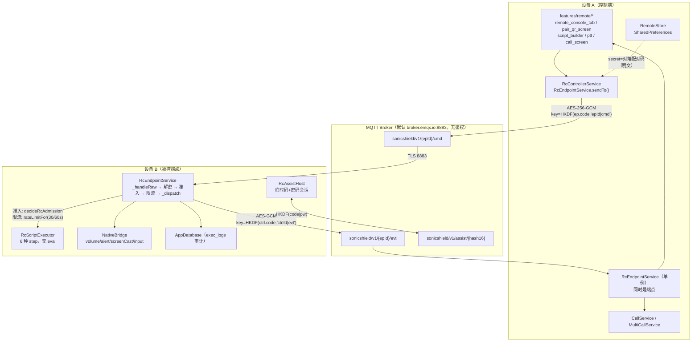
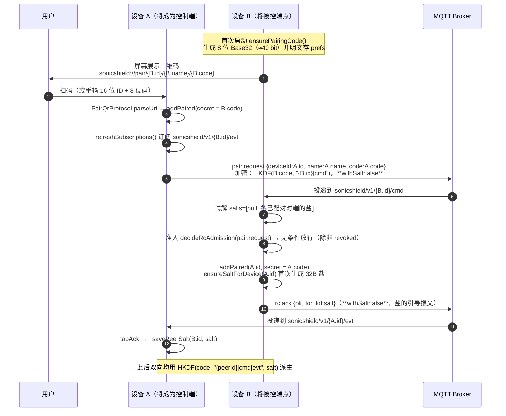

# A4 · 远程遥控 / 网络 / 安全 深度审计

> 工作包：A4（远程遥控 / 网络 / 安全）
> 目标版本：SonicShield 1.9.9+32
> 审计方式：**纯静态**代码阅读（沙箱无 dart/flutter，未运行任何测试；未对真实设备/真实 broker 发起任何连接、扫描或爆破）
> 写入范围：本文件是本次审计**唯一**写入的文件（AUDIT_ONLY，未改动 `lib/` `test/` `android/` `packages/`）
> 证据纪律：`CONFIRMED` = 代码逐行可证；`HIGH_CONFIDENCE` = 代码事实成立、后果依赖外部条件（算力/网络位置）但推理链完整；`SUSPECTED` = 有代码迹象但缺少关键一环；`NOT_REPRODUCED` = 专门核查后未发现该缺陷；`UNVERIFIED` = 依赖第三方库/平台行为，静态无法判定
> 敏感信息：本文不输出任何真实 Key / token / 密码 / 配对码（一律 `<redacted>`）

---

## 0. 结论摘要

- 远程模块的**工程实现质量高于同类项目**：传输强制 TLS（无 `onBadCertificate`）、消息 AES-256-GCM + AAD 绑定主题、±90s 时间窗 + 原子去重、未知命令显式拒绝、动作级权限位、撤销时清理在途作业 —— 这些都已做对，本报告**不重复计入缺陷**（见 §6「已核查且未发现缺陷」）。
- 但**授权模型存在结构性缺口**：全部鉴权最终收敛为「是否持有对端 8 位配对码（≈40 bit）」。配对码是**长期、共享、可被拍照/离线爆破**的对称秘密，且撤销后不失效、`from` 可伪造。据此可构造**未配对/已撤销状态下控制对端设备**的路径 → 按合规红线记 **P0（REM-01）**。
- 另一个系统性问题是**密钥即身份**：`pair.request` 把控制端的全局配对码加密下发给端点，导致「任何与你配对过的端点都掌握你的全局码」，从而能**伪造**发给你的任意事件（定位/回执/通话状态），并解密**无盐（v1）**回执。见 REM-03。
- 临时协助会话的「抗离线爆破」安全声明（docs/18）**不成立**：会合主题是 `SHA256(code|password)[0:16]` 的**快速哈希**且对 broker 可见，等于给公开的 9 位临时码配了一个离线口令校验器。见 REM-04。

按 P 级分布：**P0 × 1、P1 × 3、P2 × 6、P3 × 5**（共 15 条）；另有 1 条 `UNVERIFIED` 残余风险（REM-16）单列于 §4 末尾，不计入上述分布。

---

## 1. 远程模块架构

### 1.1 组件与数据流



**关键事实（与任务书假设的差异，需先纠正）**

| 任务书假设 | 代码实际 |
|---|---|
| HTTP/WS 端点 | **MQTT over TLS 8883**（`endpoint_service.dart:608-630`，`secure = true` 硬编码）；WSS 仅作为承载方案（`:617`），QUIC 回落 TLS |
| 中继 | 无自建中继；消息经**公共 broker** 转发（默认 `broker.emqx.io`，`remote_store.dart:173`），可选自建 broker + 可选 TURN（仅通话媒体） |
| 会话 token | **没有会话 token**。每条消息独立用「接收方配对码 + 接收方 deviceId」派生密钥；无登录态、无 sessionId（协助会话除外） |
| 指令路由表在 `docs/22` | 文档停在 33 命令 / 19 事件，代码已是 **40 / 22**；缺的 10 项里包含屏幕外发与 UI 代操作（`input.*`）。逐条对照见 §3.5 |

### 1.2 配对时序（扫码 → 交换什么 → 建立什么凭据）



**建立的凭据**：双方各自持有「对方的 8 位配对码」，并各自持有「对方 deviceId 对应的 32 字节盐」。**没有**每对设备独立的长期密钥、没有密钥协商、没有前向保密、没有会话过期。

### 1.3 密钥派生（真源 `protocol.dart:408-434`）

| 场景 | IKM | HKDF salt | info | 备注 |
|---|---|---|---|---|
| A → B 命令 | `B.code` | `sonicshield-rc-v1\|{B.id}\|cmd` | `sonicshield` | 无盐（v1） |
| A → B 命令（v2） | `PBKDF2(B.code, salt, 120000)` | `sonicshield-rc-v2\|{B.id}\|cmd` ‖ salt | 同上 | 有盐时 |
| B → A 回执 | `A.code` | `sonicshield-rc-v1\|{A.id}\|evt` | 同上 | 按接收方身份 |
| 协助 ctl | `pw` | `sonicshield-assist-v1\|{code}` | `assist` → `assist-ctl` | **无 PBKDF2** |
| 协助 ep | 同上 | 同上 | `assist-ep` | |

> ⚠️ 注意方向：**加密密钥由「接收方」的配对码决定**。因此「知道 B 的码」= 「能向 B 加密任意命令」= 「能控制 B」。

---

## 2. 指令授权矩阵

### 2.1 三层前置校验（代码真源）

| 层 | 位置 | 判据 | 覆盖范围 |
|---|---|---|---|
| L1 解密 | `endpoint_service.dart:865-885` | 能用「本机配对码 + `{本机ID}\|cmd`」+ 任一盐解开 AES-GCM | 全部 cmd |
| L2 准入 | `endpoint_service.dart:902-913` → `decideRcAdmission:3696-3714` | `msg.from` 在配对表 且 不在撤销表；**`from` 为空 → 放行**；`pair.request` → 放行 | 全部 cmd |
| L3 限流 | `endpoint_service.dart:920-930` → `rateLimitFor:4120-4137` | 每发送方 60s 内 30 条；`script.stop`/`vibrate.stop`/`call.end` 插队 | 非停类 cmd |
| L4 权限位 | `assist.dart:351-415`（仅协助会话）；`endpoint_service.dart:2016-2024`、`3884-3933` | 协助会话逐条命令 + 指令组步骤 + 任务动作；**配对通道无权限位（配对 = 全权）** | 协助会话 |
| L5 本机授权 | 各 handler 内 `NativeBridge.*` / `Permission.*` / MediaProjection 弹窗 | 麦克风、相机、定位、无障碍、投屏系统弹窗 | 相关 cmd |

### 2.2 全量矩阵（40 条 `RcCmd`）

符号：`准入` = L2 是否要求发送方在配对表；`来源绑定` = 是否校验「该命令属于本次会话/该 callId/该 castId」；`协助位` = `RcPermGate.requiredPerm`；`审计` = 是否写 `exec_logs`。

| # | 命令 | 准入 | 来源绑定 | 协助位 | 端点本机授权 | 审计 |
|---|---|---|---|---|---|---|
| 1 | `pair.request` | **无条件放行**（仅撤销表否决） | payload `deviceId` 二次查撤销 | 一律拒（未登记→denyAll） | — | ✅ |
| 2 | `ping` | 需已配对（`from` 可空绕过） | — | 免授权 | — | ❌ |
| 3 | `status.get` | 同上 | — | 免授权 | — | ❌ |
| 4 | `sound.play` | 同上 | — | `media` | — | ✅ |
| 5 | `task.list` | 同上 | — | 免授权 | — | ❌ |
| 6 | `task.toggle` | 同上 | — | `script` + 动作级 | — | ✅ |
| 7 | `task.skipNext` | 同上 | — | `script` | — | ✅ |
| 8 | `guard.set` | 同上 | — | `script` | 引擎须在跑；麦克风权限需端点前台 | ✅ |
| 9 | `logs.recent` | 同上 | — | `audit` | — | ❌（只读） |
| 10 | `script.run` | 同上 | 单实例预占 `_scriptClaimed` | `script` + 每步权限 | 录音需麦克风权限 | ✅ |
| 11 | `script.stop` | 同上 | `scriptId` 匹配（`*` 通配） | `script` | — | ✅ |
| 12 | `ptt.voice` | 同上 | `voiceId` 仅作 key | `media` | — | ✅ |
| 13 | `call.invite` | 同上 | `callId` | `video` | 自动接通开关 / 用户接听 | **❌** |
| 14 | `call.answer` | 同上 | `callId` + `_isCaller` + phase | `video` | — | **❌** |
| 15 | `call.candidate` | 同上 | `callId` | `video` | — | **❌** |
| 16 | `call.end` | 同上 | **❌ 不校验 callId**（`call_service.dart:820-822`） | `video` | — | **❌** |
| 17 | `device.status` | 同上 | — | 免授权 | — | ❌ |
| 18 | `camera.snap` | 同上 | — | `video` | 硬禁用（恒 `ok:false`） | ✅ |
| 19 | `location.get` | 同上 | — | `location` | 运行时权限 + GPS 开关 | ✅ |
| 20 | `volume.set` | 同上 | — | `volume` | 原生桥 | ✅ |
| 21 | `device.alert` | 同上 | — | `media` | 原生桥 | ✅ |
| 22 | `device.rename` | 同上 | 发送方须在表内 | `script` | — | ✅ |
| 23 | `task.get` | 同上 | — | 免授权 | — | ❌ |
| 24 | `task.upsert` | 同上 | — | `script` + 动作级 | 强制 `respectDnd` / 丢弃 `quietExempt`/`forceRun` | ✅ |
| 25 | `task.delete` | 同上 | — | `script` | — | ✅ |
| 26 | `task.runNow` | 同上 | — | `script` + 动作级 | 引擎须在跑 | ✅ |
| 27 | `asset.list` | 同上 | — | 免授权 | — | ❌ |
| 28 | `preset.list` | 同上 | — | 免授权 | — | ❌ |
| 29 | `vibrate.stop` | 同上 | 全局（无 taskId） | `vibrate` | — | ✅ |
| 30 | `vibrate.start` | 同上 | — | `vibrate` | — | ✅ |
| 31 | `plan.apply` | 同上 | — | `script` | 本机「动态反击」开关须开 | ✅ |
| 32 | `plan.get` | 同上 | — | 免授权 | — | ❌ |
| 33 | `plan.stop` | 同上 | — | `script` | — | ✅ |
| 34 | `run.master.set` | 同上 | — | `script` | — | ✅ |
| 35 | `screen.cast.request` | 同上 | `castId`（新会话替换旧会话） | `script` | MediaProjection 系统弹窗 + 无障碍（control） | ✅ |
| 36 | `screen.cast.stop` | 同上 | **❌ 不校验 castId 归属** | `script` | — | ✅ |
| 37 | `input.tap` | 同上 | `castId == _castSessionId` | `script` | 无障碍 | ✅ |
| 38 | `input.swipe` | 同上 | 同上 | `script` | 无障碍 | ✅ |
| 39 | `input.key` | 同上 | 同上 | `script` | 无障碍 | ✅ |
| 40 | `input.text` | 同上 | 同上 | `script` | 无障碍 | ✅ |

**矩阵结论**

1. **配对通道没有「权限等级」概念** —— 只要在配对表里就是全权（`endpoint_service.dart:2007-2008` 注释明说「配对 = 全权」）。因此「谁能下发什么」的答案只有两个：全部，或零。
2. 撤销是唯一的分级手段，而撤销可被 `from` 伪造绕过（REM-01）。
3. 通话链路（13-16）**完全没有审计留痕**，而这四条是唯一会打开摄像头/麦克风的命令（REM-09）。
4. `call.end` 与 `screen.cast.stop` 缺少会话归属绑定（REM-11）。

---

## 3. 协议消息全集与未知类型处理

### 3.1 命令（40，`protocol.dart:114-330`）

```
pairRequest  ping  statusGet  soundPlay  taskList  taskToggle  taskSkipNext
guardSet  logsRecent  scriptRun  scriptStop  pttVoice
callInvite  callAnswer  callCandidate  callEnd
deviceStatus  cameraSnap  locationGet  volumeSet  deviceAlert  deviceRename
taskGet  taskUpsert  taskDelete  taskRunNow
assetList  presetList  vibrateStop  vibrateStart
planApply  planGet  planStop  runMasterSet
screenCastRequest  screenCastStop  inputTap  inputSwipe  inputKey  inputText
```

### 3.2 事件（22，`protocol.dart:334-380`）

```
pong  status  tasks  logs  ack  heartbeat  exec  offline  scriptState  pttAck
callState  device  photo  location  callMissed  deviceRenamed
task  assets  presets  plan  screen  inputAck
```

### 3.3 协助会话（5，`assist.dart:316-333`）+ 指令组步骤（6，`rc_script.dart:18`）

`assist.hello / accept / reject / perm / close`；`play / tts / notify / vibrate / record / delay`。

### 3.4 未知类型处理策略（已核对，**无缺陷**）

| 入口 | 未知 `type` 行为 | 位置 | 评价 |
|---|---|---|---|
| 配对通道 cmd | 写 `skipped` 审计 + `rc.ack{ok:false, data:'未知命令'}` | `endpoint_service.dart:1400-1410` | 正确（不崩、不静默） |
| 信封版本/类型非法 | `RcMessage.tryParse` 返回 null → 解密入口丢弃 | `protocol.dart:71-82` | 正确（`v != 1` 拒绝） |
| 空消息 ID | 入口 fail-closed 返回 null | `protocol.dart:73-74` | 正确 |
| 未知 `assist.*` | 静默忽略（前向兼容） | `assist_host.dart:367-368` | 合理 |
| 未知 `step kind` | `RcStep.fromJson` 抛 → `guardDispatch` 兜底 `ok:false` | `rc_script.dart:246-252` | 正确（不崩） |
| 未知 `RcEvt` | UI 侧按 type 匹配，无匹配即忽略 | `call_service.dart:301-342` | 合理 |

### 3.5 `docs/22` 清单 vs 代码实现：**10 个消息类型未文档化**

`docs/22` 正文（表 A 命令 33 条、§1.2 事件 19 条）与代码 `protocol.dart` 实际常量（40 命令 / 22 事件）存在**纯增量漂移**：代码多出 **7 条命令 + 3 条事件**，文档全文对这 10 个字符串**零提及**（`grep -n 'device.rename\|screen.cast\|input.tap\|input.swipe\|input.key\|input.text\|deviceRenamed\|rc.screen\|inputAck' docs/22*.md` → 0 命中）。

| 类型 | 常量 | 定义 | 分发行 | 发射/消费方 | 审计 | 说明 |
|---|---|---|---|---|---|---|
| cmd | `device.rename` | `protocol.dart:208` | `endpoint_service.dart:1385` | 端点改本机设备名；事件侧 `rc.deviceRenamed` **无发射方** | ✅ `:1832-1852` | 高危度低，但改的是**对端设备名**（社会工程面：可被改名成"官方客服"） |
| cmd | `screen.cast.request` | `:309` | `:1388` | 触发 MediaProjection，端点用户须在系统弹窗确认 | ✅ `:1446,1463,1490,1499,1520` | **屏幕实时外发**，隐私等级最高一档 |
| cmd | `screen.cast.stop` | `:313` | `:1390` | 停投屏 | ✅ | 见 REM-11（不校验归属） |
| cmd | `input.tap` | `:317` | `:1392` | 需端点无障碍开关已开 | ✅ `:1603` | **远程操控对端 UI**（点击） |
| cmd | `input.swipe` | `:320` | `:1394` | 同上 | ✅ | 滑动 |
| cmd | `input.key` | `:325` | `:1396` | 同上 | ✅ | 按键 |
| cmd | `input.text` | `:329` | `:1398` | 同上 | ✅ | **文本注入**（可代填表单/搜索词） |
| evt | `rc.deviceRenamed` | `:360` | — | **无发射方、无消费方**（全仓 `grep RcEvt.deviceRenamed lib/` → 0 命中，仅常量自身） | — | **死常量**：与 `docs/22 §12 D-1`（`rc.call` 的 `connected`/`ended`）同类，但**未被登记** |
| evt | `rc.screen` | `:373` | `:1452,1469,1505,1527` | `remote_console_tab.dart:290` | — | 投屏状态镜像 |
| evt | `rc.inputAck` | `:379` | `:1561,1594` | `remote_console_tab.dart:295`、`screen_viewer.dart:99` | — | 输入回执（R91 已修） |

**影响判断（不升级为独立 REM，理由如下）**：

1. **不是"未文档化的隐藏后门"**。这 7 条命令全部走与其它命令**完全相同**的准入链（`decideRcAdmission` → 限流 → `guardDispatch`），并且**都有审计**、都要求端点侧**系统级授权**（MediaProjection 弹窗 / 无障碍开关）。也就是说，它们没有绕过任何既有控制，只是**没有写进清单**。
2. 真正的风险是**治理风险**：`docs/22` 自称「可用性真源」，而最敏感的一类能力（屏幕外发 + UI 代操作）**不在真源里**。安全评审、合规自查、`test/rc_protocol_coverage_test.dart` 的权限位登记，都会因为读文档而漏掉这一档能力。**但权限位本身分得是对的**：`screenCastRequest/Stop`、`inputTap/Swipe/Key/Text`、`deviceRename` 在 `assist.dart:409-419` 一律归 `script` 位（注释明写「输入注入是最高危能力」），并未与「播放一个音效」同级 —— 这一点优于我的初判，已更正。
3. 因此本条**记入 §3 与 §7 修复清单，不单列 REM 编号**，避免与 `docs/22 §12` 已登记的 7 条语义漂移（D-1..D-7）混淆计数。

**建议**：把上表 10 项补进 `docs/22` 表 A / §1.2，并同步 `rc_protocol_coverage_test` 的权限位断言；同时删掉 `rc.deviceRenamed` 死常量，或在 `device.rename` 成功后补发射。

---

## 4. 缺陷条目

### REM-01 撤销/解绑不使旧凭据失效，且 `msg.from` 可伪造 —— 已撤销设备仍可执行全部指令

```
Severity: P0
Evidence Status: CONFIRMED（代码路径逐行可证；未对真实设备执行）
Affected Files/Lines:
  lib/remote/endpoint_service.dart:902-913（准入调用）
  lib/remote/endpoint_service.dart:3696-3714（decideRcAdmission，:3711 空 from 放行）
  lib/remote/remote_store.dart:407-417（removePaired → revoke）
  lib/remote/remote_store.dart:437-448（revoke / clearRevoked）
  lib/remote/endpoint_service.dart:1750-1759（payload 层二次撤销判定）
  lib/remote/protocol.dart:46（from「不参与鉴权」）
```

**Expected Behavior**
用户在「我的设备」里删除某台控制器后，该设备应立即**完全无法**再向本机下发任何指令；解除配对 = 授权撤销。撤销必须是**凭据级**的（旧密钥/旧凭据失效），不能只是「列表里少一行」。

**Actual Behavior**
撤销只做三件事：① 从 `rc_paired` 列表移除；② 把 id 写进 `rc_revoked`；③ 停掉该设备在途的指令组/通话。而**消息密钥仍然只是「本机配对码」**，撤销不改变配对码，因此被撤销方手里那把「钥匙」完好无损。准入判据是 `msg.from`：

```dart
// endpoint_service.dart:3709-3713
if (senderRevoked) return RcAdmission.rejectRevoked;
if (type == RcCmd.pairRequest) return RcAdmission.allowPairing;
if (senderId.isEmpty) return RcAdmission.allowUnidentified;   // ← 空 from 放行
if (senderPaired) return RcAdmission.allowPaired;
return RcAdmission.rejectUnpaired;
```

而 `from` 是发送方**自报**的字段（`protocol.dart:46` 注释即写「不参与鉴权」），构造一条 `{"v":1,"id":"...","ts":...,"type":"sound.play","payload":{...}}`（**不带 from 或 from 为空串**）即可命中 `allowUnidentified`，绕过全部撤销与配对判定。代码注释自己承认了这个缺口（`:3687-3695`「已知缺口」）。

**Trigger Conditions**
1. 攻击者曾经与该端点配对过（或被用户在列表里删除过），因此持有端点的 8 位配对码；
2. 攻击者自行实现 MQTT 客户端（或改一行官方客户端的 `from` 赋值），向 `sonicshield/v1/{端点ID}/cmd` 发布 `from: ""` 的命令；
3. 端点已启用远程遥控并在线。

**Forward Call Chain**
`MQTT publish` → `client.updates.listen`（`:673`）→ `_handleRaw(topic, wire)`（`:825`）→ 解密成功（密钥未变）→ `reserveInboundId`（`:890`，首次必过）→ `decideRcAdmission(senderId: msg.from='')` → `allowUnidentified`（`:3711`）→ 限流（30/60s，足够）→ `_peerOf(msg)`（`:1108`，构造占位对端）→ `_dispatch`（`:1121`）→ 任意 handler。

**Reverse Call Chain**
`removePaired`（`remote_store.dart:407`）只改 `rc_paired` / `rc_revoked` / `rc_selected`；`onPeerRevoked`（`endpoint_service.dart:516`）只退订 evt 主题 + 停在途作业。**没有任何一处**改动 `_ownCode` 或使旧密文失效。

**Data Flow / State Transition**
```
paired[A] --removePaired--> paired \ {A}; revoked += {A}
_ownCode 不变  ⇒  key(A→B) 不变
A 发 from="" ⇒ admission=allowUnidentified ⇒ 执行
A 发 from=A  ⇒ admission=rejectRevoked     ⇒ 拒绝（仅"诚实"客户端被拦）
```

**Evidence**
```dart
// remote_store.dart:407-417
Future<void> removePaired(String deviceId) async {
  final list = [...paired().where((p) => p.deviceId != deviceId)];
  await _prefs.setString(_kPaired, jsonEncode(...));
  if (selectedEndpointId == deviceId) await selectEndpoint('');
  if (deviceId.isNotEmpty) await revoke(deviceId);   // 只是记账
}
```
```dart
// remote_store.dart:144-152（作者自述）
/// 为什么需要它：配对码是**全体控制端共享**的，`removePaired` 只把设备移出
/// 本机列表，拦不住它用旧码继续握手（`pair.request` 在准入里是**无条件放行**
/// 的）。… 彻底吊销仍需轮换配对码
```

**Reproduction Steps（仅设计，未执行）**
1. 设备 B 与控制器 A 正常配对，B 的「我的设备」中出现 A；
2. 在 B 上删除 A（触发 `removePaired` + `onPeerRevoked`）；
3. 用 A 侧代码把 `RcEndpointService.sendTo` 里的 `from: store.deviceId` 改为 `from: ''`（一行改动），或直接用 mosquitto_pub + 预先抓取的密文重放（90s 内）；
4. A 发 `sound.play` / `task.upsert` / `call.invite` → B 照常执行并回执（回执因 `targetPeerId=''` 退化为广播）。

**Root Cause**
「凭据」与「授权」被设计成同一个东西：能解密 = 已授权。而解密能力来自**共享的、不可按设备轮换的**配对码，因此「撤销某个设备」在密码学上无法表达。`from` 是唯一的身份声明，却没有完整性保护（虽在密文内，但任何持有配对码者都能写任意值）。

**Alternative Hypotheses**
- 「撤销后必须轮换配对码才能生效」是**有意设计**（`rotatePairingCode` 的注释与 UI 二次确认都这么说）。若如此，则缺陷应改写为「撤销 UI 的语义（删除设备）与真实效果（仍需重置配对码）不一致」，仍应至少 P1；但按合规红线「未授权控制他人设备」，当前形态仍是 P0 —— 因为用户点「删除」时不会预期「它还能控制我」。
- 也可能是「`from` 为空仅用于 `tool/rc_probe.dart` 探针」的有意兼容。但探针是本仓自带工具，不该以生产鉴权缺口为代价。

**Business Impact**
「解除配对」这一**唯一**的授权回收手段失效。家庭守护场景下（老人机被子女控制），一旦控制端设备被转手/丢失/恶意安装，端点无法单方面切断控制，除非重置配对码——而那会让**所有**控制器一起失联（见 REM-05 的连带影响）。这是合规红线（docs/08 §2「未经授权控制他人设备」）的直接命中项。

**Recommended Fix**
1. **短期（不改密钥模型）**：删除 `allowUnidentified` 分支——`senderId` 为空一律 `rejectUnidentified`（`pair.request` 已单独在最前放行，不受影响）；把 `tool/rc_probe.dart` 改为填 `from`。同时把「删除设备」的 UI 文案改为「删除并吊销（需重置配对码）」或直接引导重置。
2. **根治（密钥模型级）**：配对时由**端点生成每控制端独立的 32 字节密钥**（而不是复用控制端全局配对码），随 `pair.request` 的 ack 下发；`removePaired` 删除该密钥即真正吊销；`from` 不再参与鉴权，身份由「用哪把密钥解开」决定（每条命令按候选密钥试解，命中即身份）。
3. 撤销表增加「生效时间」并在 UI 展示，避免用户误以为删除即吊销。

**Regression Risks**
- 去掉 `allowUnidentified` 会让 `tool/rc_probe.dart`、`tool/rc_e2e_controller.dart` 的探针链路失败（它们不填 `from`）——需同步改工具，否则端到端验证手段失效。
- 旧版控制端（若存在不填 `from` 的版本）会全部被拒；需确认线上版本均填 `from`（`sendTo` 从 v1.3 起统一填充，风险低）。
- 根治方案会改变「按接收方身份派生 + 双方互扫」这一 HANDOVER §4.6 的既定决策，属架构级变更，必须与 docs/14、docs/25 同步。

**Verification Tests**
- 新增 `test/rc_admission_test.dart`：`decideRcAdmission(senderId:'', type:'sound.play', senderPaired:false)` 必须 `!allowed`（当前会 `allowUnidentified` → 红）。
- 行为测试：`debugHandleRaw(cmdTopic, wire(from:''))` 在 `store.removePaired(x)` 之后必须不进入 `_dispatch`（可用 `debugBind` + 计数 handler）。
- 回归锁：`test/unpair_revoke_test.dart` 现有断言只覆盖「诚实自报」路径，需补「空 from」反例。

**Remaining Uncertainty**
未验证真实 broker 上是否存在额外的 topic ACL 能补偿（默认公共 broker 无 ACL；自建 broker 若配置了 per-client ACL 可部分缓解，但代码未要求）。
```

---

### REM-02 配对码 = 唯一长期凭据（≈40 bit、永久、可拍照、可离线爆破、可降级绕过 PBKDF2）

```
Severity: P1
Evidence Status: HIGH_CONFIDENCE（代码事实 CONFIRMED；"可爆破"依赖攻击者算力与能否观测到无盐密文，未实际执行）
Affected Files/Lines:
  lib/remote/protocol.dart:520-526（generatePairingCode，8 位 × 32 字母表）
  lib/remote/protocol.dart:392-434（Pbkdf2 120000 / deriveKey）
  lib/remote/remote_store.dart:328-363（pairingCode / ensurePairingCode / rotatePairingCode）
  lib/remote/endpoint_service.dart:3419-3433（requestPairing，withSalt:false）
  lib/remote/endpoint_service.dart:865-885（cmd 试解候选 [null, ...salts]）
  lib/features/remote/pair_qr_screen.dart:204-223, 240-274
```

**Expected Behavior**
长期凭证应有足够熵（≥128 bit）且不可从公开信道上的观测值离线验证；扫码得到的应是一次性/可轮换的配对凭据，而不是设备永久主密钥。

**Actual Behavior**
- 配对码 = `Random.secure()` 从 32 字符表取 8 位 ⇒ **32^8 = 2^40 ≈ 1.1×10^12**，即 **40 bit**。
- 该码**就是**消息密钥的 IKM，且 `ensurePairingCode()` 只在「长度 ≠ 8」时生成一次 —— **永不自动轮换**（`remote_store.dart:336-343`）。
- 二维码明文包含它（`pair_qr_screen.dart:221-223`）；截图、相册、屏幕共享、肩窥均等于交出永久控制权。页面**未设置 FLAG_SECURE**（全仓 grep 无 `FLAG_SECURE`）。
- `pair.request` **恒以无盐 v1 派生加密**（`withSalt:false`，`:3433`），而端点 cmd 试解候选的**第一项恒为 null**（`:865`）⇒ 只要配对码正确，无盐报文永远被接受 ⇒ **PBKDF2 硬化可被「用无盐格式发送」绕过**，且攻击者永远能拿到至少一条无盐密文样本（每次配对时的 `pair.request`）。
- 因此离线攻击模型成立：在 broker 上抓一条 `pair.request` 密文 → 对 2^40 个候选码做 `HKDF(code,'{epId}|cmd')` + AES-GCM 解封验证 → 命中即得端点主密钥。GPU 量级下为「小时~天」，不是「分钟」，但**远低于长期凭证应有的强度**。

**Trigger Conditions**
攻击者能在 MQTT 层看到密文（默认公共 broker 无鉴权、无 ACL，任何客户端可 `subscribe sonicshield/v1/#`；自建 broker 的管理员同样可见），且目标设备曾发生过一次配对（产生 `pair.request`）。

**Forward Call Chain**
`pair.request` 发布（无盐）→ broker 转发 → 攻击者落盘 → 离线：`for guess in 32^8: key=HKDF(guess, '{epId}|cmd'); try AES-GCM-open(blob,key,aad=topic)` → 命中 → 得到 `epId + code` → 直接向 `{epId}/cmd` 发命令（配合 REM-01 的 `from:''` 甚至无需注册）。

**Reverse Call Chain**
`generatePairingCode`（40 bit）→ `ensurePairingCode`（一次生成、永不轮换）→ `deriveKey`（PBKDF2 仅在 salt != null 时启用）→ `_handleRaw` 的候选列表首项 `null`（兼容旧端点）→ 无盐路径永远可用。

**Data Flow / State Transition**
```
QR(code) --scan--> PairedEndpoint.secret --deriveKey--> cmd/evt key
                     ↑
          长期不变（无 TTL、无自动轮换）
rotatePairingCode(): 仅手动、需二次确认、会让所有控制器失联
```

**Evidence**
```dart
// protocol.dart:521-526
static String generatePairingCode() {
  const chars = 'ABCDEFGHJKMNPQRSTVWXYZ23456789';   // 32
  final r = Random.secure();
  final raw = List.generate(8, (_) => chars[r.nextInt(chars.length)]).join();
  return '${raw.substring(0, 4)}-${raw.substring(4)}';
}
```
```dart
// endpoint_service.dart:3430-3433
// ⚠️ 配对请求是**盐的引导报文**…必须走 v1
final sent = await sendTo(endpoint, request, store,
    enqueueOnFail: false, withSalt: false);
```
```dart
// endpoint_service.dart:865-874
final salts = <List<int>?>[null];       // ← 首项恒为 null
for (final p in store.paired()) { ... }
```

**Reproduction Steps（仅设计）**
1. 在公共 broker 上以 `sonicshield/v1/+/cmd` 订阅并持续落盘（配对事件会自然发生）；
2. 离线对每条密文尝试 2^40 个候选码（HKDF + AES-GCM tag 校验）；
3. 命中后记录 `(epId, code)`，此后可长期控制该设备（无需再配对）。

**Root Cause**
把「人类可转录的短码」直接当成密码学主密钥使用（设计取向：无账号、无服务器、双方互扫）。40 bit 对**在线**猜测足够（配合限流），对**离线**验证远远不够；而 `pair.request` 的无盐引导又恰好提供了离线验证样本。

**Alternative Hypotheses**
- 若认为「必须物理在场扫码」已足够，则攻击前提（拍到 QR）不成立；但 broker 上的密文对任何网络位置的人可见，无需物理在场 —— 这是本缺陷与「扫码 = 授权」假设的关键偏差。
- 若自建 broker 启用了严格 ACL（每设备只能订阅自己的 topic），攻击面显著缩小；但代码**默认**是公共 broker（`remote_store.dart:173`），且文档只「建议」自建。

**Business Impact**
默认配置下，任何能连到公共 broker 的人都可以对「曾配对过的设备」做离线密钥恢复，进而取得完整控制权（播放/振动/任务/定位/通话/投屏）。这与产品「端到端加密、broker 不可见内容」的安全叙事存在落差：内容确实加密，但**密钥强度不足以支撑该叙事**。

**Recommended Fix**
1. 配对码熵提升到 ≥ 100 bit（如 20 位 Base32），或保持 8 位**仅作一次性引导**：配对成功后由端点生成 32 字节 per-controller 密钥并在 ack 中下发（与 REM-01 的根治方案同一条路）。
2. 引导报文也必须带盐：端点在 `pair.request` 时无法知道控制端的盐，可改为「先发 hello 拿盐（无敏感内容），再发带盐的配对请求」，或让端点用**自己的**盐派生引导密钥（端点始终知道自己给自己生成的盐）。
3. 移除 cmd 试解候选中的 `null` 兜底（对已完成 v2 迁移的设备），使 PBKDF2 不可降级。
4. 二维码页面加 `FLAG_SECURE`（Android）并在 UI 明示「此码等于钥匙，勿截图/外传」。

**Regression Risks**
- 提高码长会破坏现有二维码/手输/测试（`PairQrProtocol.parseUri` 的 8 位硬校验、`_base32Code` 正则、多份测试夹具）。
- 移除 `null` 候选会让所有「旧配对（无盐）」设备静默失联 —— 必须保留过渡期并给出可诊断的失败提示（现有 `decode.fail` 审计可复用）。

**Verification Tests**
- 单测：`RcCodec.generatePairingCode()` 的熵下界断言（当前 40 bit，改为 ≥100 bit 后应锁住）。
- 单测：对同一 `(code, context)`，有盐/无盐派生的密钥必须不同，且 `_handleRaw` 在设备已有盐时**不得**接受无盐密文（可用 `debugHandleRaw` 构造）。
- 源码锁：`pair_qr_screen` 必须调用 `SystemChrome`/`FLAG_SECURE`（或原生侧）——需新增平台通道，属跨包改动。

**Remaining Uncertainty**
未实测 2^40 的破解成本（无 GPU 环境）；不同 broker 的 ACL 默认值未逐一核实；`mqtt_client` 是否在 TLS 下额外做证书固定（未做，见 §6）。
```

---

### REM-03 配对码随 `pair.request` 下发 → 每个已配对端点都掌握控制端的全局码，可横向解密/伪造该控制端与其它端点的全部流量

```
Severity: P1
Evidence Status: CONFIRMED（机制可证）；实际影响取决于能否订阅他人 evt 主题（默认公共 broker 可）
Affected Files/Lines:
  lib/remote/endpoint_service.dart:1728-1814（_handlePairRequest，secret: code）
  lib/remote/endpoint_service.dart:3192-3201（_send 用 peer.secret 派生 evt 密钥）
  lib/remote/protocol.dart:136-136（pair.request payload 必带 code）
  lib/features/remote/pair_qr_screen.dart:47-51（notifyPeerOfPairing 发送 code）
```

**Expected Behavior**
「A 与 B 配对」产生的信任关系不应让 B 获得 A 与 C 之间的任何能力。每对设备应有独立的密钥材料。

**Actual Behavior**
`pair.request` 的 payload **必须**携带控制端自己的 8 位配对码（否则端点无法给回执加密）。端点把它存为 `PairedEndpoint.secret`：

```dart
// endpoint_service.dart:1776-1783
await _store!.addPaired(PairedEndpoint(
  deviceId: ctrlId,
  name: ...,
  secret: code,          // ← 控制端的全局配对码
  ...
));
```

于是**端点 B 永久持有控制端 A 的全局码**。而 A 与任何其它端点 C 之间的回执，密钥是 `HKDF(A.code, '{A.id}|evt')` —— B 两者都知（`A.id` 来自 `pair.request` 的 payload，`A.code` 来自同一条报文）。在默认公共 broker 上，B 只需 `subscribe sonicshield/v1/{A.id}/evt` 即可解密 A 收到的：

- `rc.location`（**精确 GPS**）、`rc.logs`（端点审计轨迹）、`rc.tasks`（含完整任务定义）、`rc.task`、`rc.device`；
- `rc.call` / `call.answer` / `call.candidate`（SDP + ICE，可推导媒体路径）；
- `rc.ack`（含失败原因文本）。

更进一步：B 可以**伪造**上述事件发给 A（同一把密钥），例如伪造 `rc.call{state:ended}` 打断 A 的通话，或伪造 `rc.ack{ok:true}` 让 A 误以为某条命令已执行。

**Trigger Conditions**
1. A 与 B 配对（B 得到 A.code）；
2. A 与 C 也配对；
3. B 在 MQTT 层能订阅 `sonicshield/v1/{A.id}/evt`（公共 broker 无 ACL）。

**Forward Call Chain**
`A --pair.request(code=A.code)--> B` → `B.paired[A].secret = A.code` → `B subscribe('sonicshield/v1/{A.id}/evt')` → `C --rc.location--> A` → `A --_send(target=A)--> evt 主题` → B 用 `HKDF(A.code,'{A.id}|evt')` 解密。

**Reverse Call Chain**
`_send`（`:3192-3201`）对每个 peer 用 `peer.secret` 加密 —— 这意味着「谁掌握 peer.secret，谁就能解开所有发给该 peer 的事件」。密钥是**接收方全局码**，而非「A↔C 这一对」的密钥。

**Data Flow / State Transition**
```
A.code  ---(pair.request, 密文内)-->  B
A.code  ---(QR)------------------->  C
⇒ B、C 都持有 A.code
⇒ 任何知道 A.id 的一方都能解开 A 的全部 evt
```

**Evidence**
```dart
// endpoint_service.dart:3192-3197
for (final peer in peers) {
  final salt = withSalt ? _saltStore?.saltFor(peer.deviceId) : null;
  final key = await RcCodec.deriveKey(
      peer.secret, '${peer.deviceId}|evt', salt: salt);
```
```dart
// protocol.dart:118-120（pair.request 文档）
/// payload（**必须携带这三项**）：
/// `{deviceId: 控制端 16 位 ID, name: 控制端显示名, code: 控制端 8 位配对码}`
```

**Reproduction Steps（仅设计）**
1. 让目标用户把同一台手机 A 分别与 B（攻击者控制的端点）和 C（正常端点）配对；
2. B 记录 `pair.request` 里的 `code`；
3. B 订阅 `sonicshield/v1/{A.id}/evt`；
4. 用户在 A 上对 C 发起 `location.get` → B 解出经纬度。

**Root Cause**
「按接收方身份派生」+「配对码是设备级全局秘密」这两个决策叠加，使得**密钥在多个信任域之间复用**。项目把它当成「不可改决策」（`decideRcAdmission` 注释、HANDOVER §4.6），但它与「多端点」这一真实用法冲突。

**Alternative Hypotheses**
- 若产品定位是「一台控制端只控制一台端点」，则该风险退化为「端点之间互相不可见」；但代码与 UI 明确支持多端点（`store.paired()` 列表、多画面、`initialSelectedId`），所以不成立。
- 盐（per-device）在这里**不起保护作用**：盐是按「对端 deviceId」存的，B 知道 A.id，也就能从自己的存储里拿到 A 的盐？不 —— 盐是 B 自己与 A 之间的盐，与 C 与 A 之间的盐不同。**但 evt 主题的加密用的是 `_saltStore.saltFor(A.id)`，即 B 侧存的「A 的盐」，与 C 侧存的「A 的盐」是两份独立随机值**。这意味着 B **无法**解开 C→A 的 evt（盐不同），除非 A 侧对 C 用的盐恰好等于 B 侧…不会。**修正**：v2（有盐）路径下，B 不能解密 C→A 的 evt。但 **v1 无盐路径仍然成立**（`salt == null` 时密钥只由 code 决定），而 `pair.request` 恒无盐、旧配对恒无盐。因此本缺陷的准确表述是：**对所有走 v1 无盐派生的流量成立；对 v2 有盐流量不成立**。这降低了严重度但不消除（无盐路径永远可用，且旧配对全部无盐）。

**Business Impact**
在 v1/无盐流量上，配对关系不是「点对点」而是「星型共享」：任何一个端点都能读取控制端与其它端点的敏感回执（定位、审计、任务、通话信令），并可注入伪造事件。对「家人守护」场景（一台控制端管多台老人机），意味着任一被攻陷的端点可横向监视控制端。

**Recommended Fix**
与 REM-01/REM-02 同一根治路径：**per-pair 密钥**（端点侧为每个控制端生成独立密钥，控制端侧为每个端点生成独立密钥），`pair.request` 不再传全局码；过渡期内至少**强制 v2（有盐）**并把 `null` 候选从已迁移设备的候选列表中移除。

**Regression Risks**
per-pair 密钥会改变二维码语义（二维码不能再只带 8 位码，需带一次性引导 secret），涉及 `PairQrProtocol`、`remote_store`、`pair_qr_screen`、`tool/*` 与全部配对测试；迁移期必须允许旧配对继续工作（否则存量用户全部失联）。

**Verification Tests**
- 单测：给定 `A.code`、`A.id`、`C` 的盐，B 侧不得派生出与 C→A 相同的 evt 密钥（当前 v1 路径会相同 → 红）。
- 源码锁：`pair.request` 的 payload 不得再出现 `code` 字段（迁移完成后）。

**Remaining Uncertainty**
未实测公共 broker 上是否存在「订阅他人 topic」的隐性限制（EMQX 公共实例通常无 ACL，但可能有限流）；未核实存量配对中有盐/无盐的比例（取决于用户是否在 v2 之后重新配对）。
```

---

### REM-04 协助会话的会合主题是密码的快速哈希 → 「抗离线爆破」声明不成立；5 次失败锁定对「猜密码」无效

```
Severity: P1
Evidence Status: CONFIRMED（topic 派生与失败计数位置可证）；爆破成本 HIGH_CONFIDENCE
Affected Files/Lines:
  lib/remote/assist.dart:94-114（topicFor / sessionSecret）
  lib/remote/assist.dart:56-67（9 位数字码 / 8 位密码）
  lib/remote/assist.dart:40-41（maxFailures = 5）
  lib/remote/assist_host.dart:328-353（onWire 失败计数）
  lib/remote/assist_host.dart:507-516（_onHandshakeFailure）
  docs/18-临时协助会话设计（临时码+访问密码）.md:94-109, 142-143
```

**Expected Behavior**
docs/18 §4.2 明确声明：只窃听临时码的攻击者**无法算出 topic**，因此「不存在可供离线字典攻击的素材」，并称其具备「PAKE 式不可离线攻击」性质；在线猜测由「同一会话 5 次失败即作废」兜底。

**Actual Behavior**
```dart
// assist.dart:97-102
static Future<String> topicFor(String code, String password) async {
  final digest = await _sha.hash(utf8.encode('$code|$password'));   // 单次 SHA-256
  final hex = digest.bytes.map((b) => b.toRadixString(16).padLeft(2,'0')).join();
  return '$topicPrefix${hex.substring(0, 16)}';                     // 64 bit
}
```
- topic 是 `SHA256(code|password)` 的**确定性快速哈希**，且 **topic 字符串本身对 broker 与任何订阅者可见**（MQTT 不加密主题）。
- 文档同时明确「临时码是公开的」（docs/18:32）。于是：**知道公开的 9 位码 + 观测到 topic** ⇒ 可以对 2^40 个密码候选做**单次 SHA-256** 比对，离线完成（GPU 上 2^40 次 SHA-256 是分钟级，不是「不可离线」）。命中后 `sessionSecret` 只是 HKDF（**没有 PBKDF2/Argon2**），密钥立即得到。
- 「5 次失败锁定」只在**报文到达真实会话 topic 且解密失败**时计数（`assist_host.dart:344-352`）。而「密码猜错」意味着 topic 也算错 ⇒ 报文根本不会到达真实会话 ⇒ **永远不计数、永不锁定**。该限制只能防「已知密码、故意灌垃圾」的 DoS，不能防猜测。

**Trigger Conditions**
1. 攻击者在 MQTT 层可订阅 `sonicshield/v1/assist/#`（公共 broker 默认允许）；
2. 端点正在展示临时码，且攻击者获知该 9 位码（肩窥、屏幕录制、社工口述、照片）；
3. 攻击者观测到会合主题（会话建立/握手期间必然出现）。

**Forward Call Chain**
`RcAssistHost.start()` → `topicFor(code,pw)` → `transport.subscribe(topic)`（topic 出现在 SUBSCRIBE 报文中）→ 攻击者订阅通配符 → 得到 `topic` → 离线枚举 `pw`（2^40 次 SHA-256）→ `ctlKey/epKey` → 发 `assist.hello` → 端点 `_onHello` 直接把会话置 `active`（`:458-485`，**无用户二次确认**）。

**Reverse Call Chain**
`maxFailures` 由 `AssistSession.registerFailure()` 递减，唯一调用点是 `onWire` 的解密失败分支；而 `onWire` 只被 `_handleRaw` 在 `topic == session.topic` 时调用（`endpoint_service.dart:833-839`）。猜错密码 ⇒ topic 不匹配 ⇒ 不进入 `onWire`。

**Data Flow / State Transition**
```
(code 公开, pw 秘密) --SHA256--> topic（公开）
topic + code --离线枚举 pw--> pw --HKDF--> ctlKey/epKey
hello(用 ctlKey 加密) --topic 正确--> _onHello --> phase=active（权限默认全拒）
```

**Evidence**
```dart
// docs/18:103-109（被证伪的声明）
///  → **不存在可供离线字典攻击的素材**；
///  → 攻击收益不高于直接猜密码，天然具备 **PAKE 式「不可离线攻击」** 性质。
```
```dart
// assist_host.dart:344-352
final msg = await RcCodec.decode(wire, key, s.topic, seenIds: _seen);
if (msg == null) {
  if (s.phase == AssistPhase.active) return;
  await _onHandshakeFailure(s, '密文校验失败');   // 只有"能到达本 topic"才算失败
  return;
}
```

**Reproduction Steps（仅设计）**
1. 端点生成临时码并展示；攻击者获知 9 位码；
2. 攻击者订阅 `sonicshield/v1/assist/#`，记录出现的 topic（64 bit 十六进制）；
3. 离线：`for pw in 32^8: if SHA256(code|pw)[0:16] == topic: hit`；
4. 用命中密码派生密钥，发 `assist.hello` 接入；端点侧无任何用户确认动作，直接 `active`。

**Root Cause**
把「口令校验器」放进了**公开可见的命名空间**。设计者假设 topic 不可被观测（「只窃听到 code 的攻击者无法算出 topic」），但 MQTT 主题对 broker 与订阅者**始终可见**，且默认 broker 无 ACL。同时密码只有 40 bit 且未做慢哈希。

**Alternative Hypotheses**
- 若攻击者不知道 9 位码，搜索空间为 10^9 × 2^40，不可行 —— 所以「码必须保密」是隐含前提，但文档明说码是公开的。二者矛盾。
- 若协助会话的权限默认全拒（事实如此，`AssistPerms.none`），攻击者接入后仍需端点用户逐项授权才能做事，实际危害被显著削弱 —— 这是把严重度定在 P1 而非 P0 的原因。

**Business Impact**
「临时协助」是本项目对外承诺的**低信任、可随时收回**的通道；其安全论证（docs/18 §4.2）是产品差异点。该论证不成立意味着：一旦临时码被看到（而这在「电话口述给客服/家人」的场景里是常态），40 bit 密码就只剩「几分钟的离线算力」这一道门槛。

**Recommended Fix**
1. topic 改为 `SHA256(HKDF(pw, salt=code))` 或直接使用**密码的慢哈希**（PBKDF2 ≥100k / Argon2id）截断，使离线枚举成本与密码熵相乘而非相加；
2. 或彻底改为「topic 由随机 nonce 决定，nonce 只在带密码的 hello 中给出」——但那就回到可枚举 topic；
3. 密码熵提升到 ≥ 64 bit（12 位 Base32）；
4. 失败计数改为「按源 IP/客户端 + 会话」计数，并在**任何**非法 hello（含 topic 不存在的情况无法计数，故需端点侧主动探测）——更实际的做法是：端点对 `assist/#` 下的**任意**未识别报文计入会话失败（需端点订阅通配符，代价是噪声）。
5. 修正 docs/18 §4.2 的表述（在修复前至少不能再声称「不可离线攻击」）。

**Regression Risks**
改 topic 派生会让进行中的会话失效（可接受，TTL 10 分钟）；改密码长度影响 UI 输入与 `normalizePassword`；若引入慢哈希，低端机生成/校验会有 100ms 级延迟（可接受，仅在握手时）。

**Verification Tests**
- 单测：给定同一 `(code,pw)`，`topicFor` 必须与「快速 SHA-256 截断」不同（改为慢哈希后）。
- 单测：错误密码的 hello **不得**增加 `failures`（当前也不会，因为到不了 `onWire`）—— 应改为「端点对 `assist/#` 通配订阅下的未知报文计数」，并断言 5 次后 `locked`。
- 文档锁：`docs/18` 中不得再出现「不可离线攻击」等未经证明的断言。

**Remaining Uncertainty**
未实测公共 broker 上 `sonicshield/v1/assist/#` 的订阅是否被限流；未评估实际用户是否会主动外传临时码（产品流程假设「口述」）。
```

---

### REM-05 未鉴权的 CPU 放大 DoS：任意人向 cmd 主题发垃圾报文即触发 N×PBKDF2(120k)

```
Severity: P2
Evidence Status: CONFIRMED
Affected Files/Lines:
  lib/remote/endpoint_service.dart:690（订阅 cmd 主题，无 ACL）
  lib/remote/endpoint_service.dart:865-885（每条报文对每个候选盐跑一次 deriveKey）
  lib/remote/protocol.dart:392-396（Pbkdf2 iterations: 120000）
  lib/remote/endpoint_service.dart:920（限流在解密**之后**）
```

**Expected Behavior**
未通过鉴权的报文应在**廉价**校验阶段被丢弃（或至少限速），不得让任意网络对端消耗本机 CPU。

**Actual Behavior**
`_handleRaw` 对 cmd 主题的每条报文都执行：

```dart
final salts = <List<int>?>[null];
for (final p in store.paired()) { final s = _saltStore?.saltFor(p.deviceId); if (s != null) salts.add(s); }
for (final salt in salts) {
  final key = await RcCodec.deriveKey(ownCode, '$ownId|cmd', salt: salt);  // salt!=null ⇒ PBKDF2 120k
  decoded = await RcCodec.decode(wire, key, topic);
  if (decoded != null) break;
}
```
垃圾报文会**试遍所有候选**：1 次 HKDF + K 次 PBKDF2(120k)（K = 有盐的已配对控制端数）。移动端单次 PBKDF2-120k 约 50–200ms ⇒ 一条垃圾报文即造成 50–200ms 主 isolate 阻塞；每秒数十条即可让 UI 完全卡死、电量骤降、MQTT 心跳超时断连。限流（30/60s）在解密**之后**，对此无效；也没有「按密文原文去重」（该机制只在 `assist_host` 有，`_seenWires` 未用于 cmd 路径）。

**Trigger Conditions**
知道目标 `deviceId`（在主题里，公共 broker 上可枚举）即可；**无需配对、无需密钥**。

**Forward Call Chain**
`publish sonicshield/v1/{id}/cmd`（任意字节）→ `client.updates.listen`（`:673`）→ `await _handleRaw`（串行）→ 候选盐循环 → PBKDF2 × K → 失败 → `_auditDecodeFail`（限频 1/10s）→ return。

**Reverse Call Chain**
无。没有任何「解密前」的成本闸门：既无连接级 ACL 要求，也无「按发送方 clientId 限流」（MQTT 层拿不到可信发送方），也无密文级 LRU 去重。

**Data Flow / State Transition**
```
attacker bytes --publish--> broker --> endpoint
  cost_per_msg = HKDF + K*PBKDF2(120k) + AES-GCM*(K+1)
  副作用：主 isolate 阻塞、心跳延迟、订阅回调积压（内存增长）
```

**Evidence**
```dart
// protocol.dart:392-396
static final Pbkdf2 _stretch = Pbkdf2(
  macAlgorithm: Hmac.sha256(),
  iterations: 120000,
  bits: 256,
);
```

**Reproduction Steps（仅设计，未执行）**
1. 在公共 broker 上枚举 `sonicshield/v1/+/cmd` 的 topic 以获取 deviceId；
2. 以 20 msg/s 向某 deviceId 的 cmd 主题发布随机 base64；
3. 观察目标设备 UI 卡顿/掉线（预期）。

**Root Cause**
「加密即鉴权」的入口缺少**廉价预筛**：盐候选枚举把「找对密钥」的成本外部化给了接收方，且 PBKDF2 参数是为「抗离线爆破」选的，被用在了**在线可触发的路径**上。

**Alternative Hypotheses**
若 broker 侧配置了「只允许同 clientId 前缀发布」的 ACL，则攻击面消失；但默认公共 broker 无此限制，代码也未要求。

**Business Impact**
可用性攻击（远程让任意声盾设备卡死/掉线），成本极低，且不需要任何凭据。对「守护」类产品（设备需要在关键时刻可用）影响直接。

**Recommended Fix**
1. 解密前加**密文级 LRU 去重**（复用 `assist_host._seenWires` 的做法，容量 512）；
2. 把 PBKDF2 结果**缓存**（按 `(deviceId, salt)` 缓存派生密钥，盐不变则密钥不变）——这是最大的一笔优化，正常路径也应做；
3. 对「解密失败率」做按 topic 的令牌桶（如 10 次/分钟），超限直接丢弃且不写审计；
4. 长期：cmd 主题加一层「明文 nonce + 廉价 HMAC」预筛（不泄露内容，仅证明持有某密钥）。

**Regression Risks**
密钥缓存必须随 `rotatePairingCode` / 盐变更失效，否则会「改了码还用旧密钥」；缓存键需含 salt 的哈希。

**Verification Tests**
- 单测：同一 `(deviceId, salt, code)` 连续两次 `deriveKey` 只应计算一次 PBKDF2（用计数桩）。
- 行为测试：同一密文重复投递 N 次，第 2 次起不得进入 `deriveKey`。

**Remaining Uncertainty**
未实测真机 PBKDF2 耗时（沙箱无 dart）；不同 broker 的发布限流未知。
```

---

### REM-06 `deviceId` 只校验长度、不校验字符集 → MQTT 通配符注入 / 主题注入

```
Severity: P2
Evidence Status: CONFIRMED（校验缺失）；影响 HIGH_CONFIDENCE
Affected Files/Lines:
  lib/remote/endpoint_service.dart:1730-1734（pair.request 只查 length==16）
  lib/remote/protocol.dart:728-737（parseUri 只查 length==16）
  lib/remote/endpoint_service.dart:768-771（用 deviceId 拼订阅主题）
  lib/remote/endpoint_service.dart:3334（用 deviceId 拼发布主题）
  lib/features/remote/pair_qr_screen.dart:108, 136-152（手输路径**有** `_hex16`，扫码路径没有）
```

**Expected Behavior**
`deviceId` 是主题路径段与密钥派生输入，必须是固定字符集（16 位小写 hex）。任何来自二维码或网络的 deviceId 都必须按同一判据校验。

**Actual Behavior**
- 手输路径校验了 `^[0-9a-fA-F]{16}$`（`pair_qr_screen.dart:108, 142`）；
- **扫码路径**（`PairQrProtocol.parseUri`）与**入站 `pair.request`**（`_handlePairRequest`）只校验 `length == 16`。
- 于是 `deviceId = "+/+/+/+/+/+/+/+a"`（16 字符）会通过校验，并被用于：
  - `client.subscribe('sonicshield/v1/$deviceId/evt')` → 变成**多级通配符订阅**，接收 broker 上大量无关流量（噪声/CPU/元数据泄露）；
  - `client.publishMessage('sonicshield/v1/$deviceId/cmd')` → 发布到含通配符的 topic 名（MQTT 禁止），多数 broker 会**直接断开该客户端** ⇒ 远程让端点掉线；
  - 存入 `rc_paired`，长期污染配对表与 `_send` 的投递集合。

**Trigger Conditions**
① 攻击者构造恶意二维码让受害者扫（受害者成为控制端）；或 ② 持有端点配对码者发一条 `pair.request`（该命令**无条件放行**，`endpoint_service.dart:3710`）。

**Forward Call Chain（恶意 QR）**
`scan` → `classifyDetectedQr`（前缀匹配即 `sonicShield`）→ `_pairFromUri` → `PairQrProtocol.parseUri`（只查长度）→ `store.addPaired` → `refreshSubscriptions()` → `subscribe('sonicshield/v1/+/+/.../evt')` → 通配订阅生效。

**Reverse Call Chain（pair.request）**
`_handlePairRequest` → `ctrlId.length != 16` 通过 → `addPaired(secret: code)` → `refreshSubscriptions()` → 通配订阅。

**Data Flow / State Transition**
```
untrusted string (16 chars, 含 + / #) → PairedEndpoint.deviceId
  → 订阅过滤器 / 发布 topic / 密钥派生输入（context 字符串）
```

**Evidence**
```dart
// protocol.dart:732-736
final id = parts[0].toLowerCase();
final name = Uri.decodeComponent(parts[1]);
final code = parts[2].replaceAll('-', '').toUpperCase();
if (id.length != 16 || code.length != 8) return null;   // ← 无字符集校验
```
```dart
// endpoint_service.dart:1734
if (ctrlId.length != 16 || code.length != 8) { ... }
```

**Reproduction Steps（仅设计）**
1. 生成二维码 `sonicshield://pair/%2B%2F%2B%2F%2B%2F%2B%2F%2B%2F%2B%2F%2Ba/x/ABCD2345`（16 字符 deviceId 含通配符）；
2. 让受害者扫码；
3. 观察 App 订阅集合中出现通配过滤器（可用 broker 侧 ACL 日志/本地日志验证）。

**Root Cause**
「归一化只在协议层一处实现」（BUG-075 的教训）被贯彻了大小写，却漏了**字符集**；而手输路径另有一份更严的校验，恰好形成「两条路径判据不一致」——正是注释里反复警告的漂移形态。

**Alternative Hypotheses**
`mqtt_client` 可能在 `subscribe` 时对非法过滤器抛异常 → 表现为「配对后收不到回执」，而不是通配订阅。若如此，影响降级为「配对静默失效 + 客户端可能被断开」。两种结果都需要修。

**Business Impact**
① 恶意二维码可让受害者客户端订阅海量无关流量（耗电/卡顿/元数据暴露）；② 已配对者可让端点因非法 publish topic 被 broker 断开（可用性）；③ 污染配对表，后续 `_send` 持续失败。

**Recommended Fix**
在 `PairQrProtocol.parseUri` 与 `_handlePairRequest` 统一加 `^[0-9a-f]{16}$`（小写，归一化后再判）；`PairQrProtocol` 提供唯一的 `isValidDeviceId` 供两处调用；`refreshSubscriptions` / `sendTo` 在拼接前再做一次防御性断言。

**Regression Risks**
历史上可能存在大写 ID 的存量数据（`parseUri` 已归一化小写，风险低）；若某些测试夹具使用非 hex 的假 ID，需要同步修改（`test/` 内有大量 `'aaaa...'` 形式的夹具，均为合法 hex）。

**Verification Tests**
- 单测：`parseUri('sonicshield://pair/+/+/.../x/ABCD2345')` 必须返回 null。
- 单测：`_handlePairRequest` 收到含 `/` 的 16 字符串必须 `ok:false` 且不 `addPaired`。

**Remaining Uncertainty**
未验证 `mqtt_client 10.11.11` 对含通配符的 publish topic 的具体行为（抛异常 / broker 断连），需真机或库源码确认。
```

---

### REM-07 `sound.play` 的 `durationSec` 不夹紧且无远程停止通道 —— 可发起「永不停止」的播放

```
Severity: P2
Evidence Status: CONFIRMED
Affected Files/Lines:
  lib/remote/remote_playback.dart:188-216（volume 夹紧，durationSec **不夹**）
  lib/remote/endpoint_service.dart:2462-2479（_playRemote）
  lib/remote/protocol.dart:143-144（协议只写 durationSec，无上限）
  lib/remote/endpoint_service.dart:4145-4148（isStopCommand 不含 sound.*）
```

**Expected Behavior**
与「持续振动不设本地硬上限，但任何时刻都能远程停」的既定纪律一致：远程发起的持续出声也应有**时长上界**或**对应的远程停止命令**。

**Actual Behavior**
```dart
final durationSec = (payload['durationSec'] as num?)?.toInt() ?? 5;   // 无 clamp
...
ok = await play(r.path!, volume, durationSec * 1000, loop: loop);      // 可传 999999999*1000
```
- `durationSec` 未夹紧（对照 `volume` 有 `.clamp(0.0,1.0)`），`loop: true` 直接透传；
- 远程命令集中**没有** `sound.stop`；`script.stop` 只作用于 `RcScriptExecutor`（`script_executor.dart:311-321`，`if (!isRunning) return;`），对独立的 `sound.play` 无效；
- 端点本机也没有「停止播放」的远程入口（`PlaybackService.stopAllPlaying` 只在指令组终止时被调用）。

**Trigger Conditions**
任何已配对控制端（或经 REM-01 绕过者）发 `sound.play {loop:true}` 或 `{durationSec: 999999999}`。

**Forward Call Chain**
`_dispatch` → `_playRemote` → `performRemotePlay` → `playHandler(path, vol, durationSec*1000, loop:true)` → 播放器持续出声。

**Reverse Call Chain**
唯一的停止路径是 `RcScriptExecutor.stop()`（需要 `isRunning`）或端点用户在前台操作 App；两者都不覆盖「独立 sound.play」这一路径。

**Data Flow / State Transition**
```
payload.durationSec (unbounded int) → durationMs (unbounded) → playHandler
loop=true → 直到播放器被外部停止
```

**Evidence**
```dart
// remote_playback.dart:188-192
final volume = ((payload['volume'] as num?)?.toDouble() ?? 0.9)
    .clamp(0.0, 1.0).toDouble();
final durationSec = (payload['durationSec'] as num?)?.toInt() ?? 5;   // ← 未夹紧
final loop = payload['loop'] as bool? ?? false;
```

**Reproduction Steps（仅设计）**
1. 配对后发 `sound.play {assetId:<任意>, loop:true}`；
2. 观察端点持续播放；尝试所有远程命令，无一条能停止（`script.stop` 回 `ok:false '无匹配脚本'`）。

**Root Cause**
`performRemotePlay` 的夹紧只覆盖了「音量」，漏了「时长」；而「远程发起的持续动作必须有远程停止」这条纪律只落实到了振动（`vibrate.stop`），没有对称地落到声音。

**Alternative Hypotheses**
可能认为「声音不像振动那样有骚扰性，用户可以手动关音量」。但 `loop:true` 在锁屏/口袋场景下是明确的骚扰面，且与 docs/20 §7.2「任何时刻都能停」的自我要求不一致。

**Business Impact**
① 骚扰/滥用面（远程让对方设备持续出声且无法远程停止）；② 与产品的合规叙事（用户始终可停止）不一致；③ 恶意/误操作会把电池与扬声器长时间占用。

**Recommended Fix**
1. `durationSec` 夹紧到 `[1, 600]`（与指令组 `delay` 上限同量级），`loop` 仅在 `durationSec` 有界时允许；
2. 新增 `sound.stop`（或复用 `vibrate.stop` 语义扩展为 `media.stop`），并在 `isStopCommand` 中登记；
3. `_playRemote` 记录当前播放句柄，供停止命令使用（`PlaybackService` 已有 `stopAllPlaying`）。

**Regression Risks**
新增命令需同步 `RcPermGate.requiredPerm`（`media` 位）、`docs/22` 清单、`rc_protocol_coverage_test` 的「有发送方/有 case」断言；UI 需加入口。

**Verification Tests**
- 单测：`performRemotePlay({'durationSec': 10^9})` 的 `durationMs` 必须 ≤ 600000。
- 单测：`isStopCommand('sound.stop')` 为 true。
- 行为测试：`sound.play{loop:true}` 后 `sound.stop` 必须真的停（用播放器桩断言 `stopAllPlaying` 被调用）。

**Remaining Uncertainty**
未确认 `PlaybackService.play` 对 `loop:true` + `durationMs` 的实际语义（可能 loop 覆盖 duration），需读 `playback_service.dart` 确认。
```

---

### REM-08 「自动接通」开启后来电**无任何可见指示**（后台静默开麦/开摄像头）

```
Severity: P2
Evidence Status: CONFIRMED（代码路径）；与 UI 文案「接通后屏幕可见」不一致
Affected Files/Lines:
  lib/remote/call_service.dart:442-446（autoAnswerEnabled）
  lib/remote/call_service.dart:576-609（calleeActionFor → autoAccept）
  lib/remote/call_service.dart:633-691（acceptIncoming → _ensureMedia）
  lib/remote/call_service.dart:612-630（_ringUser 才发 showIncomingCall）
  lib/remote/call_service.dart:1040-1046（_teardown 取消来电通知）
  lib/features/remote/call_screen.dart:186-189（UI 承诺「接通后屏幕可见」）
```

**Expected Behavior**
任何会打开摄像头/麦克风的远程动作，都必须在对端有**持续可见**的指示（docs/61 对投屏的「可见性红线」是同一标准）；后台场景尤其需要常驻通知。

**Actual Behavior**
- 手动振铃路径会发 `showIncomingCall`（高优先级、ongoing、全屏意图）—— 可见。
- **自动接通路径不发任何通知**：`onIncomingCall` 在 `action == autoAccept` 时直接 `acceptIncoming` → `_ensureMedia` 打开摄像头/麦克风 → 仅 `_setPhase(connecting)`（应用内浮层，**只有 App 在前台才渲染**）。
- 若 App 在后台/锁屏：除系统级的摄像头/麦克风指示灯（Android 12+）外，**没有应用内可见指示**，也没有「正在通话」的常驻通知。`cancelIncomingCall` 只在收尾时调用，说明「通话中通知」这个概念根本不存在。
- UI 文案却写「接通后屏幕可见、系统摄像头指示灯正常工作，不提供隐蔽模式」—— 前半句在后台不成立。

**Trigger Conditions**
端点上用户曾开启「自动接通」（`rc_call_auto_answer = true`，需麦克风+相机权限已授予才能打开，`call_permission.dart:30-37`），之后任意已配对控制端发 `call.invite`，端点处于后台/锁屏。

**Forward Call Chain**
`call.invite` → `_handleCallInvite`（`endpoint_service.dart:2437-2454`，**无审计**）→ `CallService.onIncomingCall` → `calleeActionFor(autoAnswer:true, inCall:false) = autoAccept` → `acceptIncoming` → `_ensureMedia(video:_video)` → `getUserMedia({audio:true, video:...})`。

**Reverse Call Chain**
`_teardown` 才 `cancelIncomingCall`（`:1046`）—— 说明整个流程里唯一的通知是「来电」，而自动接通路径从未创建它。

**Data Flow / State Transition**
```
invite --autoAnswer=true--> ringing --(立即)--> connecting --getUserMedia--> connected
                  ↑ 无通知、无审计、无用户确认
```

**Evidence**
```dart
// call_service.dart:604-609
return switch (action) {
  CalleeAction.autoAccept => await acceptIncoming(payload, peer, store),
  CalleeAction.ringUser => _ringUser(payload),     // ← 只有这条发通知
  CalleeAction.rejectBusy => false,
};
```

**Reproduction Steps（仅设计）**
1. 端点开启「自动接通」，授予麦克风/相机权限，退到桌面/锁屏；
2. 控制端发 `call.invite {video:true}`；
3. 端点无任何通知/横幅，摄像头与麦克风已开始工作（仅系统指示灯）。

**Root Cause**
「自动接通」被当作「用户已授权的常设策略」，因此省掉了「来电通知」；但「授权策略」与「单次会话的可见指示」是两件事 —— 前者是一次性设置，后者必须每通电话都出现。

**Alternative Hypotheses**
可能认为系统指示灯（Android 12+ 绿点）已满足「可见」。但对「守护」类产品，用户需要知道**是谁**在通话、并能一键挂断，系统指示灯无法提供这两点；且 Android 11 及以下无该指示灯。

**Business Impact**
合规红线（docs/08 §2「隐蔽监控」）的边界项：功能上确有用户事前授权，但单次会话**无感知**。若被滥用（控制端被盗/被他人操作），端点使用者无法察觉正在被看/被听。

**Recommended Fix**
1. 自动接通时也发一条 **ongoing** 通知（「正在与 X 通话 · 点击挂断」），并在 `_teardown` 取消；
2. 或复用 `showIncomingCall` 的渠道但改为「已自动接通」文案（不响铃、仅常驻）；
3. 在 `call_screen` 的说明里补一句「后台自动接听会显示常驻通知」；
4. `call.invite` 补审计（见 REM-09）。

**Regression Risks**
新增常驻通知需注意 Android 13 通知权限（POST_NOTIFICATIONS）；若用户拒绝通知权限，则需退回「禁止自动接通」（fail-closed），否则又回到无感知状态。

**Verification Tests**
- 单测/行为：`onIncomingCall` 在 `autoAnswer=true` 时必须调用一次 `showIncomingCall`（或新的 `showOngoingCall`）。
- 平台测试：后台状态下通知存在且可挂断。

**Remaining Uncertainty**
未核实 `CallOverlayHost` 是否通过 `SystemAlertWindow`/悬浮窗在后台显示（若是，则「无感知」不成立）—— 需读 `lib/features/remote/call_incoming_overlay.dart` 与 `main.dart` 的装配；本报告按「应用内浮层」判断，属 HIGH_CONFIDENCE 而非 CONFIRMED。
```

---

### REM-09 通话链路（含开摄像头/麦克风）**零审计留痕**；协助会话下 `video` 位放行亦无记录

```
Severity: P2
Evidence Status: CONFIRMED
Affected Files/Lines:
  lib/remote/endpoint_service.dart:2437-2454（_handleCallInvite，无 logs.append）
  lib/remote/endpoint_service.dart:1360-1367（call.answer/candidate/end 直接转交，无审计）
  lib/remote/call_service.dart（全文件无 LogRepository 引用）
  lib/remote/assist_host.dart:378-448（业务命令仅对 deny 写审计）
```

**Expected Behavior**
「开启摄像头/麦克风」是远程模块中隐私等级最高的动作，必须与 `location.get` / `record` 同级留痕（`docs/22` 与 docs/18 均强调「全程审计」）。

**Actual Behavior**
- `call.invite` → 只发通知 + `CallService.onIncomingCall`，**不写 exec_logs**；
- `call.answer` / `call.candidate` / `call.end` → 直接 `CallService.*`，**不写**；
- `CallService` 自身不持有 `AppDatabase`，也不写审计；
- 协助会话下，`video` 位放行后由协助方发起的通话同样无记录（`assist_host` 只对**被拒**的命令写 `assist.deny`）。

**Trigger Conditions**
任何一次远程通话（无论自动还是手动、配对还是协助）。

**Forward Call Chain**
`_dispatch(callInvite)` → `_handleCallInvite` → `NotificationService.showEvent` + `CallService.onIncomingCall` → `acceptIncoming` → `getUserMedia`。链路中**没有** `LogRepository.append`。

**Reverse Call Chain**
端点审计表 `exec_logs` 的写入点全部在 `endpoint_service` 的 handler 内；通话 handler 是唯一一组「有副作用但无 append」的（`ping/status` 等只读命令不审计是合理的，通话不是）。

**Data Flow / State Transition**
```
call.invite --(无审计)--> camera/mic on --(无审计)--> call.end --(无审计)--> off
exec_logs: 无任何 call.* 记录
```

**Evidence**
```dart
// endpoint_service.dart:2437-2454（全文无 logs 参数使用）
Future<void> _handleCallInvite(RcMessage msg, PairedEndpoint peer) async {
  final video = ...;
  final fromName = ...;
  await NotificationService.instance.showEvent(...);
  final ringing = await CallService.instance.onIncomingCall(msg.payload, peer, _store!);
  if (!ringing) return;
  unawaited(_send(RcMessage.now(RcEvt.callState, {...})));
}
```

**Reproduction Steps（仅设计）**
1. 控制端向端点发起视频通话并接通；
2. 在端点「审计日志」页查看：无 `call.invite` / `call.answer` 记录（只有无关的其它记录）。

**Root Cause**
通话模块被当作「独立子系统」接进 `_dispatch`（三行转交），绕过了端点统一的「执行 → 审计 → 回执」模式；`_handleCallInvite` 只做了通知，没做记账。

**Alternative Hypotheses**
可能认为「通话状态由 WebRTC 侧镜像（rc.call）体现，不需要审计」。但 `rc.call` 只有 `ringing` 一个发射点（docs/22 §12 D-1 已登记），`connected`/`ended` 根本没有发射方 —— 因此连「事件轨迹」也不存在。

**Business Impact**
事后无法回答「昨晚 3 点是谁打开了我的摄像头」——这对「守护/取证」定位的产品是硬伤；也是合规审计（谁在何时用了什么能力）的缺口。

**Recommended Fix**
1. `_handleCallInvite` / `call.answer` / `call.end` 各写一条 `exec_logs`（source=`remote`，action=`call.*`，message 含 `by <peer.name>`、`video=true/false`、`callId` 前 6 位）；
2. `candidate` 不逐条记（高频），但在会话开始/结束时记一条汇总；
3. 协助会话下同样记录（`_db` 在 assist 路径可用）。

**Regression Risks**
审计量增加（每通电话 2-4 条，可接受）；需确保 `_db` 为空时（服务未 start）不抛 —— 现有 handler 已有 `if (db == null) return` 的写法可复用。

**Verification Tests**
- 行为测试：`debugDispatch(callInvite)` 后 `exec_logs` 必须出现一条 `call.invite`。
- 回归锁：`rc_protocol_coverage_test` 可扩展为「有副作用的命令必须有 audit 调用点」。

**Remaining Uncertainty**
未确认 `NotificationService.showEvent` 是否内部落库（读代码：只 `_plugin.show`，不落库）。
```

---

### REM-10 长期凭据全部明文落盘（配对码/配对 secret、broker 密码、TURN 凭据、API Key）

```
Severity: P2
Evidence Status: CONFIRMED
Affected Files/Lines:
  lib/remote/remote_store.dart:130-134（SharedPreferences）
  lib/remote/remote_store.dart:47-55（PairedEndpoint.toJson 含 secret 明文）
  lib/remote/remote_store.dart:333-343（pairingCode 明文）
  lib/remote/remote_store.dart:255-261（brokerPassword 明文）
  lib/remote/remote_store.dart:200-219（turnCred 明文）
  lib/data/repositories/api_config_store.dart:107-112（apiKey）
  lib/remote/kdf_salt_store.dart（盐，非机密）
```

**Expected Behavior**
长期共享秘密（配对码 = 设备主密钥）与第三方凭据应存放在平台密钥库（Android Keystore / EncryptedSharedPreferences / iOS Keychain），至少不应与普通偏好项同级。

**Actual Behavior**
全部走 `SharedPreferences`（Android 上是应用私有目录下的 XML 明文）。任何具备以下条件之一者可直接读取：
- root / 解锁 bootloader 的设备；
- `adb backup`（若 `allowBackup=true`，需核实 manifest）；
- 应用被降级/调试构建下的 `run-as`；
- 备份文件（云备份/换机迁移）被导出；
- 设备丢失后物理取证。

其中**配对码 = 设备主密钥**（REM-02），泄露即永久控制；broker 密码与 TURN 凭据泄露可导致中间人/流量分析；DeepSeek Key 泄露是直接费用损失（R91 已把内置 Key 置空，但用户自填的仍在明文）。

**Trigger Conditions**
设备被 root / 备份被导出 / 调试构建被 `run-as`。

**Forward Call Chain**
`RemoteStore(_prefs)` → `_prefs.getString('rc_pair_code')` / `jsonDecode(rc_paired)[i].secret` → 明文。

**Reverse Call Chain**
无加密层：`SharedPreferences.getInstance()` 直接读 XML；`KdfSaltStore` 同样明文（盐非机密，可接受）。

**Data Flow / State Transition**
```
generatePairingCode() --setString--> prefs XML（明文，应用私有）
PairedEndpoint.secret --jsonEncode--> rc_paired（明文）
```

**Evidence**
```dart
// remote_store.dart:47-55
Map<String, dynamic> toJson() => {
      'deviceId': deviceId,
      'name': name,
      'secret': secret,        // ← 明文落盘
      'pairedAt': pairedAt.millisecondsSinceEpoch,
      ...
    };
```

**Reproduction Steps（仅设计）**
1. 在已 root 的测试机上 `cat /data/data/<pkg>/shared_prefs/FlutterSharedPreferences.xml`；
2. 可直接读到 `rc_pair_code` 与 `rc_paired` 中的 `secret`。

**Root Cause**
项目选择「零依赖、无账号」的轻量路线，`SharedPreferences` 是最省事的选择；但把**设备主密钥**与普通 UI 偏好放同一存储，安全等级错配。

**Alternative Hypotheses**
Android 的应用沙箱（非 root 设备）确实提供了基本保护，且 Flutter 生态的 `flutter_secure_storage` 会引入平台通道与 Keystore 依赖。若产品明确「不承诺抗物理取证」，可作为**已知限制**登记而非缺陷 —— 但至少应在 docs/08 的安全边界里写明。

**Business Impact**
设备丢失/转手/取证场景下，攻击者可离线取得全部凭据（含配对码），进而控制所有与该设备配对过的对端（因为配对码是**对端**的码，拿到本机 prefs 就拿到所有对端的码）。这与 REM-03 叠加后影响放大。

**Recommended Fix**
1. 迁移到 `flutter_secure_storage`（Android Keystore / iOS Keychain）存放：`rc_pair_code`、`rc_paired[*].secret`、`rc_broker_pass`、`rc_turn_cred`、`api_key`、`tts_api_key`；
2. 至少对 `secret` 做一层「Keystore 包裹的 AES-GCM」本地加密（密钥不可导出）；
3. 在 `docs/08` 明确「本机凭据的威胁模型」；
4. 核实 `android:allowBackup` 与 `dataExtractionRules`（若允许备份，凭据会进云备份）。

**Regression Risks**
引入新依赖（违反「禁止改依赖」的审计约束，属**建议**而非本次可执行项）；迁移需一次性读取旧 prefs 并重写，失败会导致用户全部失联 —— 必须保留回退。

**Verification Tests**
- 源码锁：`RemoteStore` 不得再直接 `setString('rc_pair_code', ...)` 到普通 prefs。
- 迁移测试：旧 prefs 存在时首次启动应成功迁移且配对仍可用。

**Remaining Uncertainty**
未核实 `AndroidManifest.xml` 的 `allowBackup` 取值（本次未读 manifest）；未核实 iOS 侧是否启用 Keychain。
```

---

### REM-11 `call.end` 与 `screen.cast.stop` 不校验会话归属 —— 任意已配对控制端可打断他人通话/投屏

```
Severity: P3
Evidence Status: CONFIRMED
Affected Files/Lines:
  lib/remote/call_service.dart:820-822（onRemoteEnd 不校验 callId）
  lib/remote/endpoint_service.dart:1366-1367（call.end 直接转交）
  lib/remote/endpoint_service.dart:4145-4148（call.end 属"停类"，绕过限流）
  lib/remote/endpoint_service.dart:1513-1531（_screenCastStop 无条件清 _castSessionId）
  lib/remote/endpoint_service.dart:1556-1608（_inputInject 只比 castId，不比发起方）
```

**Expected Behavior**
「停」类命令应只对**发起方自己的**会话生效；跨控制端的停止属于越权干扰。docs/22 也把 `call.end` 的 `callId` 标为必填。

**Actual Behavior**
- `onRemoteEnd` 完全不看 `payload['callId']`，任何已配对控制端发 `call.end`（甚至不带 callId）都会让端点**当前这通电话**收尾；
- `call.end` 在 `isStopCommand` 白名单里 ⇒ **绕过 30/60s 限流**，可高频重复；
- `_screenCastStop` 无视 `castId` 是否匹配，直接 `_castSessionId = null` + 停原生服务；
- `_inputInject` 只校验 `castId == _castSessionId`，不校验「这条 input 是否来自开启该会话的那台控制端」—— 另一台已配对控制端只要知道 castId（可从 `rc.screen` 事件读到，而该事件是**定向**发给发起方的，所以实际需要猜或从广播泄漏）即可注入。

**Trigger Conditions**
端点同时被 ≥2 台控制器配对（产品明确支持），且两台都在线。

**Forward Call Chain**
B 发 `call.end{callId:'任意'}` → `_dispatch` → `CallService.onRemoteEnd(payload)` → `_teardown` → A 的通话被挂断。

**Reverse Call Chain**
`onAnswer` / `onCandidate` 都校验 `payload['callId'] != _callId` 即返回；唯独 `onRemoteEnd` 没有 —— 三处判据不一致。

**Data Flow / State Transition**
```
A 通话中 (callId=A1) --B 发 call.end(callId=B9)--> _teardown(reason=...) → A 的会话被拆
```

**Evidence**
```dart
// call_service.dart:820-822
Future<void> onRemoteEnd([Map<String, dynamic>? payload]) async {
  await _teardown(reason: endReasonFromSignal(payload?['reason'] as Object?));
}
```
```dart
// endpoint_service.dart:1516
_castSessionId = null; // 先失效会话锁，再停服务（顺序即护栏）
// ↑ 未检查 msg.payload['castId'] 是否等于当前会话
```

**Reproduction Steps（仅设计）**
1. A 与 B 同时配对端点 E；
2. A 与 E 通话中；
3. B 发 `call.end`（不带 callId）→ E 的通话结束，A 收到 ended。

**Root Cause**
「停类命令永远放行」的安全考量（避免叫停被限流挡住）被误用成「停类命令不需要归属校验」；两者是正交的。

**Alternative Hypotheses**
可能认为「所有已配对控制端都是同一信任域，互相打断可接受」。但产品支持「家人共享同一台设备」的多控制端模型，互相打断是明确的可用性缺陷。

**Business Impact**
多控制端场景下的互相干扰（挂断通话、停投屏），且无法追责（`call.*` 无审计，见 REM-09）。

**Recommended Fix**
1. `onRemoteEnd` 增加 `if (payload['callId'] != null && payload['callId'] != _callId) return;`（与 `onAnswer` 同口径）；
2. `_screenCastStop` 校验 `castId == _castSessionId`，不匹配则 `ok:false`；
3. `_inputInject` 记录会话发起方 deviceId，非发起方的 `input.*` 一律拒；
4. 保留 `call.end` 的限流豁免，但要求 callId 匹配（匹配后本身即低频）。

**Regression Risks**
旧控制端可能不带 callId 发 `call.end`（`_sendEndSignal` 恒带，风险低）；若允许「无 callId 的强制挂断」，需单独设计一个显式的 `call.forceEnd`（并审计）。

**Verification Tests**
- 单测：`onRemoteEnd({'callId':'other'})` 不得改变 `_phase`。
- 单测：`_screenCastStop` 传入错误 castId 必须 `ok:false` 且 `_castSessionId` 不变。

**Remaining Uncertainty**
`rc.screen` 事件是否可能被广播（当前 `targetPeerId: msg.from` 定向，若 from 为空则广播 → 见 REM-12），从而让第三方获知 castId。
```

---

### REM-12 `from` 为空时回执退化为广播 —— 定向投递（R-6）保证被绕过

```
Severity: P3
Evidence Status: CONFIRMED
Affected Files/Lines:
  lib/remote/endpoint_service.dart:3110-3120（_ack 用 forMsg.from）
  lib/remote/endpoint_service.dart:3652-3657（resolveRcDelivery：空串 ⇒ 全部 peer）
  lib/remote/endpoint_service.dart:2727-2737, 2757-2760（script 进度/终态恒广播）
```

**Expected Behavior**
R-6 的设计目标：响应式回执只回发起方，避免跨控制器泄露（定位/审计/任务清单）。

**Actual Behavior**
`resolveRcDelivery(paired, targetPeerId)` 在 `targetPeerId` 为空串时返回**全部**已配对端点。而 `_ack` 与几乎所有回执都用 `msg.from` 作为目标 —— 攻击者/旧客户端只要发 `from:''`，其回执（含 `rc.location` 经纬度、`rc.logs`、`rc.task`）就会被逐个加密广播给**所有**控制器。同时 `rc.script` 的进度/终态本来就恒广播（无 `targetPeerId`），会把「谁在执行什么 scriptId」暴露给其它控制器。

**Trigger Conditions**
发送方不填 `from`（`tool/rc_probe.dart` 即如此；攻击者亦可主动不填）。

**Forward Call Chain**
`_dispatch(locationGet)` → `_sendLocation` → `_send(..., targetPeerId: msg.from='')` → `resolveRcDelivery` 返回全部 → 逐个加密发送。

**Reverse Call Chain**
`resolveRcDelivery` 的空串分支是为「探针失联」而加的兼容（注释明说），但它同时取消了 R-6 的隔离保证。

**Data Flow / State Transition**
```
msg.from='' → targetPeerId='' → peers = paired（全部）
  ⇒ 一份 GPS 回执被发给 N 台控制器
```

**Evidence**
```dart
// endpoint_service.dart:3649-3657
/// ⚠️ `targetPeerId` 为**空串**时按广播处理：发送方未标识自己
List<PairedEndpoint>? resolveRcDelivery(List<PairedEndpoint> paired, String? targetPeerId) {
  if (paired.isEmpty) return const <PairedEndpoint>[];
  if (targetPeerId == null || targetPeerId.isEmpty) return paired;
  ...
}
```

**Reproduction Steps（仅设计）**
1. A、B 同时配对端点 E；
2. A 发 `location.get`（`from:''`）；
3. B 收到本应只属于 A 的 `rc.location`（用自己的密钥可解，因为 B 也是合法控制器）。

**Root Cause**
「无法定向时宁可广播也不丢」的容错选择，与「回执最小暴露」的安全目标冲突；根因仍是 REM-01 的「`from` 不可信」。

**Alternative Hypotheses**
若所有已配对控制器本就等价（都能自己查定位），泄露的实际增量有限 —— 但 `rc.logs`（审计轨迹）与 `rc.task` 仍属跨控制器信息暴露，且与 R-6 的修复意图直接矛盾。

**Business Impact**
多控制器场景下的信息交叉暴露；R-6 的修复在 `from:''` 面前形同虚设。

**Recommended Fix**
1. 与 REM-01 同步：`from` 为空一律拒绝（不再有「未标识发送方」这一合法形态）；
2. 回执目标改为「解密命中的那把密钥对应的 deviceId」（密钥即身份），彻底摆脱 `from`；
3. `rc.script` 进度/终态改为定向给 `_activeScriptOwner`。

**Regression Risks**
`tool/rc_probe.dart` 与旧客户端需补 `from`；`rc.script` 定向后，多控制器观察同一指令组进度的能力消失（属预期）。

**Verification Tests**
- 单测：`resolveRcDelivery(paired, '')` 在「禁止匿名」模式下应返回 null 而非全部。
- 行为测试：`from:''` 的 `location.get` 不得产生任何 `rc.location` 出站。

**Remaining Uncertainty**
是否有 UI 依赖「广播型 rc.script」来做多端同步展示（需读 `remote_scripts_tab` / `remote_console_tab`）。
```

---

### REM-13 异常文本原样回传对端 + `print` 未脱敏

```
Severity: P3
Evidence Status: CONFIRMED
Affected Files/Lines:
  lib/remote/guarded_dispatch.dart:75-79（describeFailure，截断 160 但不过滤）
  lib/remote/endpoint_service.dart:952-956（ack data = '处理器异常：${reason}'）
  lib/remote/endpoint_service.dart:684-687（print 异常）
  lib/remote/endpoint_service.dart:946-950（print 审计失败）
  lib/remote/assist_host.dart:434-443（协助会话同样回传）
```

**Expected Behavior**
对端是不可信信道，异常文本应脱敏（去除本地路径、SQL、类名、堆栈）后再回传；日志同理。

**Actual Behavior**
`describeFailure` 只做「压成一行 + 截断 160 字符」，不过滤内容。异常可能携带：
- 绝对路径（`getApplicationDocumentsDirectory()` 的完整路径、`evidence_rc_*.m4a` 文件名）；
- SQL 语句/表名/列名（sqflite 的 `DatabaseException` 通常包含 SQL 片段）；
- 平台通道错误（含方法名、参数）；
- 文件内容片段（如 `jsonDecode` 的 `FormatException` 会带上出错位置的原文）。

这些文本会出现在 `rc.ack.data` 中发给**任何**已配对控制端（协助会话下发给未配对的控制端）。`print` 的两处同样带原始 `$e`（release 下进 logcat）。

**Trigger Conditions**
任意能让 handler 抛异常的畸形载荷（如 `task.upsert` 带非法结构、`sound.play` 触发 DB 错误）。

**Forward Call Chain**
`_dispatch` → handler 抛 → `guardDispatch` catch → `describeFailure(e)` → `_ack(msg, false, data: '处理器异常：$reason')` → `_send`。

**Reverse Call Chain**
无脱敏层；`describeFailure` 是唯一收口点，但它只截断。

**Data Flow / State Transition**
```
Exception(含路径/SQL) → String(160) → ack.data → AES-GCM → 对端
```

**Evidence**
```dart
// guarded_dispatch.dart:75-79
String describeFailure(Object error, {int maxLen = 160}) {
  var s = error.toString().replaceAll('\n', ' ').replaceAll('\r', ' ').trim();
  if (s.isEmpty) s = error.runtimeType.toString();
  return s.length <= maxLen ? s : '${s.substring(0, maxLen)}…';
}
```

**Reproduction Steps（仅设计）**
1. 发 `task.upsert {task: {id:'x', triggerType:'bogus'}}` 之外的畸形载荷，触发 DB/解析异常；
2. 观察 `rc.ack.data` 是否包含本地路径或 SQL 片段。

**Root Cause**
「失败必须可见」的纪律被执行成「把原始异常全量交出去」，缺少「对外文案」与「对内诊断」的分离。

**Alternative Hypotheses**
对端已是「全权控制器」，本机路径对它价值有限；因此定 P3 而非 P2。

**Business Impact**
本地路径/库表结构泄露（低敏），以及协助会话（低信任对端）可借此探测端点内部实现。

**Recommended Fix**
1. `describeFailure` 增加脱敏：正则替换 `(/[\w.\-/]+)`、`(SELECT|INSERT|UPDATE|DELETE).*`、`0x[0-9a-f]+`，只保留「错误类别 + 前 60 字」；
2. 对端只收「错误类别」（如 `db_error` / `parse_error` / `platform_error`），详细原因写审计；
3. `print` 改为 `debugPrint` 并加 `kDebugMode` 守卫。

**Regression Risks**
脱敏过度会让「处理器异常：xxx」失去诊断价值 —— 需保留错误类别映射表。

**Verification Tests**
- 单测：`describeFailure(FileSystemException('/data/user/0/.../a.m4a'))` 不得包含 `/data/`。

**Remaining Uncertainty**
未逐一核实 sqflite 异常文本是否含 SQL（取决于 sqflite 版本）。
```

---

### REM-14 审计日志落盘精确 GPS 坐标与本地文件路径

```
Severity: P3
Evidence Status: CONFIRMED
Affected Files/Lines:
  lib/remote/endpoint_service.dart:2249-2253（location 审计含 lat,lng）
  lib/remote/endpoint_service.dart:2885-2890（record 审计含完整路径）
  lib/remote/endpoint_service.dart:1304-1326（logs.recent 只回 t/source/action/status）
```

**Expected Behavior**
审计应记录「发生了什么」，不必记录「精确到米的位置」与「本机绝对路径」；敏感值应哈希/截断。

**Actual Behavior**
- `location.get` 成功后写 `'by X · ${pos.latitude},${pos.longitude}'` 到 `exec_logs.message`；
- 录音取证写完整 `path`（`/data/user/0/<pkg>/app_flutter/evidence_rc_<ts>.evidence.m4a`）。

`logs.recent` 只返回 4 个字段（不含 message），因此**不会**经远程回传；但 DB 明文长期保存，且日志导出/备份会带上。

**Trigger Conditions**
任何一次远程定位或录音取证。

**Forward Call Chain**
`_sendLocation` → `logs.append(message: '...lat,lng')` → `exec_logs` 表。

**Reverse Call Chain**
无脱敏；`LogRepository.append` 直接写 message。

**Data Flow / State Transition**
```
GPS(精确) → exec_logs.message（明文，长期）
```

**Evidence**
```dart
// endpoint_service.dart:2249-2253
await logs.append(
    source: 'remote',
    action: 'location',
    status: 'success',
    message: 'by ${peer.name} · ${pos.latitude},${pos.longitude}');
```

**Reproduction Steps（仅设计）**
1. 远程取一次位置；
2. 导出/读取 `exec_logs` → 可见精确坐标。

**Root Cause**
「留痕要完整」被理解为「留原值」；未区分「审计可读性」与「敏感数据最小化」。

**Alternative Hypotheses**
取证类产品可能**有意**保留精确坐标作为证据链 —— 若是，应在 docs/08 写明并在导出时加密。

**Business Impact**
本机 DB 泄露（root/备份/取证）时，攻击者获得位置轨迹（比单点更敏感）。

**Recommended Fix**
1. 审计写「已获取定位（精度 Xm）」，坐标仅写前 3 位小数（≈100m）或写入单独加密表；
2. 路径改为相对路径（`evidence_rc_<ts>.m4a`）；
3. 日志导出功能加「敏感字段脱敏」开关。

**Regression Risks**
若已有取证流程依赖完整坐标，需迁移；精度截断可能影响「找回设备」场景（可保留完整值但加密存储）。

**Verification Tests**
- 单测：location 审计 message 不得包含完整 `lat,lng`（正则断言小数位 ≤ 3）。

**Remaining Uncertainty**
未确认是否存在日志导出功能（`docs` 提及「导出取证」）。
```

---

### REM-15 去重表仅存内存：进程重启后 90s 窗口内的重放会重复执行副作用

```
Severity: P3
Evidence Status: CONFIRMED（机制）；实际可利用性低
Affected Files/Lines:
  lib/remote/endpoint_service.dart:71（final _seen = <String,int>{}）
  lib/remote/protocol.dart:481-485（decode 时间窗 ±90s + seenIds 查重）
  lib/remote/protocol.dart:507-518（reserveInboundId）
```

**Expected Behavior**
重放防护应在「进程重启」后仍然有效，或至少窗口内不重复执行非幂等副作用。

**Actual Behavior**
`_seen` 是内存 Map，`stop()/start()` 不清空，但**进程被杀后清空**。因此：攻击者抓到一条密文 → 等待目标进程重启（系统回收、用户强停、崩溃）→ 在原始 `ts` 的 90s 窗口内重放 → 通过时间窗、去重表为空 → **再次执行**（`task.delete` 幂等无碍，`sound.play`/`vibrate.start`/`script.run`/`call.invite` 会重复）。

**Trigger Conditions**
能捕获密文 + 能在 90s 窗口内促成/等待进程重启。

**Forward Call Chain**
`_handleRaw` → `decode`（时间窗通过、seenIds 空）→ `reserveInboundId`（首次）→ `_dispatch`。

**Reverse Call Chain**
无持久化去重；`RemoteStore` 未保存 seen 集合。

**Data Flow / State Transition**
```
capture(ciphertext, ts=T) → 进程重启 → T+80s 重放 → 执行
```

**Evidence**
```dart
// endpoint_service.dart:71
final _seen = <String, int>{};
```

**Reproduction Steps（仅设计）**
1. 抓取一条 `sound.play` 密文；
2. 强停 App 并重启；
3. 在 90s 内重放该密文 → 再次播放。

**Root Cause**
去重状态未持久化；90s 时间窗是唯一跨进程防线，而它只约束「绝对时间」，不约束「是否已执行」。

**Alternative Hypotheses**
攻击者需要「捕获密文 + 精确控制重启时机」，成本高于直接持有配对码（REM-02），因此实际价值低。

**Business Impact**
低；重复执行一次播放/振动/通话邀请，可能造成骚扰或重复扣费（无计费逻辑）。

**Recommended Fix**
1. 把 `_seen` 的最近 N 条（含 ts）持久化到 prefs/DB，启动时恢复；
2. 或对非幂等命令（`script.run`/`sound.play`/`call.invite`）使用「持久化 requestId 账本」；
3. 缩短时间窗到 30s（与 `rcDeliveryAckTimeoutMs` 一致），降低窗口。

**Regression Risks**
持久化去重表会带来写放大（每条命令一次写盘）—— 可只持久化非幂等类型，或批量刷盘。

**Verification Tests**
- 行为测试：`debugHandleRaw` 同一条 wire 在「模拟重启（新建 seen 表）」后第二次必须仍被拒（当前会执行 → 红）。

**Remaining Uncertainty**
未确认 Android 上进程被杀后 `_seen` 是否真的清空（是，Dart isolate 内存）；未确认是否存在其它持久化层。
```

---

### REM-16（UNVERIFIED）`package:http` 跟随重定向时是否会把 `Authorization` 转发到降级/跨域目标

```
Severity: P3
Evidence Status: UNVERIFIED（依赖 dart:io HttpClient 的重定向实现，沙箱无 SDK 无法核实）
Affected Files/Lines:
  lib/services/deepseek_service.dart:121-148（isSecureEndpoint 校验后 post）
  lib/core/utils/endpoint_security.dart:20-45（只校验初始 URL）
```

**Expected Behavior**
若用户配置的 https 基址返回 302 到 `http://...` 或另一主机，`Authorization: Bearer <key>` 不应被转发。

**Actual Behavior（待核实）**
`isSecureEndpoint` 只校验**初始** `chatCompletionsUrl`；`http.post` 默认 `followRedirects = true`。dart:io 的 `HttpClient` 在重定向时会重建请求并复制请求头，**是否剥离 `Authorization` 取决于实现**（浏览器会剥离跨域凭据，dart:io 历来不做同等保护）。若复制，则一次 302 即可把 Key 明文发到 `http://` 目标。

**Trigger Conditions**
用户把基址指向一个会重定向的（恶意/被劫持）https 服务。

**Recommended Fix**
显式使用 `IOClient(HttpClient()..followRedirects = false)`，或对每一跳重新做 `isSecureEndpoint` 校验；`endpoint_security.dart` 的注释里应写明「本判据只覆盖初始 URL」。

**Verification Tests**
本地起一个 302 到 `http://127.0.0.1:PORT` 的服务，断言 Key 不出现在第二跳请求头中。

**Remaining Uncertainty**
需要 dart SDK 或阅读 `dart:io` 源码确认；本次沙箱不具备条件，故不列为确定缺陷。

---

## 5. 已核查且**未发现缺陷**的项（避免凑数，逐条给出结论与证据）

| 检查项 | 结论 | 证据 |
|---|---|---|
| 明文 HTTP 回落 | **不存在**。`secure = true` 硬编码，端口不是「关 TLS」开关；无 `onBadCertificate`；`logging(on:false)` 不打印报文 | `endpoint_service.dart:590-630`；`test/rc_transport_lock_test.dart`（据注释） |
| 证书校验被禁用 | **未发现**。全仓无 `badCertificateCallback` / `onBadCertificate` / `HttpOverrides` 放行 | grep 全仓 0 命中（除注释） |
| 消息版本/类型校验 | 有。`v != 1` / `type` 非 String / `id` 空 → 拒绝 | `protocol.dart:71-82` |
| 未知命令崩溃 | 不会。默认分支显式拒绝 + 回执 | `endpoint_service.dart:1400-1410` |
| 重放（同一进程内） | 有防护：±90s 时间窗 + AES-GCM nonce + 原子 ID 预占（同步段） | `protocol.dart:481-518`；`endpoint_service.dart:890-894` |
| 重复投递副作用 | 有防护：重复投递回「重复投递（已处理）」而不执行 | `endpoint_service.dart:890-893` |
| 网络调用超时 | `client.connect()` 由 `mqtt_client` 默认 5s 超时；DeepSeek 45s；录音 stop 2s；`abortGrace` 3s；`rcDeliveryAckTimeoutMs` 30s | `mqtt_client-10.11.11/lib/src/mqtt_client.dart:109`；`deepseek_service.dart:148`；`script_executor.dart:75,153` |
| 超时误判成功 | 未发现。投递账本区分 queued/published/acked/failed/expired；`sendTo` 返回 true 只代表 publish | `protocol.dart:572-709`；`endpoint_service.dart:3393-3399` |
| 半开连接 | 有代次（generation）+ 指数退避 + 重试预算 + 心跳 60s；旧代次回调 no-op | `endpoint_service.dart:583-587, 736-752, 797-814` |
| 会话并发（指令组） | 有同步预占 `_scriptClaimed`（BUG-121），跨 await 窗口不被双发 | `endpoint_service.dart:2555-2585` |
| 指令幂等 | `task.upsert` 按 id 幂等；`task.delete`/`toggle` 有存在性检查 | `endpoint_service.dart:1944-1978, 1214-1223` |
| 命令注入 / 任意代码执行 | **不存在**。指令组是 6 种固定 `RcStepKind` 的声明式 DSL，无 `eval`/`Process.run`/`dart:mirrors`；参数全部夹紧；SQL 全部参数化（`whereArgs`） | `rc_script.dart:18, 246-252`；`endpoint_service.dart:3571-3590`（`where: 'id = ?'`） |
| 脚本能力边界 | 有：步数 ≤50、总时长 ≤30min、单步 delay 0.5–600s、振动区间夹紧、`record` 在协助会话 `denyAll` | `rc_script.dart:491-504`；`assist.dart:441-447` |
| SSRF（远程指令改 URL） | **不存在**：远程命令集里没有任何「写 API baseUrl / broker / TURN」的命令；这些只能本机设置 | `protocol.dart:114-330` 全量比对；`api_config_store.dart` 无远程调用点 |
| SSRF（用户自填 URL） | 存在**设计允许**的面：`isSecureEndpoint` 允许 `http://` 到回环/RFC1918，且允许任意 https 主机；不校验重定向 | `endpoint_security.dart:20-45`（见 REM-16） |
| 越权访问他人设备（无凭据） | 需要 40 bit 配对码；无「零凭据」路径（除 REM-05 的 DoS，非控制） | 见 REM-01/REM-02 |
| `task_wire` 字段对齐 | 出站 14 字段、入站白名单 + 夹紧 + 未知 kind 拒绝；`quietExempt`/`forceRun` 入站强制丢弃（安全方向）；`updatedAt` 入站强制刷新（防伪造时间线） | `task_wire.dart:164-274` |
| 旧/新版本缺字段 | 不崩：`_asMap`/`_clampInt`/`_enumByName` 均有兜底；`fromWire` 整体 try/catch 返回 null | `task_wire.dart:191-274, 502-567` |
| `task.upsert`/`toggle`/`delete` 写入语义 | upsert：清旧 pending → 重物化 → 重排；toggle：`setEnabled` + 清 pending + 重物化 + 重排，且「关」永远放行；delete：任务 + 全部 occurrence | `endpoint_service.dart:1944-2003, 1206-1273` |
| 对端无感知开麦/开摄像头 | 投屏有 MediaProjection 系统弹窗 + 前台服务通知；录音有 heads-up + ongoing 通知；`guard.set` 有引擎前台服务通知；**唯自动接通例外**（REM-08） | `endpoint_service.dart:1459-1477`；`ScreenCastService.kt:83-103`；`script_executor.dart:214-232` |
| 敏感信息进 `toString()` | `PairedEndpoint` 无自定义 `toString`（默认只输出 `Instance of ...`），`RcMessage` 同；未发现 `print(secret)` | grep |
| 敏感信息进崩溃上报 | 未接入任何 crash reporter（全仓无 sentry/firebase_crashlytics 调用） | grep |

---

## 6. 未覆盖范围与原因

| 范围 | 未覆盖原因 | 残余风险 |
|---|---|---|
| **真实 broker 行为**（EMQX 公共实例的 ACL/限流/`#` 订阅能力） | 沙箱禁止对真实网络发起连接；任务书禁止真实配对/扫描 | REM-02/03/04/06 的可利用性取决于 broker 策略，需在自建 broker 上复测 |
| **真机 PBKDF2 耗时、UI 卡顿阈值** | 无 dart/flutter，无法运行 | REM-05 的 DoS 强度是估算（50–200ms/次） |
| **`mqtt_client` 对非法 topic / 通配符 publish 的具体反应** | 需运行库或真机；仅读了 `connect` 超时部分 | REM-06 的影响可能是「断连」或「静默失败」 |
| **Android 原生侧**（`ScreenCastService.kt`、`RemoteInputService.kt`、`NativeBridgePlugin.kt`） | 本工作包聚焦 `lib/remote`；仅抽查了投屏通知 | 输入注入的原生参数校验（归一化坐标 → 像素）未审计；无障碍事件注入的边界未审计 |
| **`assist_join.dart` 全文**（496 行，仅读关键段） | 时间预算；其安全边界主要是密钥派生（已读 `assist.dart` 真源） | 控制端侧对 `accept` 的 sessionId 校验、审计面板数据流未逐行核对 |
| **`multi_call_service.dart` 全文**（616 行） | 多路视频为控制端发起，端点侧仍走单路 `CallService` | 多路会话的资源释放、4 路上限的强制点未逐行核对 |
| **`call_lifecycle.dart` / `call_media_profile.dart` / `node_catalog.dart` / `device_group.dart`** | 纯判据/常量，安全面小 | 低 |
| **UI 侧 `remote_console_tab` / `remote_tasks_tab` / `script_builder_screen`**（共 ~3800 行） | 只抽查了权限灰化与自动接通文案；UI 不做鉴权（鉴权在服务层） | UI 是否把未授权按钮灰化（`RcPermGate.allows`）未逐条核对；错误提示是否会泄露内部信息未核对 |
| **`packages/native_bridge`** | 跨包，属其它工作包 | 原生 `volume.set` 不夹紧（docs/22 已登记） |
| **依赖库漏洞**（`mqtt_client` / `cryptography` / `flutter_webrtc` 的 CVE） | 无网络，无法查 CVE 库 | 建议单独做 SBOM 扫描 |
| **动态验证（重放/爆破/中间人）** | 任务书明确禁止 | 本报告所有攻击路径均为**设计推演**，未执行 |

### 6.1 对既有结论的复核（不重复报告，仅记录是否仍成立）

| 既有结论 | 复核结果 |
|---|---|
| R91 内置 DeepSeek Key 置空 | **成立**。`api_config_store.dart:57-63` `defaultValue: ''`；旧 Key 需人工轮换（无法从代码判断是否已轮换） |
| `endpoint_security.dart` 抽取 | **成立**。DeepSeek（`deepseek_service.dart:121`）与 TTS（`online_tts_client.dart:328`）共用；但只覆盖初始 URL（REM-16） |
| PTT peer 过滤 | 未见明文 peer 过滤；`_playPtt` 用 `targetPeerId: msg.from` 定向回执（空串会广播，见 REM-12） |
| 观看页 inputAck | **成立**。`RcEvt.inputAck` 定向发给 `msg.from`（`:1593-1601`） |
| 多视频上限 4 | **成立**。`multi_call_service.dart:286` `maxConcurrentSessions = 4` |
| 切换端点清回执 | 未复核（UI 侧，超出本包重点） |
| 迟到 ack 单独提示 | **成立**。`RcDeliveryLedger.acceptAck` 对终态/过期返回 null；`_tapAck` 分开处理配对绑定与投递账本（`:1039-1054`） |
| `unpair_revoke` 相关测试 | 测试存在，但**只覆盖「诚实自报 from」**；`from:''` 反例缺失 → REM-01 的回归锁不完整 |

---

## 7. 修复优先级建议（按投入产出）

1. **立刻（1 行级改动，止血）**：删除 `allowUnidentified`（REM-01 第 1 步）+ 同步改 `tool/rc_probe.dart`；`onRemoteEnd` 加 callId 校验（REM-11）；`sound.play` 夹紧 `durationSec`（REM-07）。
2. **本轮（不改密钥模型）**：`deviceId` 字符集校验（REM-06）；cmd 路径加密文去重 + 派生密钥缓存（REM-05）；通话补审计（REM-09）；自动接通补常驻通知（REM-08）；`describeFailure` 脱敏（REM-13）；**`docs/22` 补齐 10 个未文档化消息类型并删掉 `rc.deviceRenamed` 死常量（见 §3.5）**。
3. **架构级（需产品决策）**：per-pair 密钥（REM-01 根治 / REM-02 / REM-03）；协助会话 topic 改慢哈希（REM-04）；凭据迁 Keystore（REM-10）；二维码加 `FLAG_SECURE`（REM-02）。
